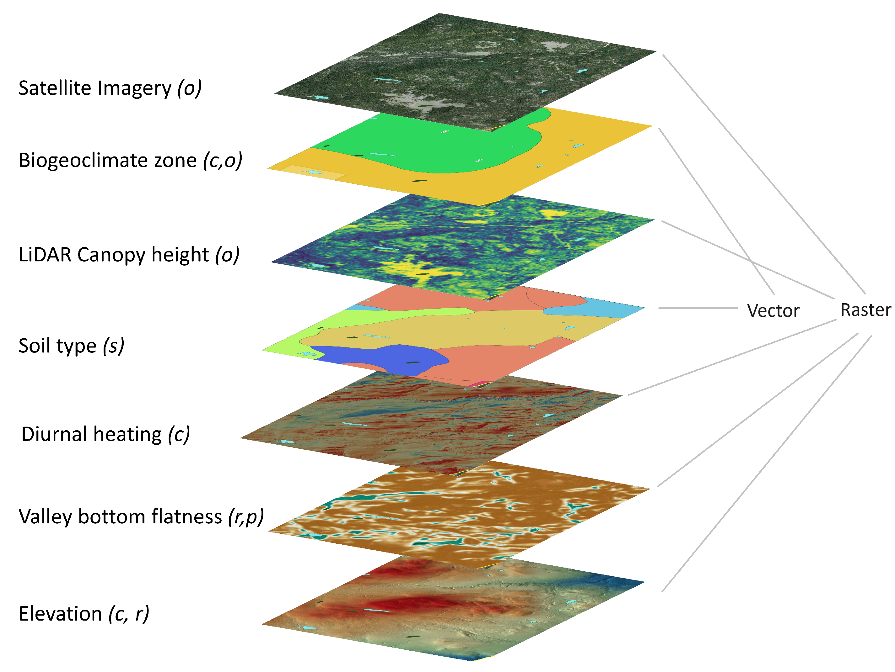
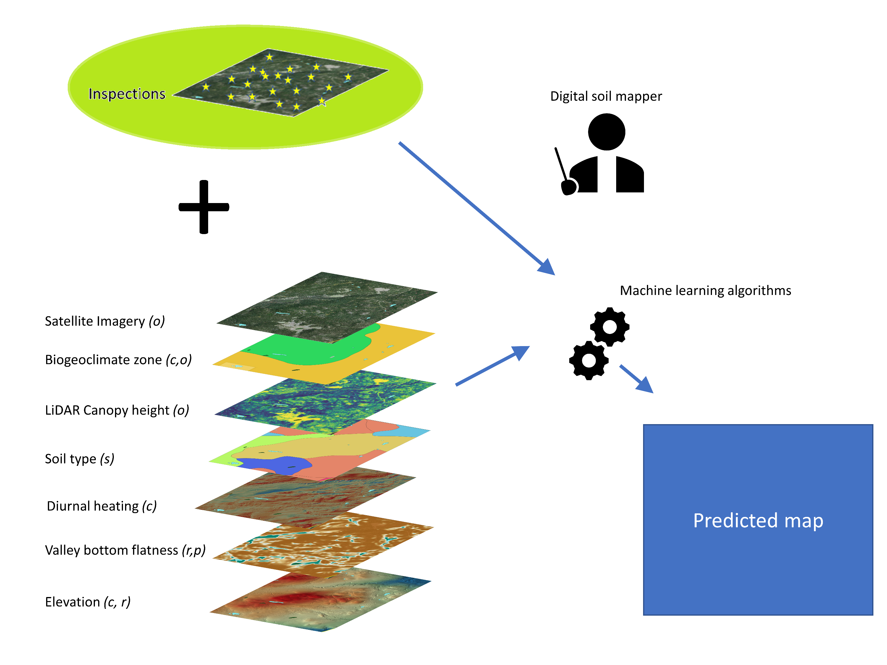

# Colección y armonización de covariables {style="color: #122562"}

::: {.callout-tip}
## Datos de este capítulo

Los archivos que usa este capítulo están en [datos/cap10](https://github.com/ctirado-cgiar/Libro_MDS/tree/main/datos/cap10).

Para ejecutar el código, descarga el proyecto completo ([Libro_MDS.zip](https://github.com/ctirado-cgiar/Libro_MDS/archive/refs/heads/main.zip)), descomprímelo y ábrelo en RStudio con `DSM.Rproj`. Las rutas del código funcionan tal cual.
:::


El primer paso para llevar a cabo el DSM corresponde a la recopilación de datos y capas que contienen información que formarán parte del modelado.

## Colección de variables

Para este proceso se busca reunir la mayor cantidad de información que servirá como fuente de entrada para el DSM, es importante identificar las fuentes que son útiles en este proceso y realizar la recopilación.

**Identificar fuentes de datos**: Para cada factor del modelo se debe colectar la mayor cantidad de información, con la mejor calidad posible. Para esto se verifica que las fuentes sean confiables y que en medida de lo posible contengan información durante un largo periodo de tiempo para que los datos no estén sesgados a fenómenos con poca ocurrencia.

**Recopilación de datos**: Se obtienen los archivos vectoriales, ráster y demás que pertenecen a cada factor. Se recomienda guardarlos de forma ordenada para facilitar el procesamiento.

Al momento de colectar las covariables del estudio, es importante tener definido el objetivo del estudio para conocer la zona y la temporalidad de interés. Luego se procede con la búsqueda de la información; para el proceso del Mapeo Digital de Suelos se requiere obtener la información descrita dentro del modelo scorpan:

S = *f(s, c, o, r, p, a, n)* donde,

**s** = suelo, otras propiedades del suelo medidas previamente o en un punto. Algunas fuentes donde se pueden encontrar estas covariables son: [IGAC](https://geoportal.igac.gov.co/contenido/datos-abiertos-igac), [FAO](https://www.fao.org/home/es), [SoilGrid](https://soilgrids.org/), geoportales para cada país: [Colombia](https://www.colombiaenmapas.gov.co/), [Ecuador](https://www.geoportaligm.gob.ec/portal/), [Perú](https://visor.geoperu.gob.pe/); entre otros.

**c** = clima , propiedades climáticas del medio ambiente en un punto. Recolectando información en [Chirps](https://www.chc.ucsb.edu/data/chirps), [Wordclim](https://www.worldclim.org/) o estaciones climatológicas del área de estudio.

**o** = organismos , incluida la cobertura terrestre y la vegetación o fauna natural o la actividad humana. Factores como el uso del suelo, tipos de cobertura, ecosistemas, biomas y prácticas de manejo, hacen parte de este tipo de covariables. Algunas fuentes donde se encuentra información es [MapBiomas](https://amazonia.mapbiomas.org/) o geoportales de cada país.

**r** = relieve , topografía, atributos del paisaje. Se obtienen en su mayoría de satélites como [Landsat](https://developers.google.com/earth-engine/datasets/catalog/landsat-9) (30m) y [Sentinel](https://developers.google.com/earth-engine/datasets/catalog/sentinel-2) (10m).

**p** = material parental , litología, geología. De fuentes como [Geocatmin](https://geocatmin.ingemmet.gob.pe/geocatmin/) para Perú, [IIGE](https://geoportal.geoenergia.gob.ec/iige/) en Ecuador y el [Servicio Geológico](https://www.sgc.gov.co/) para Colombia.

**a** = edad, el factor tiempo

**n** = datos espaciales de los puntos que se muestreen, distancias referente a otros puntos, etc.

***Nota:** En este book se realizará la armonización y estadarización de las covariables en R, pero se recomienda incorporar a este proceso softwares/plataformas/lenguajes de programación como: SAGA-GIS, GRASS-GIS, ArcGIS, QGIS, Google Earth Engine, Python, Java Script, etc.*

[{fig-align="center" width="550"}](https://geo.libretexts.org/Bookshelves/Soil_Science/Digging_into_Canadian_Soils%3A_An_Introduction_to_Soil_Science/03%3A_Digging_Deeper/3.04%3A_Digital_Soil_Mapping)

## Armonización y preparación de covariable {style="color: #122562"}

La armonización de covariables se refiere al proceso de estandarización y homogenización de las variables recopiladas para garantizar su compatibilidad y coherencia en el análisis. Esto puede implicar la reconciliación de diferentes formatos de datos, la codificación consistente de categorías, la unificación de unidades de medida y la resolución de discrepancias entre fuentes de datos.

**Calidad de los datos**: En este paso se evalúa la calidad y fiabilidad de los datos. Se elimina información que no sea necesaria y se define el sistema de coordenadas que utilizará el proyecto.

### Procesamiento de covariables {style="color: #122562"}

Posteriormente, los datos se empiezan a procesar de forma manual y automática, antes de entrar en los procesos de machine learning. Los datos tabulados deben organizarse y relacionarlos a un dato SIG (Sistema de Información Geográfico) relacionandolo a una geometría; la cartografía digital y las imágenes satélitales se geo-referencian, se corrigen geométricamente y se verifica que todos los archivos geográficos estén en el sistema de coordenadas definido por el mapeador.

Por último, se realizan cambios de formatos en los archivos que lo requieran. Donde todas las covariables deben ser reproyectadas y rasterizadas respecto a los ***atributos del DEM***.

[{fig-align="center" width="573"}](https://geo.libretexts.org/Bookshelves/Soil_Science/Digging_into_Canadian_Soils%3A_An_Introduction_to_Soil_Science/03%3A_Digging_Deeper/3.04%3A_Digital_Soil_Mapping)

***Librerías***

*Antes de iniciar con los procesos de edición de datos, se recomienda cargar todas las librerías que se usarán. Para agilizar los procesos que se llevarán a cabo y asegurar que las funciones operen de manera correcta.*

::: {.callout-note collapse="true"}
# Cargar librerías

```{r, warning=FALSE}
library(sf)
library(raster)
library(stars)
library(tmap)
library(rsi)
library(terra)
library(raster)
library(sf)
library(elevatr)
library(dplyr)
library(remotes)
```
:::

El primer paso siempre será preparar el DEM, el cuál sirve de guía para las demás covariables:

::: {.callout-note collapse="true"}
# Código

Se carga el archivo DEM y el área de amortiguamiento:

```{r, attr.warning=FALSE}
raster_DEM = raster("datos/cap10/DEM_Cont.tif")
buffer = st_read("datos/cap10/buffer_300m_rasterizado.gpkg", quiet = TRUE)
```

Se visualizan los archivos cargados:

```{r, attr.warning=FALSE}
plot(raster_DEM)  #DEM un poco más grande, se rasteriza del dem para saber que es lo máximo que rasteriza
plot(buffer, add= TRUE, col= NA, border= "red")
```

Posteriormente se corta y extrae del DEM, el área de interés:

```{r, attr.warning=FALSE}
raster_DEM_crop= crop(raster_DEM, buffer)

tmap_mode("view")
## tmap mode set to plotting
tm_shape(raster_DEM_crop) +
    tm_raster(("DEM_Cont"), palette = terrain.colors(10)) +
tm_shape(buffer) +
    tm_borders("red", lwd = .5) +
tm_legend(show = FALSE)

raster_referencia= mask(raster_DEM_crop, buffer)
tmap_mode("view")
## tmap mode set to plotting
tm_shape(raster_referencia) +
    tm_raster(("DEM_Cont"), palette = terrain.colors(10)) +
tm_shape(buffer) +
    tm_borders("red", lwd = .5) +
tm_legend(show = FALSE)


writeRaster(raster_referencia, "salidas/DEM.tif", overwrite = TRUE)
```

Se obtiene el "buffer final" para obtener la guía que servirá para procesar todas las covariables. Basándose en las modificaciones realizadas al DEM:

```{r, attr.warning=FALSE}
resample= reclassify(raster_referencia, c(-Inf,Inf, 1))


buffer_rast= stars::st_as_stars(resample) 

buffer_final= st_as_sf(buffer_rast, merge = TRUE)
plot(buffer_final)  #con este se recorta los demás  

buffer_final

```
:::

### Procesamiento de covariables en formato ráster

Ahora se procesa una la covariable de coberturas, respecto a los atributos del DEM

::: {.callout-note collapse="true"}
# Código

Se carga el archivo, se visualiza y se obtiene el CRS actual:

```{r}
# Cargar el raster original y el raster de referencia
raster_original <- raster("datos/cap10/originales/Coverage_Cat.tif")

raster_referencia %>% plot()
raster_original  %>% plot()

crs(raster_original)
```

Se proyecta al CRS del proyecto, en este caso es EPSG: 32717

```{r}
# Cambiar el CRS del raster original al CRS del raster de referencia
raster_proyectado= projectRaster(raster_original, crs = projection(raster_referencia),res = res(raster_referencia), method = "ngb" )

raster_proyectado
plot(raster_proyectado)
```

Se corta y extrae el área de interés, de acuerdo a la información del raster de referencia (se obtuvo del DEM):

```{r}
raster_final= raster_proyectado %>% crop(raster_referencia) %>% mask(buffer_final)
extent(raster_final) <- extent(raster_referencia)


tmap_mode("view")
## tmap mode set to plotting
tm_shape(raster_final) +
    tm_raster(("Coverage_Cat"), palette = terrain.colors(10)) +
tm_shape(buffer) +
    tm_borders("red", lwd = .5) +
tm_legend(show = FALSE)

```

Como el archivo ya está listo se guarda para su posterior uso

```{r}
# Guardar el raster transformado en un nuevo archivo
writeRaster(raster_final, filename = "salidas/Coverage.tif",format = "GTiff", overwrite = TRUE)

```
:::

### Procesamiento de covariables vectoriales

Por otra parte, al tener datos en archivos vectoriales es necesario procesarlos y volverlos un archivo ráster.

::: {.callout-note collapse="true"}
# Código

Se cargan los datos y se les asigna el CRS del proyecto:

```{r, attr.warning=FALSE}
datos_shape = st_read("datos/cap10/originales/Geology_Cat.gpkg", quiet = TRUE)
st_crs(datos_shape) = 32717
```

Se crea un raster vacío y se le asignan los atributos del ráster de referencia:

```{r, attr.warning=FALSE}
# Crear un raster vacío
raster_resultante = raster()

# Definir la extensión del raster  
extent_raster = extent(raster_referencia)

# Definir la resolución del raster
resolucion = res(raster_referencia)# ajusta la resolución según sea necesario

# Establecer la extensión y la resolución del raster resultante
extent(raster_resultante) = extent_raster
res(raster_resultante) = resolucion
```

Se extrae el atributo que se utilizará para rasterizar:

```{r, attr.warning=FALSE}
f = datos_shape[,5] 
f$LITOLOGI_1 = datos_shape[,5]$LITOLOGI_1 %>% factor() %>% as.numeric()
```

Se rasteriza y se visualiza el archivo, ahora en formato ráster:

```{r, attr.warning=FALSE}
# Rasterizar el Shapefile
rasterizado = rasterize(st_zm(f),raster_referencia, field = "LITOLOGI_1")
plot(rasterizado)
```

Se corta y se extrae del ráster, el polígono que nos interesa:

```{r, attr.warning=FALSE}
raster_mask= crop(rasterizado, buffer_final) %>% mask(buffer_final)
plot(raster_mask)
plot(buffer_final, add= TRUE, col= NA, border= "red")
```

Se guarda el archivo obtenido:

```{r, attr.warning=FALSE}
writeRaster(raster_mask, filename = "salidas/Litology.tif",format = "GTiff", overwrite = TRUE)
```
:::

### Covariables derivadas del DEM

Del Modelo Digital de Elevación (DEM) se pueden derivar una serie de covariables, las cuales se calculan a partir de la información que este contiene. Veámos un ejemplo de estas:

::: {.callout-note collapse="true"}
# Código

Se carga el DEM

```{r}
DEM = raster("datos/cap10/originales/DEM_Cont.tif")
```

Con la función `terrain()` se obtiene la pendiente del terreno:

```{r}
# Calcular la pendiente del DEM
slope = terrain(DEM, opt = "slope")

# Mostrar el resultado
plot(slope)
```

Se extrae el área de interés:

```{r}
slope_final= crop(slope, buffer_final) %>% mask(buffer_final)
plot(slope_final)

```

Se guarda el proceso realizado:

```{r}
writeRaster(slope_final, filename = "salidas/Slope.tif",format = "GTiff", overwrite = TRUE)
```
:::

## Obtención de covariables desde R {style="color: #122562"}

### Delimitación del área de estudio {style="color: #122562"}

En esta etapa se define y prepara el área de estudio que será utilizada para la generación de covariables. Primero se carga el shapefile de cuencas y se selecciona únicamente la cuenca de interés según su área. Luego se visualiza y se recortan los puntos de muestreo de suelos para conservar únicamente aquellos ubicados dentro del polígono seleccionado, utilizando operaciones de recorte (*`crop`*) e intersección espacial. Este preprocesamiento asegura que todos los datos geográficos utilizados en etapas posteriores estén correctamente.

::: {.callout-note collapse="true"}
# Área de estudio

Selección del área de estudio-poligono

```{r, attr.warning=FALSE}


# 1. Leer AOI
AOI <- st_read("datos/cap10/Watersheds.gpkg", quiet = TRUE)

# 2. Confirmar que realmente es sf
print(class(AOI))

# 3. Seleccionar la cuenca deseada (fila 2) 
AOI <- AOI[2, ]        # Seleccion directa
AOI <- st_make_valid(AOI)   # Por si hay geometrías corruptas

# --- 4. Plot de la cuenca seleccionada ---
plot(AOI["AREA_KM2"])

```


Organizar los puntos

```{r, attr.warning=FALSE}
puntos <- st_read("datos/cap10/horizontes.gpkg", quiet = TRUE)

# Asegurar CRS
if (is.na(st_crs(puntos))) {
  stop("El shapefile puntos no tiene CRS asignado.")
}

# Transformar si es necesario
if (st_crs(puntos) != st_crs(AOI)) {
  puntos <- st_transform(puntos, st_crs(AOI))
}

# Reparar geometría
puntos <- st_make_valid(puntos)

plot(puntos)

# --- 4. Recortar y cortar ---
# st_crop falla cuando AOI tiene bounding box NA → make_valid lo corrige
puntos_crop <- suppressWarnings(st_crop(puntos, AOI))

# Intersección final
puntos_AOI <- st_intersection(puntos_crop, AOI)

plot(puntos_AOI, col = "red", pch = 16)


```
:::

### Obtención y preparación del modelo digital de elevación (DEM) {style="color: #122562"}

Se obtiene un modelo digital de elevación (DEM) para el área de estudio utilizando la función *`get_elev_raster`*, que descarga los datos ajustados al sistema de referencia del polígono. Luego se visualiza el DEM y se inspecciona la distribución de elevaciones mediante un histograma para evaluar su rango y variabilidad. Finalmente, el DEM se guarda como archivo raster y se vuelve a cargar para garantizar su uso consistente en los análisis posteriores.

::: {.callout-note collapse="true"}
# DEM

Descarga del DEM

```{r}

dem <- get_elev_raster(AOI, prj = projection(AOI), z = 12, clip = "locations")
plot(dem)
hist(values(dem), main = "Distribución de elevaciones")
# Guardar el DEM
writeRaster(dem, "salidas/dem_ecuador.tif", overwrite=TRUE)
dem = rast("salidas/dem_ecuador.tif")
```
:::

### **Descarga y generación de índices espectrales de Sentinel-1** {style="color: #122562"}

En esta etapa se descargan imágenes radar Sentinel-1 correspondientes al periodo definido, utilizando el polígono del área de estudio como límite espacial. La imagen resultante se carga como raster y se visualiza para verificar su correcta obtención. Posteriormente, se identifican las bandas disponibles y se calculan los índices espectrales derivados de Sentinel-1 mediante la función *`calculate_indices`*. Estos índices sintetizan la información radar y sirven como covariables adicionales para el análisis. Finalmente, los índices generados se guardan, se vuelven a cargar y se representan gráficamente para comprobar su calidad.

::: {.callout-note collapse="true"}
# Sentinel 1

Descargar imágenes Sentinel-1 para el AOI y el rango de fechas indicado

```{r}
S1 <- get_sentinel1_imagery(
  AOI[1],                      # Polígono del área de estudio
  start_date = "2022-08-01",   # Fecha inicial
  end_date = "2022-08-30",     # Fecha final
  collection = "sentinel-1-grd", # Colección de datos SAR (GRD)
  output_filename = "datos/cap10/S1_ecuador.tif",
  overwrite = TRUE# Nombre del archivo de salida
)

# Cargar la imagen descargada como raster
S1 <- rast("datos/cap10/S1_ecuador.tif")
plot(S1)  # Visualizar la imagen Sentinel-1
```

Identificar las bandas disponibles para calcular índices espectrales

```{r}
available_indices <- filter_bands(
  bands = names(terra::rast(S1))
)
```

Calcular los índices espectrales de Sentinel-1

```{r}
indices_S1 <- calculate_indices(
  rj <- stack(S1),            # Convierte el raster a stack (necesario para la función)
  available_indices,          # Índices compatibles con las bandas disponibles
  output_filename = "salidas/indices_S1.tif",  # Guardar el resultado como archivo
  overwrite = TRUE
)

# Cargar nuevamente los índices calculados
indices_S1 <- rast("salidas/indices_S1.tif")
plot(indices_S1)  # Visualizar los índices espectrales generados


```
:::

### **Obtención de imágenes Landsat y cálculo de índices espectrales** {style="color: #122562"}

Este código descarga imágenes Landsat para el área de estudio dentro del rango de fechas especificado. La función genera un composite (o mosaico temporal) usando la mediana de las imágenes disponibles, lo que permite reducir nubes y obtener una representación más estable de la superficie.

Luego se carga el raster resultante y se visualiza la imagen en color real utilizando las bandas 4 (rojo), 3 (verde) y 2 (azul), aplicando un estiramiento de histograma para mejorar el contraste.

Después, se identifican las bandas disponibles y se calculan los **índices espectrales** compatibles con Landsat (como NDVI, EVI, NBR, etc.). Los índices generados se guardan en un archivo, se cargan nuevamente y se representan para verificar su correcta creación.

::: {.callout-note collapse="true"}
# Landsat

Descargar imágenes Landsat para el AOI en el rango de fechas indicado

```{r}
L <- get_landsat_imagery(
  AOI[1],                      # Polígono del área de estudio
  start_date = "2022-07-01",   # Fecha inicial
  end_date = "2022-10-30",     # Fecha final
  composite_function = "median",   # Crear un compuesto temporal usando la mediana
  output_filename = "datos/cap10/landsat_ecuador.tif" # Nombre del archivo de salida
  
)

# Cargar el archivo Landsat descargado
L <- rast("datos/cap10/landsat_ecuador.tif")
plot(L)  # Visualizar el raster multibanda
```

Visualizar la imagen en color real (RGB)

```{r}
plotRGB(
  L,
  r = 4, g = 3, b = 2,         # Bandas Rojo, Verde y Azul
  stretch = "hist"             # Ajuste de histograma para mejorar contraste
)
```

Identificar las bandas disponibles para calcular índices espectrales

```{r}
available_indices <- filter_bands(
  bands = names(stack(L))
)
```

Calcular los índices espectrales de Landsat (NDVI, EVI, etc.)

```{r}
indices_L <- calculate_indices(
  rj <- stack(L),              # Convertir a raster stack para la función
  available_indices,           # Índices posibles según las bandas presentes
  output_filename = "salidas/indices_L.tif",  # Guardar el resultado
  overwrite = TRUE
)

# Cargar los índices calculados
indices_L <- rast("salidas/indices_L.tif")
plot(indices_L)  # Visualizar los índices espectrales generados
```
:::

## Creación del stack de las covariables {style="color: #122562"}

Luego del procesamiento de las covariables, se crea la pila o stack para facilitar el manejo varias covariables o variables independientes juntas. Esta pila de información puede servir como entrada para diversos tipos de modelos estadísticos o espaciales. En nuestro caso se utilizan datos climáticos, topográficos, geológicos y los mencionados del modelo Scorpan.

Para crear un stack de covariables en R, se utiliza la función `stack()` del paquete `raster`, ingresando cada ráster que ha sido cargado previamente.

::: {.callout-note collapse="true"}
# Código

Agrega el folder donde guarda las covariables, el codigo se encuentra comentado para su modificación
```{r}
#lista_raster= list.files(path = "datos/covariables", pattern = ".tif", full.names = TRUE)
#stack= stack(lista_raster)
#plot(stack)
```
:::

## Ejercicio práctico {style="color: #122562"}

Del área de estudio seleccionada, obtenga las covariables.
