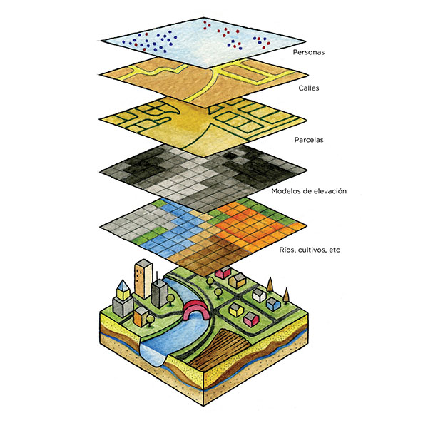
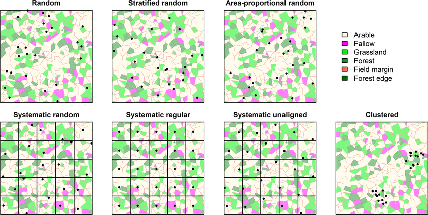
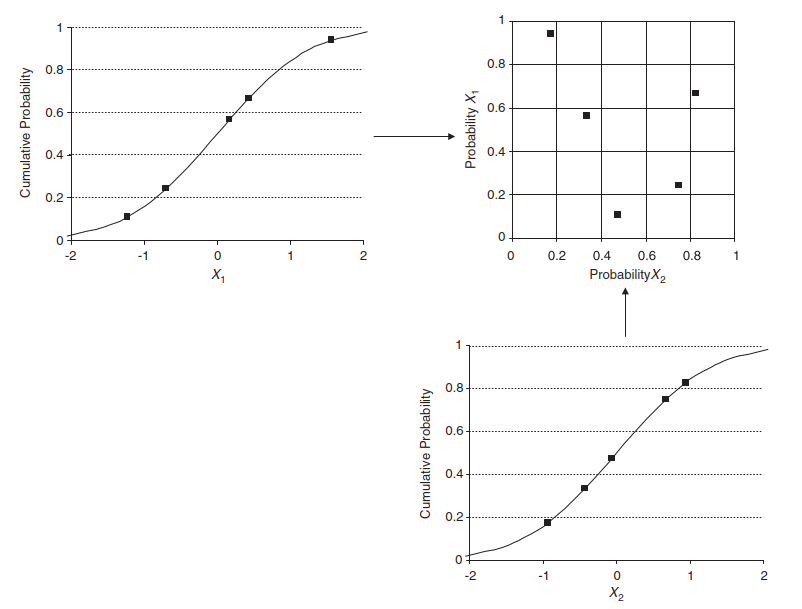

# Estrategia de muestreo {style="color: #122562"}

::: {.callout-tip}
## Datos de este capítulo

Los archivos que usa este capítulo están en [datos/covariables](https://github.com/ctirado-cgiar/Libro_MDS/tree/main/datos/covariables).

Para ejecutar el código, descarga el proyecto completo ([Libro_MDS.zip](https://github.com/ctirado-cgiar/Libro_MDS/archive/refs/heads/main.zip)), descomprímelo y ábrelo en RStudio con `DSM.Rproj`. Las rutas del código funcionan tal cual.
:::


Cuando se realiza muestreo se busca obtener datos que permitan estimar algún parámetro estadístico, o predicciones espaciales de algunas propiedades sobre un área. El muestreo está limitado por los objetivos que tiene el proyecto y los recursos financieros y disponibles, por lo que se busca una estrategia de muestreo eficiente. Por lo que en el estudio de suelos para mapeo se busca establecer sitios que optimicen la recolección de los datos.

## Muestreo en Mapeo Digital de Suelos {style="color: #122562"}

Para el DSM los estudios del suelo y de las demás variables de interés que están en la superficie terrestre, se pueden planificar de manera óptima respecto al uso de la información que ha sido colectada en varios lugares. Se recomienda utilizar el muestreo de hipercubo latino condicionado (cLHS), que permite explorar de manera eficiente el espacio de búsqueda multidimensional de variables continuas (*McKay et al., 1979*).

### Datos auxiliares {style="color: #122562"}

El muestreo puede estar guiado por la presencia de datos auxiliares o información secundaria que se ha recolectado previamente. Los mapas de mediciones geofísicas, imágenes de sensores remotos, mapas de vegetación, mapas geológicos, modelos digitales de elevación (DEM) y sus atributos del terreno, son ejemplos de datos auxiliares. (*Goovaerts, 1997*)

[{fig-align="center" width="435"}](https://www.lexgeo.com/arquitecturaenterreno/)

## Diferentes tipos de estrategias de muestreo {style="color: #122562"}

### **Muestreo estratificado**

El muestreo estratificado es una técnica de muestreo probabilístico que se utiliza para obtener una representación más precisa de la variabilidad espacial de las propiedades del suelo en un área determinada. En comparación con el muestreo aleatorio simple, el muestreo estratificado permite distribuir las muestras de manera más uniforme en diferentes estratos o subgrupos del área de estudio, asegurando una mejor cobertura de la variabilidad presente.

{fig-align="center" width="534"}

### Hipercubo latino condicionado

El hipercubo latino condicionado (cHL, por sus siglas en inglés) se utiliza para obtener muestras en áreas que tienen una gran cantidad de información en los datos auxiliares. Donde se proporcionan ***n*** sitios con información multidimensional, selecciona una muestra que a su vez represente todos los intervalos de clase de las distribuciones marginales que componen la distribución multivariada. (*Kurina et al. , 2016*)

[{fig-align="center" width="491"}](https://www.google.com/url?sa=i&url=https%3A%2F%2Fdialnet.unirioja.es%2Fdescarga%2Farticulo%2F8116440.pdf&psig=AOvVaw3ySmVb4ww0_XAArtyiln0A&ust=1716914703050000&source=images&cd=vfe&opi=89978449&ved=2ahUKEwj3iJPpo66GAxUXj4QIHcEFBAEQ3YkBegQIABAX)

Dentro de las ventajas que ofrece esta técnica de muestreo, se encuentra que:

-   Se pueden incorporar tanto variables continuas como categóricas.

-   Se puede incorporar coordenadas espaciales, lo que garantiza una buena distribución de los puntos de muestreo.

-   Se pueden imponer restricciones adicionales a la función objetivo, por ejemplo, distancia de las carreteras y límites del campo.

### **Muestreo en grilla**

El muestreo en grilla, también conocido como muestreo regular o sistemático en grilla, es una técnica de muestreo probabilístico que consiste en dividir el área de estudio en una red regular de celdas o puntos de muestreo. Es útil para recolectar datos espaciales cuando se requiere una cobertura uniforme y sistemática del área de estudio.

Este modelo es relativamente sencillo de implementar y no requiere de un conocimiento previo complejo del área de estudio. Sin embargo, puede no ser eficiente en áreas heterogéneas debido a que la distribución espacial de las variables es muy heterogénea.

Por otra parte, este método no considera la variabilidad espacial y esto lo vuelve un modelo inflexible y no adaptarse a la forma o características del área de estudio.

### **Muestreo aleatorio**

El muestreo aleatorio es una técnica fundamental en estadística que permite obtener una muestra representativa de una población más grande. La principal característica del muestreo aleatorio es que cada individuo de la población tiene la misma probabilidad de ser seleccionado, lo que garantiza que la muestra no esté sesgada y refleje fielmente las características de la población.

Dentro de las ventajas de este muestreo está su facilidad de implementación,debido a que es un módelo que utiliza un bajo nivel de procesamiento y el tiempo de respuesta es rápido.

Algunas de las desventajas del muestreo aleatorio pueden ser su costo,requiere un marco muestral completo que contenga una lista de todas las variables del conjunto de datos y en algunos casos, puede ser imposible seleccionar una muestra aleatoria de la población, por ejemplo, cuando la población es muy grande o inaccesible.

```{r}
#| output: true
#| echo: false
library(lhs)
library(ggplot2)
library(gridExtra)

# Define el número de muestras y de variables
n_samples <- 10  # Número total de muestras
n_vars <- 2       # Número de variables

# Genera un diseño de hipercubo latino
lhs_design <- randomLHS(n = n_samples, k = n_vars)

# Genera muestreo aleatorio
random_samples <- matrix(runif(n_samples * n_vars), nrow = n_samples, ncol = n_vars)

# Combina los datos en un dataframe para ggplot2
lhs_df <- data.frame(X1 = lhs_design[,1], X2 = lhs_design[,2])
random_df <- data.frame(X1 = random_samples[,1], X2 = random_samples[,2])

# Genera la grilla
grid_density <- 3.5  # Densidad de la grilla
grid_values <- seq(0, 1, length.out = grid_density)
grid_points <- expand.grid(grid_values, grid_values)
colnames(grid_points) <- c("X1", "X2")
grid_df <- data.frame(grid_points)

# Crea los gráficos con ggplot2

# Gráfico de muestreo hipercubo latino
plot2 <- ggplot(lhs_df, aes(x = X1, y = X2)) +
  geom_point(color = "navy") +
  labs(title = "Muestreo hipercubo latino", x = "", y = "") +
  theme_minimal() +
  coord_cartesian(xlim = c(0, 1), ylim = c(0, 1)) +
  theme(plot.title = element_text(hjust = 0.5)) +
  scale_x_continuous(limits = c(0, 1)) +
  scale_y_continuous(limits = c(0, 1))

# Gráfico de muestreo aleatorio
plot3 <- ggplot(random_df, aes(x = X1, y = X2)) +
  geom_point(color = "sienna") +
  labs(title = "Muestreo aleatorio", x = "", y = "") +
  theme_minimal() +
  coord_cartesian(xlim = c(0, 1), ylim = c(0, 1)) +
  theme(plot.title = element_text(hjust = 0.5)) +
  scale_x_continuous(limits = c(0, 1)) +
  scale_y_continuous(limits = c(0, 1))

# Gráfico de muestreo en grilla
plot4 <- ggplot(grid_df, aes(x = X1, y = X2)) +
  geom_point(color = "black", fill = "black", shape = 21) +
  labs(title = "Muestreo en grilla", x = "", y = "") +
  theme_minimal() +
  coord_cartesian(xlim = c(0, 1), ylim = c(0, 1)) +
  theme(plot.title = element_text(hjust = 0.5)) +
  scale_x_continuous(limits = c(0, 1)) +
  scale_y_continuous(limits = c(0, 1))

# Colocar los gráficos en una cuadrícula de 2 filas y 2 columnas
grid.arrange(plot2, plot3, plot4,  ncol = 2, nrow = 2)

```

***Librerías***

*Antes de identificar el área objetivo y colectar datos auxiliares (covariables) , se recomienda cargar todas las librerías que se usarán.*

::: {.callout-note collapse="true"}
# Cargar librerías

```{r, warning=FALSE}
library(sf)
library(raster)
library(clhs)
```
:::

### Proceso para realizar el cHLC {style="color: #122562"}

Se cargan las covariables en formato ráster, deben tener la misma extensión y resolución:

::: {.callout-note collapse="true"}
# Cargar archivos

```{r}

lista_raster= list.files(path = "datos/covariables", pattern = ".tif", full.names = TRUE)

```

Se concatenan en una pila de ráster, todas las capas cargadas y se les asigna un nombre:

::: {.callout-note collapse="true"}
# Concatenar

```{r}

stack = stack(lista_raster)
stack= stack[[c("DEM","Annual_Prec")]]

plot(stack)
```
:::

Ahora se convierte la pila de ráster en un `SpatialPointsDataFrame` en este proceso, cada píxel se convierte en una fila dentro de un dataframe:

::: {.callout-note collapse="true"}
# Conversión

```{r}
s = rasterToPoints(stack, spatial=TRUE)
```
:::

Se aplica la función `cLHS` a toda la pila de ráster, este proceso puede tomar bastante tiempo esto dependerá del tamaño de los archivos:

::: {.callout-note collapse="true"}
# Modelo clhs

```{r}
s_clhs = clhs(s, size = 20, progress = FALSE, iter = 5000, simple = FALSE, use.coords = TRUE)
```
:::

Se pueden obtener los gráficos de diagnóstico, donde se ilustra el resultado del procedimiento del muestreo:

::: {.callout-note collapse="true"}
# Gráficos

```{r}

plot(s_clhs, mode=c("obj", "box"))
```
:::

Se extraen los índices:

::: {.callout-note collapse="true"}
# Índices

```{r}
subset_idx <- s_clhs$index_samples
```
:::

Finalmente se trazan los puntos dentro del área de estudio:

::: {.callout-note collapse="true"}
# Mapa

```{r, warning= FALSE}

par(mar = c(1,1,1,1))
plot(stack$DEM, axes=FALSE)
points(s[subset_idx, ], bg = 'red', pch=21)

f = cbind(data.frame(A = s_clhs$sampled_data$DEM, B = s_clhs$sampled_data$Annual_Prec))


# Gráfico de muestreo hipercubo latino
plot2 <- ggplot(f , aes(x = A, y = B)) +
  geom_point(color = "navy") +
  labs(title = "Muestreo hipercubo latino", x = "", y = "") +
  theme_minimal() +
  theme(plot.title = element_text(hjust = 0.5)) 
plot2
```
:::
:::

Se recomienda utilizar este tipo de muestreo porque permite una exploración más completa y eficiente de los distintos parámetros en comparación con los demás métodos. Además, al garantizar que los puntos estén bien distribuidos en todo el espacio de parámetros, se tendrán resultados más robustos y representativos.

# Muestreo de suelos, colección de datos en campo y análisis de laboratorio {style="color: #122562"}

El proceso de muestreo de suelos, colección de datos en campo y análisis de laboratorio es crucial para obtener información precisa sobre la salud y fertilidad del suelo. Esta información es esencial para tomar decisiones informadas sobre el manejo del suelo, la fertilización y las prácticas agrícolas.

**Muestreo de suelos**

El primer paso es realizar un muestreo adecuado del suelo. Esto implica tomar muestras de suelo en diferentes puntos del área de estudio, de manera que representen las características del suelo en general. La profundidad, la cantidad y la distribución de las muestras dependerán del objetivo del estudio y las características del suelo. Existen diferentes métodos de muestreo de suelos, entre los más comunes se encuentra el muestreo al azar simple, muestreo en cuadrícula, muestreo estratificado, entre otros.

-01.png){fig-align="center" width="599"}

**Colección de datos en campo**

Además de tomar muestras de suelo, también es importante recopilar otros datos en campo, como:

-   **Ubicación:** Registrar la ubicación de cada muestra de suelo utilizando un GPS.
-   **Topografía:** Describir la pendiente y la forma del terreno.
-   **Vegetación:** Describir el tipo de vegetación presente en el área.
-   **Manejo del suelo:** Describir las prácticas de manejo del suelo que se han utilizado en el área, como el laboreo, la fertilización y el riego.
-   **Historial del uso del suelo:** Describir los cultivos que se han cultivado en el área en los últimos años o el uso que ha tenido la zona de estudio.
-   **Rotular la muestra:** Se debe marcar la bolsa donde está el suelo con la ubicación, fecha de recolección, profundidad de muestreo y nombre de quién toma la muestra.

**Análisis de laboratorio**

Las muestras de suelo se envían al laboratorio para su análisis. En el laboratorio, se realizan una serie de pruebas para determinar las propiedades físicas, químicas y biológicas del suelo. Algunas de las pruebas más comunes incluyen:

-   **Granulometría:** Determina la distribución de las partículas de arena, limo y arcilla en el suelo.
-   **pH:** Mide la acidez o alcalinidad del suelo.
-   **Conductividad eléctrica:** Mide la cantidad de sales disueltas en el suelo.
-   **Materia orgánica:** Mide la cantidad de materia orgánica en el suelo.
-   **Nutrientes:** Mide la cantidad de nutrientes disponibles para las plantas, como nitrógeno, fósforo y potasio.

**Interpretación de los resultados**

Los resultados del análisis de laboratorio se interpretan en conjunto con los datos recopilados en campo para obtener una imagen completa de la salud y fertilidad del suelo. Esta información se puede utilizar para desarrollar un plan de manejo del suelo que mejore la productividad del suelo y la sostenibilidad ambiental.
