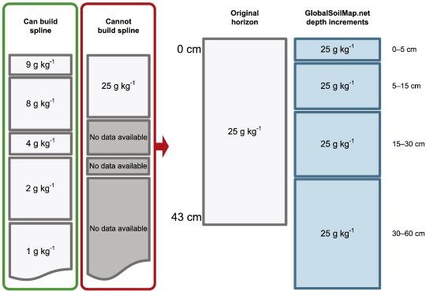

# Limpieza, procesamiento y análisis exploratorio de datos de campo {style="color: #122562"}

::: {.callout-tip}
## Datos de este capítulo

Los archivos que usa este capítulo están en [datos/cap12](https://github.com/ctirado-cgiar/Libro_MDS/tree/main/datos/cap12) · [datos/covariables](https://github.com/ctirado-cgiar/Libro_MDS/tree/main/datos/covariables).

Para ejecutar el código, descarga el proyecto completo ([Libro_MDS.zip](https://github.com/ctirado-cgiar/Libro_MDS/archive/refs/heads/main.zip)), descomprímelo y ábrelo en RStudio con `DSM.Rproj`. Las rutas del código funcionan tal cual.
:::


Luego de haber realizado el muestreo en campo y tener los resultados de los análisis corrrespondientes a los factores de interés. Se procede a limpiar los datos de acuerdo a los estándares definidos.

## Limpieza de valores nulos {style="color: #122562"}

En el proceso de transcripción de los datos suele presentar errores en los datos obtenidos en campo y luego pueden alterar el análisis que se realice. Es importante resaltar que de aquí en adelante es crucial el conocimiento de la persona que esté mapeando; el criterio y la experiencia permiten que la interpetación y edición de los datos tengan éxito.

Primero se deben haber definido unas estándares previos que resuelvan: qué datos son necesarios en el muestreo, qué unidades se van a utilizar, quiénes tomaron los datos y con qué métodos. Esto se vuelve necesario para saber a qué fuentes acudir cuándo los datos presenten muchas confusiones.

**Importación de datos**

Se importan los datos del muestreo en R utilizando las funciones adecuadas según el formato que tengan los datos (por ejemplo, `read.csv()` para archivos CSV, `read_excel()` para archivos Excel, etc.).

::: {.callout-note collapse="true"}
# Librerías y datos

```{r, warning=FALSE}
#| output: false
#| echo: true

#Para el spline de profundidad se usa la librería mpspline2 (disponible en CRAN). Si no la tiene, instálela con:
#install.packages("mpspline2")


library(readxl)
library(sf)
library(dplyr)
library(ggplot2) 
library(readxl)
library(Hmisc)
library(tmap)
library(mpspline2)
library(readxl)
library(raster)
library(pastecs)


```

```{r}
puntos_AOI= st_read("datos/cap12/puntos_final.gpkg", quiet = TRUE)
dataframe = as.data.frame(puntos_AOI)

dataset = read_excel("datos/cap12/datos_suelo_EC.xlsx")
```

```{r, warning=FALSE}
df= data.frame(dataset) %>% type.convert(na.strings = "NA", as.is = TRUE) 

df$PDIS %>% pastecs::stat.desc()

```
:::

**Seleccionar columnas relevantes**

También se puede hacer un set aparte, seleccionando solo las columnas de interés. Donde se debe especificar que columnas se quieren conservar en lugar de eliminar las que no se necesitan:

::: {.callout-note collapse="true"}
# Seleccionar variables

```{r}

df= df[c('ID', 'CORX', 'CORY', 'ARENA', 'LIMO', 'ARCILLA', 'MO', 'CO', 'LIMSUP', 'LIMINF', 'PHAQ')] 

df= na.omit(df)

```
:::

Se realiza una visualización reducida de los datos, para tener una idea de los datos recolectados.

::: {.callout-note collapse="true"}
# Visualizar datos

```{r}
head(df)
```
:::

**Visión general de los datos**

La función `skim()` del paquete skimr, sirve para obtener una visión general de las distribución de los datos en el dataframe.

::: {.callout-note collapse="true"}
# Código

```{r}
skim_df = skimr::skim(df)
skim_df
```
:::

## Estandarización de valores y unidades {style="color: #122562"}

En los procesos de transcripción, cálculos en campo, estimaciones y demás, se puede presentar modificación en los datos lo que aumenta los errores en el estudio. Se procede a filtrar los datos que se salgan de la normalidad de cada variable y es necesario definir si fueron errores de cálculo de tipeo. Para esto se debe ubicar en cada variable esos valores y transformarlos o eliminarlos si es el caso:

**Conversión de unidades**

Algunos valores pueden estar en unidades diferentes. Luego de filtrarlos se deben convertir a una unidad común, esto se realiza utilizando factores de conversión:

::: {.callout-note collapse="true"}
# Convertir unidades

```{r}
# Conversión de unidades
df$DA = df$ARCILLA / 10
head(df)
```
:::

También se pueden generar nuevas columnas con la información derivada de algunos datos tomados en campo:

::: {.callout-note collapse="true"}
# Agregar cálculos

```{r}

# Crear nueva columna con el resultado de la multiplicación
Carbono = df$MO / df$CO

df$Carbono = Carbono

# Ver el dataframe resultante
head(df)
```
:::

# Exploración de datos de campo {style="color: #122562"}

El análisis exploratorio de datos (EDA, por sus siglas en inglés de Exploratory Data Analysis) corresponde a la fase de análisis de datos donde se busca entender, visualizar y resumir el comportamiento del conjunto de los datos.

Este análisis resulta en una identificación de patrones, valores atípicos y nulos. Además permite formular hipótesis que pueden ser útiles para el análisis posterior y la toma de decisiones.

Se debe cargar la información en un formato que permita su manipulación estadística y gráfica, se recomienda utilizar archivos en formato data.frame

## Análisis estadístico {style="color: #122562"}

En el análisis estadístico se incluye la recolección, organización e interpretación de los datos. Se aplican distintos métodos estadísticos para analizar y entender los datos. Se pueden utilizar las funciones específicas para obtener los valores de la media, mediana, moda, desviación estándar, varianza, simetría de los datos, entre otros.

**Descripción de datos**

Se obtiene información general del tipo y la cantidad de datos que se tiene:

::: {.callout-note collapse="true"}
# Tipos de datos

```{r}
#| output: true
#| echo: true
str(df)
```
:::

Luego se utilizan medidas descriptivas como la media, la mediana, la moda, la desviación estándar y varianza, para resumir y describir las características principales de los datos.

::: {.callout-note collapse="true"}
# Medidas descriptivas

```{r}
#| output: true
#| echo: true
summary(df)
```
:::

::: {.callout-note collapse="true"}
# Desviación estándar

```{r}
#| output: true
#| echo: true
a= sd(df$MO)
a

```
:::

Una libreria más completa para describir estadisticamente los datos es Pastecs

::: {.callout-note collapse="true"}
# EDA completo

```{r}
stat.desc(df)
```
:::

## Análisis gráfico {style="color: #122562"}

**Histograma**

Una forma útil de explorar las variables numéricas es con histogramas. Estos podemos hacerlos con el comando hist(), donde ponemos como argumento el nombre del dataframe seguido de \$ y el nombre de la variable que queremos graficar.

::: {.callout-note collapse="true"}
# Histograma

```{r}
#| output: true
#| echo: true

hist(df$MO )
```
:::

**Boxplot**

Un diagrama de caja y bigotes, también conocido como boxplot, es un gráfico que representa un conjunto de datos estadísticos de manera visual utilizando los cuartiles, también se muestra la dispersión de una serie de datos de forma rápida y eficiente.

Aquellos valores que sobrepasan los límites superior e inferior son los que se conocen como valores atípicos (outliers).

::: {.callout-note collapse="true"}
# Boxplot

```{r}
#| output: true
#| echo: true

# Trazar un boxplot de los datos
boxplot(df$MO, main = "Boxplot", ylab = "Valores")

```
:::

**EDA Automático**

Pero hay una forma más eficiente de realizar este proceso, mediante librerías que realizan el EDA de forma automática y generando informes detallados para acelerar el proceso de exploración de un nuevo conjunto de datos.

Los tres paquetes de R ( DataMaid , DataExplorer y SmartEDA ) son muy eficaces para realizar EDA en un conjunto de datos determinado y los científicos de datos de una organización pueden considerar su implementación.

::: {.callout-note collapse="true"}
# SmartEDA

Al correr la siguiente linea se creará un archivo HTML con un reporte estadistico automatico de los datos

```{r}
#library(SmartEDA)
#ExpReport(df,op_file='EDA_Ecuador.html')
```
:::

## Equal- area spline {style="color: #122562"}

El Equal - area spline también conocido como spline de suavizado cuadrático de áreas iguales, es un tipo específico de función spline que es utilizada en diversos campos, particularmente en la ciencia del suelo y los estudios ambientales.

Esta función matemática ajusta una curva suave a través de una serie de puntos de datos, conservando al mismo tiempo el área total bajo los datos originales y la curva ajustada. Lo que facilita el análisis y modelamiento en funciones de profundidad continuas, como la variación de las propiedades del suelo (carbono orgánico, pH) u otras variables ambientales a diferentes profundidades.

Al suavizar dichas fluctuaciones de los datos, el spline proporciona una representación más interpretable e informativa de la tendencia subyacente.

[{fig-align="center"}](https://www.sciencedirect.com/science/article/abs/pii/S0016706112002170)

### Librería mpspline2

Para realizar el Spline en R, se utiliza la librería `mpspline2`, mediante la función `mpspline()`, la cual ajusta la función y preserva la masa (picnofiláctica) a datos de perfil de suelo. La función toma un `data.frame` con el identificador del perfil, la profundidad superior, la profundidad inferior y la propiedad, y devuelve los valores estimados para las profundidades estándar definidas.

> Nota: la versión original de este capítulo usaba la función `ea_spline()` de la librería `ithir`, que ya no se puede instalar. `mpspline2` implementa el mismo método (*equal-area spline*, Bishop et al., 1999).

::: {.callout-note collapse="true"}
# Spline

```{r}
#Se filtran los valores que están en profundidades menores a 30 para excluir los datos del proceso
df_lower_30 = df %>% group_by(ID) %>% summarise(LIMINF = max(LIMINF)) %>% filter(LIMINF < 29)
df = df[!(df$ID %in% df_lower_30$ID), ]

#Se definen las variables donde se encuentran los datos de interés y se define la profundidad estándar y la propiedad a obtener
lon = df$CORX
lat = df$CORY
id = df$ID
top = df$LIMSUP
bottom = df$LIMINF
stand_depth = c(0,30)
Propiedad = df$MO

#Se crea un dataset con el perfil: identificador, profundidad superior, profundidad inferior y propiedad
prof1 <- data.frame(id, top, bottom, Propiedad)

#Con esta función se realiza el spline de la propiedad definida previamente
Propiedad_spline <- mpspline(prof1, var_name = "Propiedad", lam = 0.1, d = stand_depth)

#Se guardan los datos obtenidos: identificador del perfil y valor estimado de 0 a 30 cm
datos <- data.frame(
  id = names(Propiedad_spline),
  X0.30.cm = vapply(Propiedad_spline, function(x) if (length(x$est_dcm)) unname(x$est_dcm[1]) else NA_real_, numeric(1))
)
head(datos)
```

```{r}
#Se crea un dataframe con los datos obtenidos en el spline
datos= data.frame(lapply(datos, type.convert,as.is = TRUE))
#Se separan las coordenadas de cada punto, diferenciada por el ID
coord= df[,1:3] %>% unique(by = "ID")

# Se crea un nuevo vector de nombres 
nuevos_nombres = c("id", "lon", "lat")

# Luego se asignan los nuevos nombres al dataframe
names(coord) = nuevos_nombres

#Se unen los datos de MO para cada punto y se le agrega su coordenada mediante el ID
data_final=right_join(datos,coord, by= "id")


# Se crea un objeto shapefile a partir del dataframe
datos_spline_sf <- st_as_sf(data_final, coords = c("lon", "lat"), crs = 32717) #Se especifíca el sistema de referencia de coordenadas (CRS) según los datos

#Se cargan los datos del ráster y el buffer de las covariables
Buffer = st_read("datos/cap12/buffer_300m_rasterizado.gpkg", quiet = TRUE)


DEM = raster("datos/covariables/DEM.tif")

#Se grafican los valores del spline dentro del DEM 
tm_view("view")
tm_shape(DEM) +
  tm_raster() +
  tm_shape(datos_spline_sf) + 
  tm_dots("X0.30.cm", palette = "-RdYlBu") + 
tm_shape(Buffer) + 
  tm_borders(col = "red")

# Se guarda el objeto como un archivo shapefile
st_write(datos_spline_sf, "salidas/spline.gpkg", delete_layer = TRUE)

```
:::

## Ejercicio de recopilación {style="color: #122562"}

Las muestras tomadas en campo son analizadas en el laboratorio y posteriormente se obtienen los resultados.

1.  Convierta los puntos seleccionamos previamente en un dataframe.
2.  Realiza un EDA para entender un poco el comportamiento de estos datos.
3.  Seleccione la variable de su interés, la cuál utilizará para realizar el mapeo.
4.  Calcula los valores de spline si es necesario.
