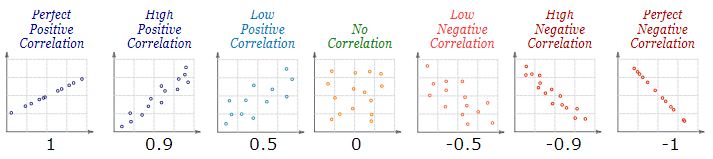
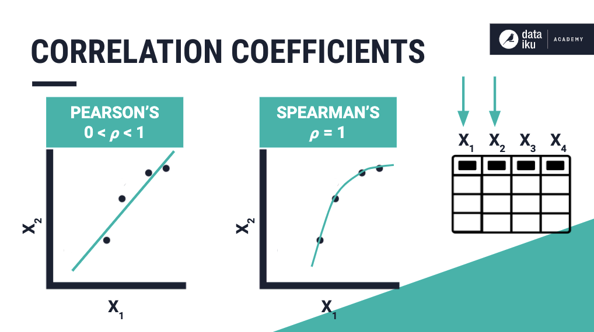
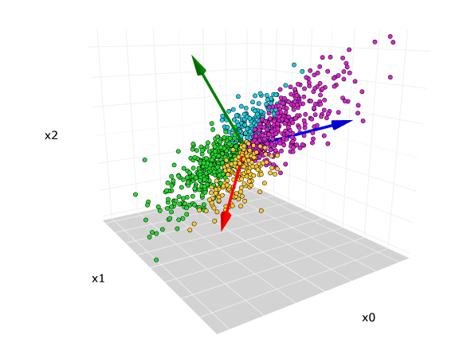

# Selección de covariables {style="color: #122562"}

Seleccionar las covariables adecuadas es fundamental dentro de la preparación de los datos. En este paso se busca explicar la relación que tienen las variables. Una covariable es influyente en la variable dependiente (la que se quiere estudiar) pero no es parte de la variable independiente (la que se manipula).

## Importancia de la selección de covariables {style="color: #122562"}

Además de las covariables recolectadas, también se deben tener en cuenta los datos de campo y su influencia en el estudio. El conjunto de datos cada vez va obteniendo más variables y el procesamiento se puede ver afectado al igual que la interpretación de los datos, algunas ventajas de realizar el manejo de las covariables son las siguientes:

-   **Se evita colinealidad**

    Debido a que los conjuntos de datos a menudo contienen muchas variables. La selección de covariables ayuda a reducir la dimensionalidad, manteniendo solo las variables más importantes. Esto facilita la interpretación y el análisis.

-   **Interpretación más clara**

    Al seleccionar cuidadosamente las covariables, se obtiene un modelo más interpretable. Las variables seleccionadas tienen una relación más directa con la variable de respuesta, lo que facilita la interpretación de los resultados.

-   **Mediciones precisa**

    Al eliminar covariables irrelevantes o redundantes, se mejora la precisión del modelo. Un modelo con menos variables puede generalizar mejor y evitar el sobreajuste. Además, incluir demasiadas covariables puede llevar a sobreajuste del modelo y reducir su poder estadístico.

-   **Eficiencia computacional**

    Menos covariables implican menos cálculos y menos recursos computacionales. Esto es especialmente importante en grandes conjuntos de datos o cuando se aplican algoritmos intensivos en cómputo.

**Librerías**

::: {.callout-note collapse="true"}
# Cargar librerías

```{r}
library(sf)
library(raster)
library(tmap)
library(knitr)
library(car)
library(VSURF)
library(corrplot)
```

```{r}
#| output: false
#| echo: false
#| warning: false
puntos=st_read("datos/cap13/spline.gpkg", quiet = TRUE)
```
:::

**Listado de covariables**

::: {.callout-note collapse="true"}
# Covariables

```{r}
lista_raster= list.files(path = "datos/covariables", pattern = ".tif", full.names = TRUE)
raster_stack= stack(lista_raster)
plot(raster_stack)
```
:::

Se estraen los datos de cada celda que intercepta con los puntos colectados de campo

::: {.callout-note collapse="true"}
# Extracción de datos

```{r}
#Se visualizan los datos del spline sobre una de los elementos del stack 
tm_view("view")
tm_shape(raster_stack[["Slope"]]) +
  tm_raster(palette = "Greens") +
tm_shape(puntos) +
  tm_dots("X0_30_cm", size= 0.2)
  
#Se extraen los valores de todas las covariables para cada punto calculado en el spline
final= raster::extract(raster_stack, puntos)
final %>% head()
```
:::

::: {.callout-note collapse="true"}
# Dataset de datos extraídos

```{r}
#Se crea un set de datos con los valores extraídos (covariables) y la materia orgánica que se obtuvo en el spline (variable respuesta)
data_sf = cbind(puntos,final)
plot(data_sf)
```
:::

## Matriz de correlación {style="color: #122562"}

La matriz de correlación es una herramienta que consiste en obtener los coeficientes de correlación muestral simples para cada par de variables explicativas y ver si el grado de correlación entre estas es alto.

Es útil para decidir qué variables se puedes eliminar, debido a que al estar altamente correlacionadas, se pueden evitar los problemas por multicolinealidad. A continuación un ejemplo de cómo implementar la matriz de correlación con los datos del dataset Iris:

Primero se deben importar los datos y asegurarse de tener el conjunto de datos con variables numéricas.

**Coeficiente de Correlación de Pearson**

El coeficiente de correlación de Pearson mide la relación lineal entre dos variables continuas. Es adecuado cuando se busca evaluar si un cambio en una variable está asociado con un cambio proporcional en la otra variable. Los valores de este coeficiente oscilan entre -1 y 1, obteniendo la siguiente categorización:

[{fig-align="center"}](https://www.maximaformacion.es/blog-dat/analisis-de-correlacion-guia-rapida-en-r/)

::: {.callout-note collapse="true"}
# Pearson

```{r}
#Se convierten los datos a dataframe
df_sh= data.frame(data_sf)
# Calcular la correlación de Pearson
cor_pearson = cor(df_sh[, 2:26], method = "pearson")
cor_pearson %>%  kable(position= "center", full_width= TRUE) #Estas modificaciones son para mejorar la visualización de los datos
```
:::

**Coeficiente de Correlación de Spearman**

La correlación de Spearman evalúa la relación entre dos variables continuas u ordinales. No requiere una distribución normal de los datos. En este caso, las variables cambian al mismo tiempo, pero no necesariamente a un ritmo constante.

[{fig-align="center" width="477"}](https://knowledge.dataiku.com/latest/ml-analytics/statistics/concept-correlation-matrix.html)

::: {.callout-note collapse="true"}
# Spearman

```{r}
#Se obtiene el coeficiente de correlación de Spearman
cor_spearman = cor(df_sh[, 2:26], method = "spearman")
cor_spearman %>% kable(position= "center", full_width= TRUE) #Estas modificaciones son para mejorar la visualización de los datos
```
:::

## Matrices de correlación gráficas {style="color: #122562"}

Las gráficas son una forma visual de representar la correlación entre dos variables. Se pueden visualizar diferentes formatos como el gráfico de dispersión o un mapa de calor:

**Mapa de calor (Heatmap)**

Con este mapa se pueden visualizar las matrices de una forma más sencillas, donde los colores indican la fuerza de la correlación: colores más oscuros para correlaciones más fuertes, es útil para visualizar múltiples variables al mismo tiempo.

::: {.callout-note collapse="true"}
# Matriz gráfica

```{r, warning= FALSE}
corrplot(cor_pearson[1:10,1:10], method="square", type="upper", addCoef.col="black", number.cex = 0.8)
```
:::

### **Eliminación de variables altamente correlacionadas**

Se recomiendan eliminar las variables que estén altamente correlacionadas con la variable dependiente o entre sí. En general, se recomienda eliminar las variables con coeficientes de correlación superiores a un umbral preestablecido (por ejemplo, 0.7 o 0.8). Todo dependerá del conocimiento y la experiencia de relacionar los resultados obtenidos con el contexto de los datos.

***Recuerda:*** La correlación no debe ser el único fundamento para seleccionar o eliminar covariables, debe haber un proceso de integración con todos los factores del estudio, el análisis previo, las hipótesis planteadas y el conocimiento del mapeador. Todos estos factores juntos aseguran el éxito de la predicción.

**Análisis de componentes principales (PCA)**

Principal Component Analysis (PCA) es un método estadístico que permite simplificar la complejidad de espacios muestrales con muchas dimensiones a la vez que conserva la información. Funciona transformando un conjunto de variables correlacionadas en un nuevo conjunto de variables no correlacionadas llamadas componentes principales.

1.  **Cálculo de la matriz de covarianza**: Se calcula la matriz de covarianza a partir del conjunto de datos original.

2.  **Cálculo de autovectores y autovalores**: Una vez que se ha calculado la matriz de covarianza, se encuentran los autovectores y autovalores de esta matriz. Los autovectores representan las direcciones de máxima varianza en los datos, mientras que los autovalores representan la cantidad de varianza explicada por cada autovector.

3.  **Selección de componentes principales**: Los componentes principales se ordenan de acuerdo con los autovalores, de modo que el primer componente principal explica la mayor parte de la variabilidad en los datos, el segundo componente principal explica la siguiente mayor parte, y así sucesivamente.

4.  **Proyección de datos**: Los datos originales se proyectan en el nuevo espacio definido por los autovectores seleccionados.

{fig-align="center" width="542"}

## Factor de inflación de la varianza (VIF) {style="color: #122562"}

Finalmente, es necesario analiza la multicolinealidad, la cuál se refiere a un fenómeno que aparece cuando alguna variable predictora es combinación lineal de otras. Para medir estos grados de colinealidad se suelen usar la matriz de correlación y el **factor de inflación de la varianza** (VIF).

En otras palabras, el VIF mide cuánto influye o “infla” el comportamiento de una variable independiente debido a su interacción o correlación con otras variables independientes.

-   **VIF \< 5:** La variable tiene **multicolinealidad baja** (no hay problemas significativos).
-   **VIF entre 5 y 10:** La variable tiene **multicolinealidad moderada** (requiere mayor investigación).
-   **VIF \> 10:** La variable tiene **multicolinealidad alta** (problema serio, considere técnicas de mitigación).

::: {.callout-note collapse="true"}
# VIF

```{r}
# Calcular el VIF para todas las variables predictoras
vif_result = vif(lm(data = df_sh, X0_30_cm ~ Age + Annual_Prec + Landforms + BSI + Coverage + DEM + EVPTP_Zone + Litology +   Mean_Temp_cold_q + Mean_Temp + Mean_Temp_dry_q + Mean_Temp_wam_q + Mean_Temp_wet_q + MSI + NDVI + Prec_cold_q + Prec_dry_q +  Prec_warm_q + Prec_wet + Radiation + SAGA_Wetness_Index + Slope + Soils + TPI_Cont))
vif_result %>% sort(decreasing = TRUE) %>% kable()


```

Se van eliminando las covariables que presentan un alto grado de multicolinealidad:

```{r}
vif_result = vif(lm(data = df_sh, X0_30_cm ~ Age + Annual_Prec + Landforms + BSI + Coverage + DEM + EVPTP_Zone + Litology -   Mean_Temp_cold_q - Mean_Temp + Mean_Temp_dry_q + Mean_Temp_wam_q - Mean_Temp_wet_q + MSI + NDVI + Prec_cold_q + Prec_dry_q +  Prec_warm_q + Prec_wet + Radiation + SAGA_Wetness_Index + Slope + Soils + TPI_Cont))
vif_result %>% sort(decreasing = TRUE) %>% kable()


vif_result = vif(lm(data = df_sh, X0_30_cm ~ Age - Annual_Prec + Landforms + BSI + Coverage + DEM + EVPTP_Zone + Litology -   Mean_Temp_cold_q - Mean_Temp - Mean_Temp_dry_q - Mean_Temp_wam_q - Mean_Temp_wet_q + MSI + NDVI + Prec_cold_q + Prec_dry_q +  Prec_warm_q - Prec_wet + Radiation + SAGA_Wetness_Index + Slope + Soils + TPI_Cont))
vif_result %>% sort(decreasing = TRUE) %>% kable()


vif_result = vif(lm(data = df_sh, X0_30_cm ~ Age + Annual_Prec + Landforms - BSI + Coverage + DEM + EVPTP_Zone + Litology - Mean_Temp_cold_q - Mean_Temp - Mean_Temp_dry_q - Mean_Temp_wam_q - Mean_Temp_wet_q + MSI + NDVI - Prec_cold_q - Prec_dry_q -  Prec_warm_q - Prec_wet + Radiation + SAGA_Wetness_Index + Slope + Soils + TPI_Cont))
vif_result %>% sort(decreasing = TRUE) %>% kable()


```

Finalmente los datos obtenidos se guardan en un dataset diferente

```{r}
data_VIF= data.frame(df_sh["X0_30_cm"],df_sh[names(vif_result)])
```
:::

## Selección de variables mediante bosques aleatorios (VSURF) {style="color: #122562"}

Paquete R, que implementa un procedimiento de selección de variables de tres pasos basado en bosques aleatorios. Inicialmente desarrollado para manejar datos de alta dimensión (para los cuales el número de variables excede en gran medida el número de observaciones), el paquete es muy versátil y puede tratar la mayoría de las dimensiones de datos, para problemas de regresión y clasificación supervisada. El primer paso está dedicado a eliminar variables irrelevantes del conjunto de datos. El segundo paso tiene como objetivo seleccionar todas las variables relacionadas con la respuesta para fines de interpretación. El tercer paso refina la selección eliminando la redundancia en el conjunto de variables seleccionadas en el segundo paso, con fines de predicción.

La selección de variables con bosques aleatorios sirve para mejorar el rendimiento y la interpretabilidad de los modelos de aprendizaje automático, especialmente en conjuntos de datos con muchas variables. Al identificar las variables más importantes, se puede construir modelos más eficientes, robustos y fáciles de comprender.

Este método se basa en la construcción de múltiples árboles de decisión dentro de un bosque aleatorio y la evaluación de la importancia de cada variable en la predicción final.

**Ventajas de la selección de variables con bosques aleatorios:**

-   **Reducción de la dimensionalidad:** Elimina las variables irrelevantes o redundantes, mejorando la eficiencia del modelo y reduciendo el riesgo de sobreajuste.

-   **Mejora de la interpretación del modelo:** Al identificar las variables más importantes, se puede comprender mejor cómo el modelo realiza sus predicciones.

::: {.callout-note collapse="true"}
# VSURF

```{r}


y = df_sh$X0_30_cm
x = df_sh[3:26]
  
# Ejecutar VSurF con el método "forward"
set.seed(2024)
vsurf_resultado <-  VSURF::VSURF(y = y, x = x, method = "forward")
# Imprimir el resumen de VSurF
summary(vsurf_resultado)
# Visualizar la importancia de las variables
plot(vsurf_resultado)

vsurf_resultado$varselect.thres
a=df_sh[vsurf_resultado$varselect.thres]
a %>% kable()

vsurf_resultado$varselect.interp
b=df_sh[vsurf_resultado$varselect.interp]
b %>% kable()


vsurf_resultado$varselect.pred
c=df_sh[vsurf_resultado$varselect.pred]
c %>% kable()

#Se guarda el dataset que el método VSURF recomendado
data_VSURF=  data.frame(df_sh["X0_30_cm"], b)
data_VSURF %>% kable()

```
:::

## Ejercicio práctico {style="color: #122562"}

1.  Toma el set de covariables realizado en el capitulo 10.
2.  Realice un stack con estas covariables.
3.  De acuerdo a la propiedad de suelo escogida previamente, haga la seleccion de las covariables para su variable.
4.  Seleccione el conjunto final de covariables con las que hará la predicción.
