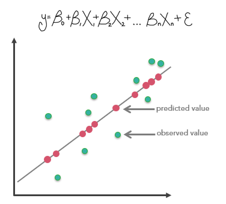
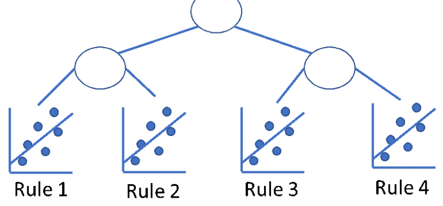
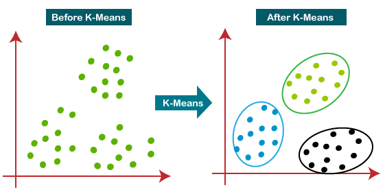
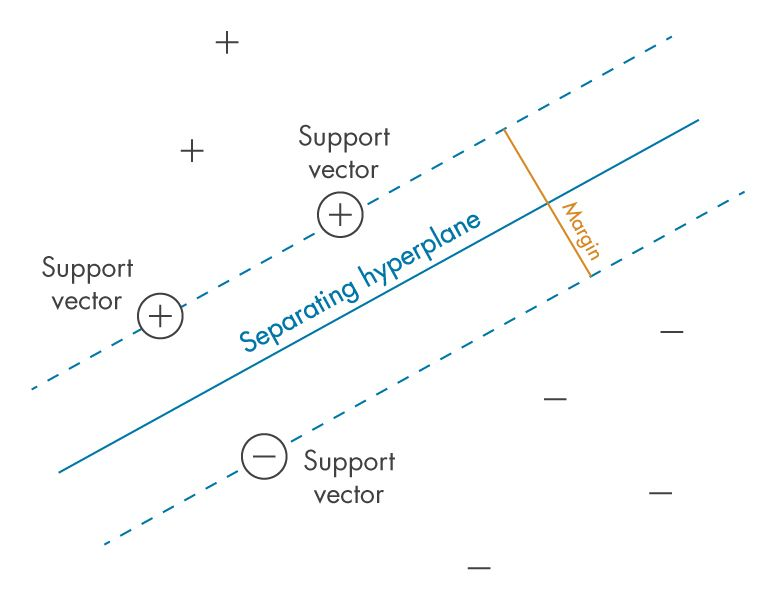
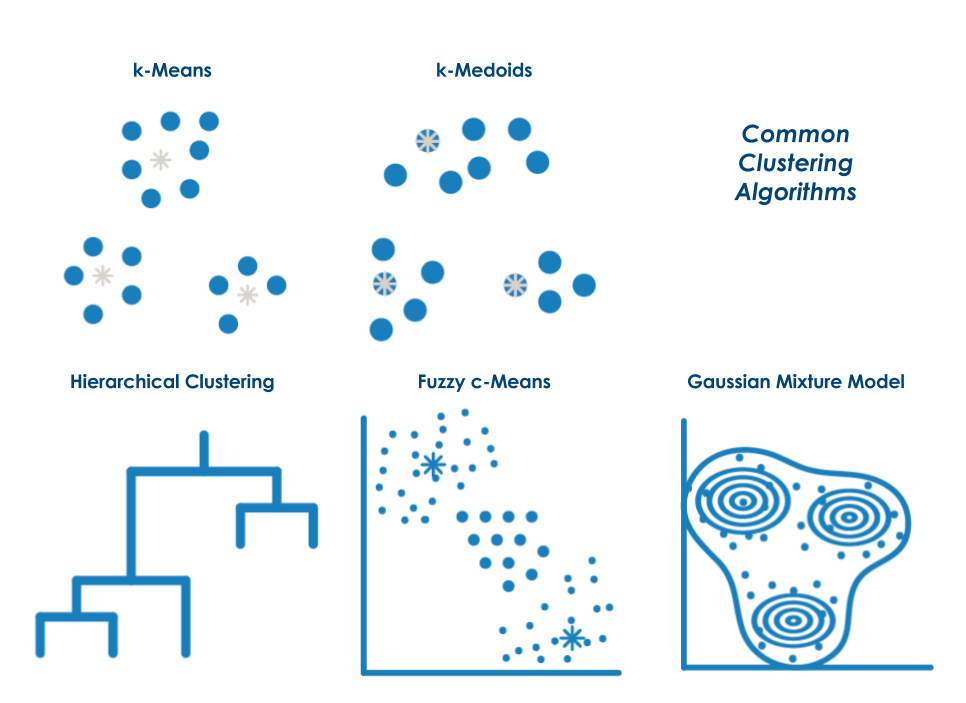
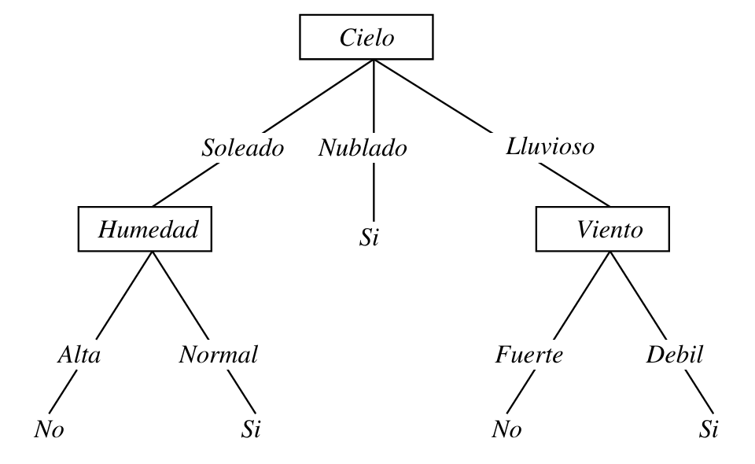
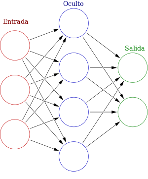

# Herramientas y métodos para la predicción espacial {style="color: #122562"}

La predicción juega un papel fundamental dentro del DSM. De allí proviene la información que permitirá una toma de decisiones acertada. Para predecir dicha información, se utilizan diferentes modelos analíticos, estadísticos y de machine learning, estos métodos se verán a continuación.

## Regresión lineal {style="color: #122562"}

El modelo de regresión lineal es el más utilizado para la predicción debido a que es relativamente simple y de fácil interpretación. Este modelo predice una variable cuantitativa a partir de los valores de otra variable, esta relación se convierte en un modelo de regresión simple. Por otra parte, el modelo de regresión lineal múltiple, permite considerar más de una variable explicativa en el modelo.

[{fig-alt="Tomado de: doc.arcgis.com" fig-align="center"}](https://doc.arcgis.com/es/allsource/1.0/analysis/geoprocessing-tools/spatial-statistics/generalized-linear-regression.htm)

En el manejo de datos espaciales, este modelo permite modelar, examinar y explorar relaciones espaciales, lo que ayuda en la explicación de los diversos factores que influyen en la presencia de patrones espaciales que han sido observados.

Un ejemplo de la aplicación de este modelo en la agricultura, es la medición de los efectos de diferentes variables en la cosecha de un cultivo. Variables como la aplicación de fertilizantes y el agua permitirán plantear la siguiente relación:

Rendimiento = β₀ + β₁ (fertilizante) + β₂

Donde,

β₀ representa la cosecha esperada sin usar fertilizantes, ni agua.

β₁ es el cambio promedio en la cosecha cuando la cantidad de fertilizante se aumenta en una unidad, suponiendo que la cantidad de agua permanece constante.

β₂ Es el cambio promedio en la cosecha cuando la cantidad de agua se aumenta en una unidad, asumiendo que la cantidad de fertilizante es la misma.

Los valores de β₁ y β₂, se podrán combinar de diferentes formas para que finalmente se ajusten las cantidades de fertilizante y agua sean las óptimas para maximizar la cosecha.

::: {.callout-note collapse="true"}
# Modelo de regresión

Se cargan los datos del dataset `iris`, este es un conjunto de datos cuantifica la variación morfológica de la flor *Iris* de tres especies relacionadas. Contiene 4 mediciones de cada muestra: largo y ancho del sépalo y el pétalo en centímetros.

::: {.callout-note collapse="true"}
# Cargar datos

```{r}
#| output: false
#| echo: true
lm.fit=lm(Petal.Length~Petal.Width,data=iris)

lm.fit
```
:::

La función `lm()` genera un objeto que almacena toda la información del modelo, para ver su contenido se emplea la función `names()` y para visualizar los principales parámetros del modelo generado se utiliza `summary()`.

::: {.callout-note collapse="true"}
# Contenido

```{r}
names(lm.fit)
```
:::

::: {.callout-note collapse="true"}
# Parámetros

```{r}
summary(lm.fit)
```
:::

La función `abline()` permite agregar una línea a un gráfico, recibe como parámetros la pendiente y el intercepto que se obtuvieron en el paso anterior. También puede recibir directamente un objeto lm.

::: {.callout-note collapse="true"}
# Gráfico tendencia

```{r}
plot(Petal.Length~Petal.Width,data=iris)

abline(1.083,2.229,col='darkblue')
```
:::

Se utiliza la función `predict.lm()` para la predicción

::: {.callout-note collapse="true"}
# Predicción de un valor

```{r}
predict.lm(lm.fit,data.frame(Petal.Width=1))
```
:::

Si se busca predecir más de un valor, se define un vector con los valores que se quieran predecir y a la función se proporciona el vector. En este caso el vector será "m"

::: {.callout-note collapse="true"}
# Predicción de varios valores

```{r}
m=c(2,4,7,8,15,29)

predict.lm(lm.fit,data.frame(Petal.Width=m))
```
:::
:::

## Regresión cubist {style="color: #122562"}

El método Cubist, también conocido como regresión Cubist, es un algoritmo de aprendizaje automático para la construcción de modelos de regresión no lineales. A diferencia de los modelos lineales tradicionales, Cubist es capaz de capturar relaciones complejas entre las variables predictoras y la variable objetivo, haciéndolo una herramienta útil para modelar fenómenos no lineales en diversos campos.

[{fig-align="center" width="525"}](https://www.google.com/url?sa=i&url=https%3A%2F%2Fopendatascience.com%2Fcubist-models-in-r-balancing-interpretability-and-predictive-power%2F&psig=AOvVaw2RCpXWuHABVU-oYeGOZuOp&ust=1717100226112000&source=images&cd=vfe&opi=89978449&ved=0CBUQ3YkBahcKEwjAhNL51rOGAxUAAAAAHQAAAAAQCA)

En resumen, la validación de un modelo Cubist es un proceso esencial para garantizar su confiabilidad y generalización. Al utilizar técnicas de validación cruzada, conjuntos de prueba independientes, selección de variables, interpretación del modelo y monitoreo del rendimiento, puede construir modelos Cubist robustos y efectivos para diversas aplicaciones de regresión no lineal.

## Clusterización (k-means) {style="color: #122562"}

El algoritmo k-means es un método de agrupamiento que se utiliza para dividir un conjunto de datos en k grupos o clusters, donde cada punto de datos pertenece al grupo cuyo centroide es más cercano. Esta técnica usa la distancia entre los datos para saber que tan parecidos o diferentes son, este algoritmo se considera de aprendizaje no supervisado. Su funcionamiento se explica a continuación:

1.  **Inicialización:** Elegir número de clústeres.

2.  **Asignación de puntos a clústeres:** Cada punto de datos se asigna al clúster más cercano.

3.  **Recálculo de centroides:** Se calcula el nuevo centro de cada clúster.

4.  **Reasignación de puntos:** Se vuelven a asignar los puntos en función a la distancia.

5.  **Bucle:** Se repiten los pasos 3 y 4 hasta que no hayan cambios significativos.

6.  **Resultado:** Cuando el algoritimo converge cada clúster representará un grupo distinto de datos.

[{fig-align="center" width="554"}](https://www.javatpoint.com/k-means-clustering-algorithm-in-machine-learning)

::: {.callout-note collapse="true"}
# k-means

Del conjunto de datos cargado, se realiza una gráfica que muestre la dispersión de los datos

::: {.callout-note collapse="true"}
# Dispersión

```{r}
library(ggplot2)
ggplot(data = iris, aes(x = Sepal.Length, y = Sepal.Width, col = Species)) +
  geom_point()
```
:::

En este caso, se dividirán los datos con un 70% para el entrenamiento y 30% de prueba

::: {.callout-note collapse="true"}
# División datos: 70/30

```{r}
#| output: true
#| echo: true
set.seed(12345)
size = floor(0.70 * nrow(iris))
idx = sample(seq_len(nrow(iris)), size = size)
iris_train = iris[idx, ]
iris_test  = iris[-idx, ]
```
:::

La función `knn` reconoce patrones en los datos sin un aprendizaje específico, simplemente midiendo la distancia entre grupos de datos. 

::: {.callout-note collapse="true"}
# KNN

```{r}
library(class)
k = sqrt(nrow(iris_train))
iris_prediction = knn(
  train = iris_train[1:4], 
  test = iris_test[1:4], 
  cl = iris_train[,ncol(iris_train)], 
  k = k
)
```
:::
:::

## Máquinas de vectores de soporte (SVM) {style="color: #122562"}

Una máquina de vectores de soporte (SVM, por sus siglas en inglés) es un algoritmo de aprendizaje supervisado, que se utiliza en problemas de clasificación y regresión.

El objetivo del algoritmo SVM es encontrar un hiperplano que separe los puntos de datos de una clase y de los de otra clase. En otras palabras, un hiperplano con el mayor margen entre las dos clases. Este algoritmo es viable sólo para problemas que sean linealmente separables, donde puede encontrar dicho hiperplano.

Para la solución de los problemas prácticos, el algoritmo maximiza el margen suave permitiendo una pequeña cantidad de clasificaciones erróneas.

[{fig-align="center" width="494"}](https://www.mathworks.com/discovery/support-vector-machine.html)

El algoritmo cuenta con una función conocida cómo kernel, dicha función asigna los datos a un espacio diferente en diferentes dimensiones, para facilitar la separación de las clases.

## Fuzzy clustering - agrupamiento difuso {style="color: #122562"}

La agrupación difusa, también conocida como agrupación suave o k-medias suaves, es una técnica de agrupación de datos que se diferencia de los métodos de agrupación tradicionales en un aspecto clave: el grado de membresía. El agrupamiento difuso tiene la cualidad de ser un agrupamiento basado en particiones, donde los datos pueden estar en más de un cluster.

El resultado obtenido son los centros de los clústers (similar a k-means) pero con difusión (fuzziness) de forma que las observaciones o individuos pueden pertenecer a más de 1 cluster.

[{fig-align="center" width="478"}](https://manualmodelizandor.netlify.app/tecnicas-de-clustering.html)

::: {.callout-note collapse="true"}
# Código

::: {.callout-note collapse="true"}
# Cargar librerías

```{r}
#| output: false
#| echo: true
# Cargar librerías
library(e1071)
library(ggplot2)
```
:::

::: {.callout-note collapse="true"}
# Cargar y seleccionar los datos

```{r}
# Cargar datos de iris
data(iris)

# Seleccionar las columnas con las características
datos = iris[, 1:4]
```
:::

::: {.callout-note collapse="true"}
# Modelo de agrupamiento difuso

```{r}
# Realizar agrupamiento difuso
resultados = cmeans(datos, centers=3)

# Obtener los centros de los grupos
centros = resultados$centers

# Asignar nombres a las columnas
colnames(centros) = colnames(datos)

# Asignar cada observación a un grupo
grupos = resultados$cluster

# Añadir la asignación de grupos al conjunto de datos
iris$Grupo = factor(grupos)
```
:::

::: {.callout-note collapse="true"}
# Visualización

```{r}
# Graficar los datos y los centros de los grupos
ggplot(iris, aes(x = Sepal.Length, y = Sepal.Width, color = Grupo)) +
  geom_point() +
  geom_point(data = as.data.frame(centros), aes(x = Sepal.Length, y = Sepal.Width), size = 5, shape = 8, color = "black") +
  theme_minimal() +
  labs(title = "Agrupamiento difuso en datos de iris", x = "Longitud del sépalo", y = "Anchura del sépalo") +
  scale_color_manual(values = c("red", "blue", "green")) +
  guides(color = guide_legend(title = "Especies"))

```
:::
:::

## Expert knowledge-based methods - Sistema basado en el conocimiento (KBS) {style="color: #122562"}

Los métodos expertos basados en el conocimiento, también conocidos como sistemas basados en el conocimiento (KBS) o sistemas expertos (ES), son un tipo de técnica de inteligencia artificial (IA) que se basa en capturar y utilizar el conocimiento de expertos humanos en un dominio específico para resolver problemas.

{fig-align="center" width="528"}

## Árboles de decisión {style="color: #122562"}

Los **árboles de decisión** son uno de los algoritmos más utilizados en la toma de decisiones. Aunque su capacidad es menor a otros algoritmos, son de uso frecuente por su sencilla implementación y fácil interpretación. Un árbol de decisión es un modelo predictivo que divide el espacio de los predictores agrupando observaciones con valores similares para la variable respuesta o dependiente.

Un árbol de decisión puede tener diferentes tipos de nodos:

-   Primer nodo o nodo raíz: en él se produce la primera división en función de la variable más importante.

-   Nodos internos o intermedios: dividen el conjunto de datos en función a las demás variables que complementan el nodo raíz.

-   Nodos terminales u hojas: se ubican en la parte inferior del esquema y su función es indicar el resultado.

{fig-align="center" width="516"}

## Modelo de Random Forest {style="color: #122562"}

Los [bosques aleatorios](https://youtu.be/DNvvqtaj9Ak) (Random Forest) son un método de aprendizaje automático muy popular, utilizado tanto para tareas de clasificación como de regresión. Se caracterizan por su robustez, precisión y versatilidad, lo que los convierte en una herramienta valiosa para diversos análisis de datos.

En R, el paquete `randomForest` proporciona las herramientas necesarias para implementar y utilizar bosques aleatorios. Su funcionamiento se resume en dos partes:

**Creación de múltiples árboles de decisión**

-   El algoritmo genera un conjunto de árboles de decisión de forma iterativa.
-   Cada árbol se construye utilizando una submuestra aleatoria de los datos (bagging) y un subconjunto aleatorio de características (característica aleatoria).
-   La característica aleatoria seleccionada en cada división se elige al azar entre un conjunto predefinido de variables.
-   Esto permite que cada árbol aprenda diferentes patrones en los datos y reduce la correlación entre ellos.

**Predicciones**

-   Para realizar predicciones, cada árbol del bosque emite una predicción individual.
-   En el caso de la clasificación, la clase más votada por los árboles individuales se convierte en la predicción final para la nueva instancia.
-   Para la regresión, se calcula el promedio de las predicciones individuales de los árboles.

En el modelo de bosques aleatorios, las variables de división empleadas por cada nodo se seleccionan en función de su capacidad para maximizar la diferencia en los valores medios de las variables de respuesta en los nodos de división resultantes, por lo que el valor predicho del bosque es el valor predicho medio de los árboles individuales.

::: {.callout-note collapse="true"}
# Modelo RF

Se deben cargar las librerías y el dataset, esta vez se muestra otra manera de invocar el dataset iris

::: {.callout-note collapse="true"}
# Cargar librerias y datos

```{r}
#| output: false
#| echo: true
library(tidyverse)
library(class)
library(gmodels)
library(caret)
library(e1071)
library(caTools)
library(ggplot2)
library(lattice)
library(nnet)
library(foreach)
library(glmnet)
library(randomForest)
data(iris)
str(iris)
```
:::

Se realiza una descripción rápida del dataset

::: {.callout-note collapse="true"}
# Descripción del dataset

```{r}
summary(iris)
```
:::

En los modelos de aprendizaje supervisado, es importante dividir los datos en un conjunto de entrenamiento (train) y un conjunto de prueba (test) para evaluar el rendimiento del modelo de forma adecuada. En este caso, se dividirá un 80% para entrenar el modelo y un 20% para validarlo.

::: {.callout-note collapse="true"}
# Dividir dataset

```{r}
set.seed(12345)
size = floor(0.80 * nrow(iris))
idx = sample(seq_len(nrow(iris)), size = size)
iris_train = iris[idx, ]
iris_test  = iris[-idx, ]
```
:::

Se entrena el modelo de random forest y por defecto se crean 500 árboles

::: {.callout-note collapse="true"}
# Entrenamiento

```{r}
forestIris = randomForest(Species ~ Petal.Width + Petal.Length, data = iris, prox = TRUE)
forestIris
```
:::

Con la función `getTree` se busca seleccionar uno de los árboles creados, en este caso el 3

::: {.callout-note collapse="true"}
# Extraer uno de los árboles generados

```{r}
getTree(forestIris, k = 3)
```
:::

Mediante una matriz de confusión se ven los resultados preliminares

::: {.callout-note collapse="true"}
# Matriz de confusión

```{r}
table(predict(forestIris), iris$Species)
prop.table(table(predict(forestIris), iris$Species))
```
:::

La gráfica permite visualizar los centros de cada clase

::: {.callout-note collapse="true"}
# Identificación de centros de clase

```{r}
iris.p <- classCenter(iris[, c(3, 4)], iris$Species, forestIris$prox)
plot(iris[, 3], iris[, 4], pch = 21, xlab = names(iris)[3], ylab = names(iris)[4], 
     bg = c("red", "blue", "green")[as.numeric(factor(iris$Species))], main = "Datos con centros de clase.")
points(iris.p[, 1], iris.p[, 2], pch = 21, cex = 2, bg = c("red", "blue", "green"))
```
:::

Se combinan direfentes modelos para perfeccionar el entrenamiento del mismo

::: {.callout-note collapse="true"}
# Combinando varios modelos

```{r}
forestIris1 <- randomForest(Species ~ Petal.Width + Petal.Length, data = iris, 
                            prox = TRUE, ntree = 50)
forestIris2 <- randomForest(Species ~ Petal.Width + Petal.Length, data = iris, 
                            prox = TRUE, ntree = 50)
forestIris3 <- randomForest(Species ~ Petal.Width + Petal.Length, data = iris, 
                            prox = TRUE, ntree = 50)
forestIris1
forestIris2
forestIris3

```
:::

El modelo final combina los modelos que se crearon anteriormente

::: {.callout-note collapse="true"}
# Nuevo modelo

```{r}
model <- combine(forestIris1, forestIris2, forestIris3)
model
```

# Matriz de confusión- nuevo modelo

```{r}
table(predict(model, iris), iris$Species)
```
:::

Se obtienen las clases del nuevo conjunto de datos

::: {.callout-note collapse="true"}
# Clases para nuevos objetos

```{r}
newdata <- data.frame(Sepal.Length <- rnorm(1000, mean(iris$Sepal.Length), sd(iris$Sepal.Length)), 
                      Sepal.Width <- rnorm(1000, mean(iris$Sepal.Width), sd(iris$Sepal.Width)), 
                      Petal.Width <- rnorm(1000, mean(iris$Petal.Width), sd(iris$Petal.Width)), 
                      Petal.Length <- rnorm(1000, mean(iris$Petal.Length), sd(iris$Petal.Length)))

pred <- predict(model, newdata)
```
:::

De esta forma se visualizan los resultados del modelo, mostrando que Random Forest es capaz de separar conjuntos de datos que no son separables linealmente

::: {.callout-note collapse="true"}
# Visualización

```{r}
plot(newdata[, 4], newdata[, 3], pch = 21, xlab = "Petal.Length", ylab = "Petal.Width", 
     bg = c("red", "blue", "green")[as.numeric(pred)], main = "Nuevos datos")
```
:::
:::

## Redes neuronales artificiales (ANN) {style="color: #122562"}

Las redes neuronales artificiales están compuestas por elementos simples que se conocen como neuronas, cada una de estas puede tomar decisiones matemáticas simples. Cuando se unen forman redes interconectadas que permiten analizar problemas complejos y brindar respuestas precisas.

**Arquitectura de una red neuronal simple**

**Capa de entrada**

Se ingresan los datos en la red neuronal artificial desde la capa de entrada. Los nodos de entrada procesan los datos, los analizan o los clasifican y los pasan a la siguiente capa.

**Capa oculta**

Las capas ocultas toman su entrada de la capa de entrada o de otras capas ocultas, se pueden tener una gran cantidad de capas ocultas. Cada capa oculta analiza la salida de la capa anterior, la procesa aún más y la pasa a la siguiente capa.

**Capa de salida**

La capa de salida proporciona el resultado final de todo el procesamiento de datos que realiza la red, puede tener uno o varios nodos.

[{fig-align="center"}](https://es.wikipedia.org/wiki/Red_neuronal_artificial)

En la siguiete tabla hay una comparación de los modelos vistos anteriormente, la elección del método más adecuado dependerá del tipo de los datos a procesar, el tipo de solución (regresión o clasificación), la capacidad de computo, entre otros.

|     Algoritmo      | Precisión | Tiempo de entrenamiento | Linealidad | Hiperparámetros |
|:-------------:|:-------------:|:-------------:|:-------------:|:-------------:|
|  Regresión lineal  |   Buena   |         Rápido          |     Si     |       \~4       |
| Boques de decisión |   Alta    |        Moderado         |     No     |       \~5       |
|  Redes neuronales  |   Buena   |        Moderado         |     No     |       \~8       |

: Comparación de algoritmos

## Modelo ensamblado- Ensamble model {style="color: #122562"}

Un modelo ensamblado es una técnica en la que se combinan múltiples modelos de aprendizaje automático para mejorar la precisión y la robustez de las predicciones. En lugar de confiar en un solo modelo, los resultados de varios modelos se combinan de diferentes maneras, como promediando las predicciones, ponderando cada modelo de manera diferente, sumándolos o utilizando la observación más común entre los modelos. Esta combinación crea un efecto de votación múltiple que puede llevar a predicciones más precisas y fiables, especialmente cuando los modelos individuales tienen desacuerdos.

Los modelos ensamblados tienden a ser particularmente efectivos cuando los modelos individuales son diversos y no están perfectamente correlacionados entre sí. Esta diversidad permite que los errores de un modelo sean compensados por los aciertos de otros, mejorando el rendimiento general del sistema. Además, los modelos ensamblados a menudo superan el rendimiento de cualquier modelo individual, proporcionando una solución más robusta y generalizable.

::: {.callout-note collapse="true"}
# Ejemplo de ensemble model

```{r, warning=FALSE}

#Ejemplo con dataset de diabetes en mujeres de  al menos 21 años
# Cargar librerias
library("SuperLearner")
library(MASS)

# Train y test: definir sets
train <- Pima.tr
test <- Pima.te

# Visualizar train
head(train)
# Se dividen variables x y y

y <- as.numeric(train[,8])-1
ytest <- as.numeric(test[,8])-1

x <- data.frame(train[,1:7])
xtest <- data.frame(test[,1:7])

#Con listwrappers se visualizan el listado de modelos posibles que se incluyen en la librería SuperLearner

listWrappers()

#Se realiza el modelo con un sólo tipo de modelo
set.seed(2024)
    single.model <- SuperLearner(y,
                                 x,
                                 family=binomial(),
                                 SL.library=list("SL.ranger"))
    single.model
    
#Se entrena el modelo ensamblado
set.seed(2024)
model <- SuperLearner(y,
                      x,
                      family=binomial(),
                      SL.library=list("SL.ranger",
                                      "SL.ksvm",
                                      "SL.ipredbagg",
                                      "SL.bayesglm"))

# Modelo final
model    

```
:::
