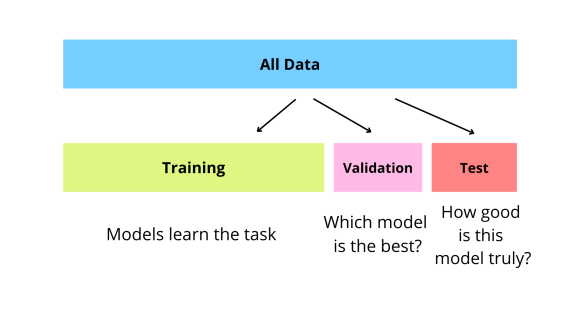
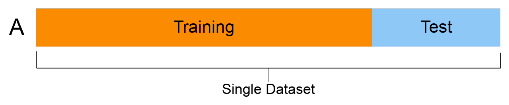
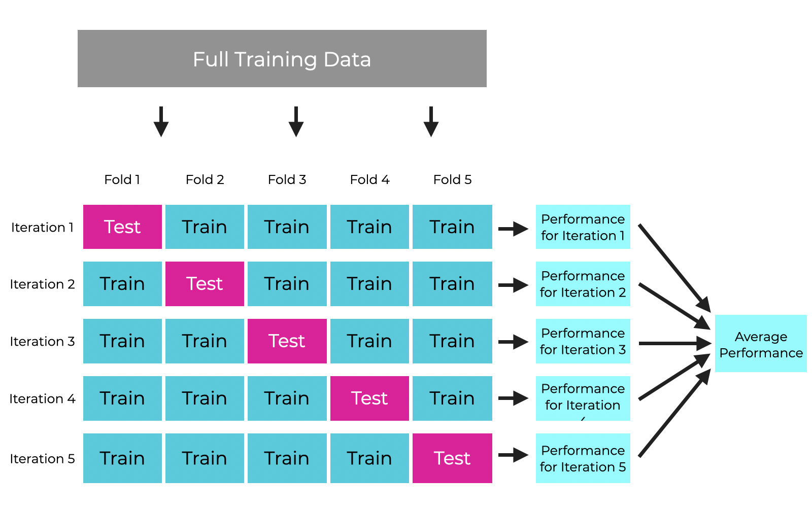
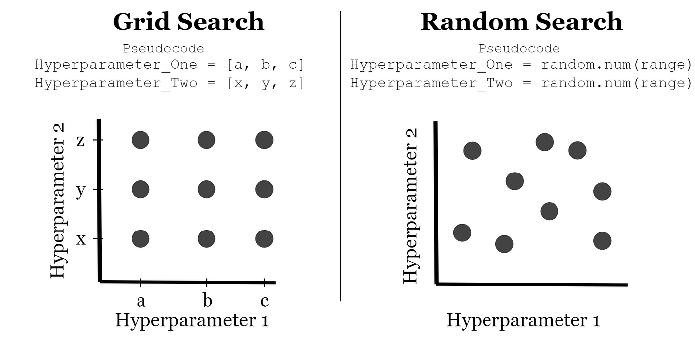

# Predicción espacial: Modelamiento y validación {style="color: #122562"}

El modelo seleccionado para este ejercicio es el Random Forest o bosques aleatorios, al principal ventaja de este método es su precisión de predicción. En muchos conjuntos de datos funcionan mejor, que otros algoritmos de clasificación y regresión.

## Entrenamiento y validación de los modelos {style="color: #122562"}

En el contexto de **Machine Learning**, el conjunto de **entrenamiento** (train) y el conjunto de **prueba** (test) son fundamentales para desarrollar y evaluar modelos predictivos.

[{fig-align="center" width="433"}](https://www.google.com/url?sa=i&url=https%3A%2F%2Fmedium.com%2F%40rahulchavan4894%2Funderstanding-train-test-and-validation-dataset-split-in-simple-quick-terms-5a8630fe58c8&psig=AOvVaw25FHtPfYMFF60aBwt7_AX3&ust=1717107400758000&source=images&cd=vfe&opi=89978449&ved=0CBIQjRxqFwoTCMDyx9fxs4YDFQAAAAAdAAAAABAE)

-   **Conjunto de Entrenamiento (Train)**: Es la porción de datos que se utiliza para **entrenar** el modelo. El modelo aprende a identificar patrones y hacer predicciones de acuerdo a la información proporcionada.

-   **Conjunto de Prueba (Test)**: Es la porción de datos que se encarga de **evaluar** la eficiencia del modelo. Estos datos no se utilizan durante el entrenamiento y sirven para probar cómo el modelo puede generar nuevos datos.

Lo que se busca es que el modelo pueda predecir correctamente los resultados en datos desconocidos, esto indica su capacidad de generalización. Si el modelo presenta un rendimiento similar en ambos conjuntos, es probable que funcione bien con datos nuevos.

Sin embargo, si hay una gran discrepancia entre el rendimiento en el conjunto de entrenamiento y el de prueba, podría indicar un problema, como el sobreajuste (overfitting), donde el modelo aprende demasiado los detalles del conjunto de entrenamiento y pierde capacidad de generalizar.

## Validación {style="color: #122562"}

La validación evalúa qué tan bien el modelo realizará predicciones con datos nuevos, es decir, datos que no se utilizaron durante el entrenamiento del modelo. Es importante para asegurar que el modelo sea generalizable y funcione bien con datos que no ha visto antes.

## División de dataset {style="color: #122562"}

Se describirán algunas de las técnicas utilizadas para realizar las divisiones de donde se obtendrán las técnicas para validar el modelo:

### Split simple {style="color: #122562"}

Esta técnica es comúnmente usada para dividir el conjunto de datos en dos subconjuntos: un conjunto de entrenamiento y un conjunto de prueba. Este proceso de división se realiza aleatoriamente, asegurando que ambos conjuntos representen la distribución general de los datos. La proporción común para la división es 80% para el conjunto de entrenamiento y 20% para el conjunto de prueba.

El Split simple se caracteriza por ser simple, eficiente y fácil de interpretar que proporciona una valiosa evaluación del modelo. Además, es un método computacionalmente eficiente que no requiere dividir el conjunto de datos en múltiples subconjuntos.

Cortarla a solo la parte de arriba

[{fig-align="center" width="548"}](https://www.google.com/imgres?q=train%20test%20and%20validation%20set&imgurl=https%3A%2F%2Fupload.wikimedia.org%2Fwikipedia%2Fcommons%2Fb%2Fbb%2FML_dataset_training_validation_test_sets.png&imgrefurl=https%3A%2F%2Fcommons.wikimedia.org%2Fwiki%2FFile%3AML_dataset_training_validation_test_sets.png&docid=QvKXmCdvn1VsUM&tbnid=hdf1m-snhXAfGM&vet=12ahUKEwipr_7V8bOGAxWGkIQIHYcIC98QM3oECE8QAA..i&w=1280&h=558&hcb=2&ved=2ahUKEwipr_7V8bOGAxWGkIQIHYcIC98QM3oECE8QAA)

### Validación cruzada - Cross validation {style="color: #122562"}

La validación cruzada (CV) es una técnica comúnmente utilizada para evaluar el rendimiento de un modelo y su capacidad para generalizar a datos invisibles. Implica dividir los datos disponibles en múltiples pliegues o subconjuntos, utilizar uno de estos pliegues como conjunto de validación y entrenar el modelo en los pliegues restantes. Este proceso se repite varias veces y cada pliegue sirve como conjunto de prueba exactamente una vez.

Dentro de las ventajas de la validación cruzada, se puede decir que evita el sobreajuste al usar datos invisibles para la evaluación. Y puede brindar una guía para la selección de los hiperparámetros óptimos del modelo.

[{fig-align="center" width="515"}](https://www.google.com/url?sa=i&url=https%3A%2F%2Fwww.sharpsightlabs.com%2Fblog%2Fcross-validation-explained%2F&psig=AOvVaw06_n3u-Cc2BbBBGCFiqyvx&ust=1717107633393000&source=images&cd=vfe&opi=89978449&ved=0CBIQjRxqFwoTCLipo8jys4YDFQAAAAAdAAAAABBP)

## Ajuste de los modelos {style="color: #122562"}

El ajuste de modelos o tuning de hiperparámetros, es un proceso crucial para optimizar el rendimiento de un modelo entrenado. En donde se ajustan los valores de los hiperparámetros, que son configuraciones que controlan el comportamiento del algoritmo de aprendizaje.

El objetivo es encontrar la combinación de hiperparámetros que maximice la capacidad del modelo para generalizar bien a los nuevos datos no vistos durante el entrenamiento, para lograr un mejor rendimiento y generalización.

Los hiperparámetros son parámetros que son independientes del proceso de entrenamiento: el científico de datos los establece de antemano. Por ejemplo, en un bosque aleatorio, un hiperparámetro sería cuántos árboles incluir o cuántos nodos puede tener cada árbol. Los parámetros serían los criterios para cada nodo, que encuentra el proceso de entrenamiento para el bosque aleatorio. 

**Búsqueda de cuadrícula y búsqueda aleatoria**

La búsqueda de cuadrícula es donde se selecciona *x* número de valores que están espaciados uniformemente a lo largo de cada eje. Esto forma una cuadrícula, de ahí el nombre. La búsqueda aleatoria es cuando se selecciona aleatoriamente un número de valores *x cuadrado* . Ambos casos generan un número de puntos *x cuadrado* .

{fig-align="center" width="499"}

## Modelo seleccionado {style="color: #122562"}

### Random Forest

Se realiza el modeloRandom Forest con cross validation para los 3 sets de datos que se seleccionaron previamente:

::: {.callout-note collapse="true"}
# Librerías

```{r, warning=FALSE}
# Librerias
library(randomForest)
library(ggplot2)
library(purrr)
library(caret)
library(dplyr)
library(sf)
library(SuperLearner)
library(MASS)
library(arm)
```

```{r}
#| echo: false
#| output: false 


data_sf= read_sf("datos/cap15/data_sf.gpkg")
colnames(data_sf)= c( "id","X0_30_cm","Age","Annual_Prec","BSI","Coverage","DEM","EVPTP_Zone","Landforms","Litology","Mean_Temp","Mean_Temp_cold_q","Mean_Temp_dry_q","Mean_Temp_wam_q", "Mean_Temp_wet_q","MSI","NDVI","Prec_cold_q","Prec_dry_q","Prec_warm_q","Prec_wet","Radiation","SAGA_Wetness_Index" ,"Slope","Soils","TPI_Cont","geometry")
data_VSURF= c("X0_30_cm","SAGA_Wetness_Index" ,"Mean_Temp_wet_q","EVPTP_Zone","NDVI","Age","BSI")
data_VIF= c( "X0_30_cm","Age","Annual_Prec","Landforms" ,"Coverage","DEM","EVPTP_Zone","Litology","MSI","NDVI","Radiation" ,         "SAGA_Wetness_Index", "Slope","Soils","TPI_Cont")
```
:::

::: {.callout-note collapse="true"}
### Random forest con todas las covariables del estudio

```{r}

# Cargar la base de datos 
data=data.frame(data_sf)[1:26]

set.seed(2024)  # Seleccionar la semilla de la división
train_index <- createDataPartition(data$X0_30_c , p=0.7, list=FALSE) 

# Se divide el set de datos en entrenamiento basados en el index obtenido
train <- data[train_index, ]
test <- data[-train_index, ]


set.seed(2024) 
# Definir el control que se tiene para el test 
train_control <- trainControl(
  method = "cv",            # Cross-validation
  number = 10,                # Numero de folders
  verboseIter = TRUE,       # Progreso
  allowParallel = TRUE      # Permitir paralelización
)

# Definir parámetro grid
param_grid <- expand.grid(
  mtry = c(2, 3, 4),    # Valores mtry ejemplo
  ntree = c(50, 100, 150)   # Valores para arboles
)

set.seed(2024) 
# Entrenamiento con parametros del grid
rf_model_grid_tun <- caret::train(
  data = train,            # El dataset
  X0_30_cm ~ .,                   # Predictor
  method = "rf",               # Random Forest 
  trControl = train_control,   # Training control con grid
  search = param_grid,
)

set.seed(2024) 
# Entrenamiento con parametros random
rf_model_random_tun <- caret::train(
  data = train,            # Dataset
  X0_30_cm ~ .,                   # Predictor
  method = "rf",               # Random Forest 
  trControl = train_control,   # Training control con random
  search = "random",
  tuneLength = 10   
)


# Obtener el mejor modelo RF
print(rf_model_grid_tun)
print(rf_model_random_tun)

# Se definen lo mejores modelos obtenidos con cada tuning 
best_rf_grid_tun <- rf_model_grid_tun$finalModel
best_rf_grid_tun

best_rf_random_tun <- rf_model_random_tun$finalModel
best_rf_random_tun
```
:::

::: {.callout-note collapse="true"}
### Random forest con las covariables seleccionadas mediante VSURF

```{r}

# Cargar la base de datos 

data= data[data_VSURF]

set.seed(2024)  # Seleccionar la semilla de la división

train_index <- createDataPartition(data$X0_30_cm , p=0.7, list=FALSE) 

# Se divide el set de datos en entrenamiento basados en el index obtenido
train <- data[train_index, ]
test <- data[-train_index, ]


set.seed(2024) 
# Definir el control que se tiene para el test 
train_control <- trainControl(
  method = "cv",            # Cross-validation
  number = 10,                # Numero de folders para CV
  verboseIter = TRUE,       # Imprimir proceso
  allowParallel = TRUE      # Permitir paralelización
)

# Definir parámetro grid
param_grid <- expand.grid(
  mtry = c(2, 3, 4),    # Valores seleccionados para mtry
  ntree = c(50, 100, 150)   # Valores seleccionados para numero de árboles
)

set.seed(2024) 
# Entrenamiento con parametros del grid
rf_model_grid_tun_VSURF <- caret::train(
  data = train,              # Dataset
  X0_30_cm ~ .,                   # Variable predictora
  method = "rf",               # Random Forest 
  trControl = train_control,   # Control de entrenamiento con grid
  search = param_grid,
)

set.seed(2024) 
# Entrenamiento con parametros random
rf_model_random_tun_VSURF <- caret::train(
  data = train,            # Dataset
  X0_30_cm ~ .,                   # Variable predictora
  method = "rf",               # Random Forest 
  trControl = train_control,   # Control de entrenamiento con random
  search = "random",
  tuneLength = 10       
)

# Obtener el mejor modelo RF
print(rf_model_grid_tun_VSURF)
print(rf_model_random_tun_VSURF)

# Se definen lo mejores modelos obtenidos con cada tuning 
best_rf_grid_tun_VSURF <- rf_model_grid_tun_VSURF$finalModel
best_rf_grid_tun_VSURF

best_rf_random_tun_VSURF <- rf_model_random_tun_VSURF$finalModel
best_rf_random_tun_VSURF
```
:::

::: {.callout-note collapse="true"}
### Random Forest con las covariables seleccionadas mediante VIF

```{r}
#| output: false
#| echo: false

data=data.frame(data_sf[(data_VIF)])

set.seed(2024)  # You can choose any integer value
train_index <- createDataPartition(data$X0_30_cm , p=0.7, list=FALSE)

train_sf <- data_sf[train_index, ]
test_sf <- data_sf[-train_index, ]

train <- data.frame(data[train_index, ])[1:15]
test <- data.frame(data[-train_index, ])[1:15]


set.seed(2024) 
# Definir el control que se tiene para el test 
train_control <- trainControl(
  method = "cv",            # Cross-validation
  number = 10,                # Numero de folders para CV
  verboseIter = TRUE,       # Imprimir proceso
  allowParallel = TRUE      # Permitir paralelización
)

# Definir parámetro grid
param_grid <- expand.grid(
  mtry = c(2, 3, 4),    # Valores seleccionados para mtry
  ntree = c(50, 100, 150)   # Valores seleccionados para numero de árboles
)

set.seed(2024) 
# Entrenamiento con parametros del grid
rf_model_grid_tun_VIF <- caret::train(
  data = train,              # Dataset
  X0_30_cm ~ .,                   # Variable predictora
  method = "rf",               # Random Forest 
  trControl = train_control,   # Control de entrenamiento con grid
  search = param_grid,
)

set.seed(2024) 
# Entrenamiento con parametros random
rf_model_random_tun_VIF <- caret::train(
  data = train,            # Dataset
  X0_30_cm ~ .,                   # Variable predictora
  method = "rf",               # Random Forest 
  trControl = train_control,   # Control de entrenamiento con random
  search = "random",
  tuneLength = 10       
)

# Imprimir el modelo
print(rf_model_grid_tun_VIF)
print(rf_model_random_tun_VIF)

# Se definen lo mejores modelos obtenidos con cada tuning 
best_rf_grid_tun_VIF <- rf_model_grid_tun_VIF$finalModel
best_rf_grid_tun_VIF

best_rf_random_tun_VIF <- rf_model_random_tun_VIF$finalModel
best_rf_random_tun_VIF
```
:::

```{r}
#| echo: false
#| output: false

data_VIF= c( "X0_30_cm","Age","Annual_Prec","Landforms" ,"Coverage","DEM","EVPTP_Zone","Litology","MSI","NDVI","Radiation" ,"SAGA_Wetness_Index", "Slope","Soils","TPI_Cont")
library(raster)
```

::: {.callout-note collapse="true"}
### Validación del modelo

Se prueba el modelo con un set de datos que no conce, estos datos fueron separados inicialmente. Y el modelo es aquel seleccionado anteriormente:

```{r, warning=FALSE}

#Se obtiene la importancia de las variables
var_imp <- varImp(best_rf_random_tun_VIF, scale=FALSE)

var_imp <- data.frame(variables=row.names(var_imp), importance=var_imp$Overall)

#Se grafican para entender cúal está influyendo más en el modelo
var_imp %>% arrange(importance) %>% ggplot(aes(x=reorder(variables, importance), y=importance)) + geom_bar(stat='identity') + coord_flip() + xlab('Variables') + labs(title='Random forest variable importance') + theme_minimal() + 
        theme(axis.text = element_text(size = 10), 
              axis.title = element_text(size = 15), 
              plot.title = element_text(size = 20),)

#Evaluar el desempeno del modelo con el set de entrenamiento 

#Los datos en formato ráster servirán para que la predicción ahora no sea numérica sino en formato ráster

lista_raster= list.files(path = "datos/covariables", pattern = ".tif", full.names = TRUE)

raster_stack= stack(lista_raster)

#Se predice utiliando el RF elegido y el stack de los raster
X0_30_cm_pred <- predict(object = raster_stack[[data_VIF]], model = best_rf_random_tun_VIF)*1

#Se visualiza la predicción realizada
plot(X0_30_cm_pred)
plot(train["X0_30_cm"], add = TRUE)


#Se extraen los puntos donde los datos de entrenamiento y de prueba se cruzan en el mapa predicho
train_extract = raster::extract(x = X0_30_cm_pred, y = train_sf)
test_extract = raster::extract(x = X0_30_cm_pred, y = test_sf)


#Se tabulan los valores predichos y los valores de materia orgánica reales que se dividieron en el set de entrenamiento y prueba
val_train_data = cbind(train["X0_30_cm"], predicho = train_extract)
val_test_data = cbind(test["X0_30_cm"], predicho = test_extract)

#Se obtienen las métricas de validación para el set de entrenamiento
train.R2 = round(R2(train$X0_30_cm, train_extract),3)
train.RMSE = round(RMSE(train$X0_30_cm, train_extract))
train.MAE = round(MAE(train$X0_30_cm, train_extract))

#Se obtienen las métricas de validación para el set de prueba
test.R2 = round(R2(test$X0_30_cm, test_extract),3)
test.RMSE = round(RMSE(test$X0_30_cm, test_extract))
test.MAE = round(MAE(test$X0_30_cm, test_extract))

#Se visualizan las métricas
Train_metrics = c(R2 = train.R2, RMSE = train.RMSE, MAE = train.MAE) # R2, RMSE, MAE
Test_metrics = c(R2 = test.R2, RMSE = test.RMSE, MAE = test.MAE) # R2, RMSE, MAE

Train_metrics
Test_metrics

# Crear un ggplot comparanda los valores predichos con los datos de entrenamiento y prueba
ggplot()+
  geom_point(aes(x = train$X0_30_cm, y = train_extract, color = "green"), data =train) +
  geom_point(aes(x = test$X0_30_cm, y = test_extract, color = "red"), data = test)

```
:::


## Quantile Regression Forest

El Quantile Regression Forest (QRF) es una extensión del algoritmo Random Forest que no solo predice un valor promedio (como lo hace un Random Forest tradicional), sino que además permite estimar la distribución completa de la variable respuesta. Esto quiere decir que QRF puede calcular cuantiles (por ejemplo, el 5%, 50% o 95%), proporcionando información sobre incertidumbre, rangos de valores posibles y extremos.

A diferencia del Random Forest clásico, que entrega una única predicción basada en los promedios de los árboles, el QRF conserva todas las observaciones de las hojas terminales donde caen los datos, lo que permite reconstruir una distribución empírica para cada predicción.

::: {.callout-note collapse="true"}
### Librerías

```{r}

# Librerías necesarias
library(ranger)
library(caret)
library(ggplot2)
library(dplyr)
library(sf)
library(raster)
library(tidyr)
```
:::

```{r}
#| output: false
#| echo: false
# Cargar y preparar datos 
data_sf = read_sf("datos/cap15/data_sf.gpkg")
colnames(data_sf) = c( "id","X0_30_cm","Age","Annual_Prec","BSI","Coverage","DEM","EVPTP_Zone","Landforms","Litology","Mean_Temp","Mean_Temp_cold_q","Mean_Temp_dry_q","Mean_Temp_wam_q", "Mean_Temp_wet_q","MSI","NDVI","Prec_cold_q","Prec_dry_q","Prec_warm_q","Prec_wet","Radiation","SAGA_Wetness_Index" ,"Slope","Soils","TPI_Cont","geometry")

# Variables que usas en cada set
data_VSURF = c("X0_30_cm","SAGA_Wetness_Index","Mean_Temp_wet_q","EVPTP_Zone","NDVI","Age","BSI")
data_VIF   = c("X0_30_cm","Age","Annual_Prec","Landforms","Coverage","DEM","EVPTP_Zone","Litology","MSI","NDVI","Radiation","SAGA_Wetness_Index","Slope","Soils","TPI_Cont")
colnames(data_sf) = c( "id","X0_30_cm","Age","Annual_Prec","BSI","Coverage","DEM","EVPTP_Zone","Landforms","Litology","Mean_Temp","Mean_Temp_cold_q","Mean_Temp_dry_q","Mean_Temp_wam_q", "Mean_Temp_wet_q","MSI","NDVI","Prec_cold_q","Prec_dry_q","Prec_warm_q","Prec_wet","Radiation","SAGA_Wetness_Index" ,"Slope","Soils","TPI_Cont","geometry")
# Variables de cada set
data_VSURF = c("X0_30_cm","SAGA_Wetness_Index","Mean_Temp_wet_q","EVPTP_Zone","NDVI","Age","BSI")
data_VIF   = c("X0_30_cm","Age","Annual_Prec","Landforms","Coverage","DEM","EVPTP_Zone","Litology","MSI","NDVI","Radiation","SAGA_Wetness_Index","Slope","Soils","TPI_Cont")

```

Sets de entrenamiento y prueba

Para realizar entrenar y testear el modelo, debe definir que cantidad de datos utilizará para entrenar su modelo y seleccionarlos.

::: {.callout-note collapse="true"}
### Definir sets

```{r}

# Para entrenar / testear usaremos el set VIF (ajusta si quieres VSURF u otro)
data = data.frame(data_sf)[ , data_VIF]

# quitar filas con NA en predictora o covariables
data = data %>% drop_na()

#Partición de datos
set.seed(2025)
train_index <- createDataPartition(data$X0_30_cm, p = 0.7, list = FALSE)
train <- data[train_index, ]
test  <- data[-train_index, ]
```
:::

Luego se definen los parámetros del modelo, aquí se puede definir los parámetros mtry, ntree y min.node.size:

mtry Es el número de variables predictor que el modelo selecciona aleatoriamente en cada división del árbol. Este parámetro controla la diversidad entre los árboles del bosque. Valores pequeños generan árboles más distintos entre sí, mientras que valores más grandes producen árboles más similares y con mayor ajuste, aunque con riesgo de sobreajuste.

Se mueve entre 1 y el número total de variables predictor del modelo.

ntree Corresponde al número total de árboles que se construyen en el bosque. Un mayor número de árboles mejora la estabilidad de las predicciones y reduce la varianza del modelo, especialmente en la estimación de cuantiles. Sin embargo, aumentar demasiado este número incrementa también el tiempo de cómputo.

Puede variar entre 100 y 2000 árboles.

Rangos prácticos más comunes:

100–500 → más rápido, buen desempeño general.

500–1000 → mayor estabilidad en cuantiles y menor varianza.

+1000 → solo cuando se necesita alta estabilidad (por ejemplo, mapas espaciales grandes o cuantiles extremos).

min.node.size Representa el tamaño mínimo que debe tener un nodo terminal en cada árbol. Este parámetro controla la profundidad y complejidad del árbol. Valores más pequeños permiten árboles más detallados y profundos, mientras que valores más grandes producen árboles más simples y generalistas.

Afecta la profundidad del árbol y se mueve normalmente entre 1 y 20.

Rangos más usados:

1–5 → árboles más detallados (común en regresión).

5–10 → árboles más simples y generalistas.

Valores → 10 se usan cuando se quiere evitar sobreajuste en datasets pequeños.

::: {.callout-note collapse="true"}
### Definir parámetros

```{r}
# --- Grid manual para Quantile RF ---

# Valores que se evaluarán para mtry (número de variables por división)
mtry_vals   <- c(3,4,6)

# Valores que se evaluarán para ntree (número de árboles del bosque)
ntree_vals  <- c(100, 300, 500)

# Valor a evaluar para min.node.size (tamaño mínimo de los nodos terminales)
min.node.size_vals <- c(5)

# Se crea un data frame con todas las combinaciones posibles de parámetros
results <- expand.grid(mtry = mtry_vals,
                       num.trees = ntree_vals,
                       min.node.size = min.node.size_vals)

# Columnas vacías para almacenar desempeño del modelo
results$RMSE_oob  <- NA   # Error estimado OOB
results$RMSE_test <- NA  # Error sobre datos de prueba (más confiable)
```
:::

Con los parámetros establecidos podemos entrenar el modelo realizando una búsqueda óptima dentro de lo establecido. Se predice en el conjunto de prueba para obtener las métricas.

::: {.callout-note collapse="true"}
### Modelo óptimo

```{r}
# Bucle que recorre cada combinación del grid
for(i in seq_len(nrow(results))){
  
  # Extrae los valores de parámetros para la iteración actual
  mtry_i <- results$mtry[i]
  ntree_i <- results$num.trees[i]
  mn_i <- results$min.node.size[i]

  # Para asegurar reproducibilidad
  set.seed(2025)

  # Entrena el modelo Quantile Regression Forest
  rf_q <- ranger(
    formula = X0_30_cm ~ .,       # Variable respuesta y predictores
    data = train,                 # Datos de entrenamiento
    num.trees = ntree_i,          # Número de árboles
    mtry = mtry_i,                # Número de variables por división
    min.node.size = mn_i,         # Tamaño mínimo del nodo terminal
    importance = "permutation",   # Importancia de variables
    quantreg = TRUE,              # Activa QRF para cuantiles
    respect.unordered.factors = "order", # Manejo de factores
    seed = 2025)

# Predicción en el conjunto de prueba
  pred_test <- predict(rf_q, data = test, type = "response")$predictions

  # Cálculo del RMSE en test (métrica principal de evaluación)
  results$RMSE_test[i] <- sqrt(mean((test$X0_30_cm - pred_test)^2, na.rm = TRUE))
  
  # Obtención del error OOB si está disponible (ranger suele devolver MSE)
  if(!is.null(rf_q$prediction.error)){
    results$RMSE_oob[i] <- sqrt(rf_q$prediction.error)
  } else {
    results$RMSE_oob[i] <- NA
  }

  # Imprime el avance del proceso
  cat(sprintf("Iter %d/%d: mtry=%d, ntree=%d -> RMSE_test=%.4f\n",
              i, nrow(results), mtry_i, ntree_i, results$RMSE_test[i]))
}

```
:::

De las metricas obtenidas en el modelo luego de predecir con el conjunto de prueba, se elige el "MEJOR" modelo.

::: {.callout-note collapse="true"}
### Selección de modelo

```{r}

# Elegir el mejor por menor RMSE en test
best_row <- results[which.min(results$RMSE_test), ]
best_row
```
:::

Se reentrena el modelo con los parámetros definidos como óptimos.

::: {.callout-note collapse="true"}
### Entrenar modelo final

```{r}
# Re-entrenar el mejor modelo con todos los datos de entrenamiento usando los hiperparámetros seleccionados
set.seed(2025)
best_qrf <- ranger(
  formula = X0_30_cm ~ .,
  data = train,
  num.trees = 100,
  mtry = 4,
  min.node.size = 5,
  importance = "permutation",
  quantreg = TRUE,
  respect.unordered.factors = "order",
  seed = 2025
)

#Para guardar este modelo:

saveRDS(best_qrf, file = "salidas/best_qrf.rds")

```
:::

Se predice con los datos sobre ambos datasets

::: {.callout-note collapse="true"}
### Predicción de los datos

```{r}

# --- Evaluación en train y test usando predicción de la media (type='response') ---
pred_train_mean <- predict(best_qrf, data = train, type = "response")$predictions
pred_test_mean  <- predict(best_qrf, data = test, type = "response")$predictions

# Si quieres también obtener cuantiles (ej. median 0.5 y 0.025/0.975)
pred_test_q50  <- predict(best_qrf, data = test, type = "quantiles", quantiles = 0.5)$predictions
pred_test_q005 <- predict(best_qrf, data = test, type = "quantiles", quantiles = 0.005)$predictions
pred_test_q095 <- predict(best_qrf, data = test, type = "quantiles", quantiles = 0.095)$predictions

```
:::

Se calculan las métricas de los datos predichos y la importancia de las variables

::: {.callout-note collapse="true"}
### Validación del modelo e importancia de las variables

```{r}
# Métricas (usando caret::postResample o funciones propias)
train.RMSE <- round(sqrt(mean((train$X0_30_cm - pred_train_mean)^2, na.rm = TRUE)), 4)
test.RMSE  <- round(sqrt(mean((test$X0_30_cm - pred_test_mean)^2, na.rm = TRUE)), 4)
train.R2 <- round(cor(train$X0_30_cm, pred_train_mean, use="complete.obs")^2, 3)
test.R2  <- round(cor(test$X0_30_cm, pred_test_mean, use="complete.obs")^2, 3)

Train_metrics <- c(R2 = train.R2, RMSE = train.RMSE)
Test_metrics  <- c(R2 = test.R2,  RMSE = test.RMSE)

Train_metrics
Test_metrics

# Importancia de variables (permutation importance)
var_imp <- as.data.frame(best_qrf$variable.importance)
colnames(var_imp) <- "importance"
var_imp$variable <- rownames(var_imp)
var_imp <- var_imp %>% arrange(desc(importance))
ggplot(var_imp, aes(x = reorder(variable, importance), y = importance)) +
  geom_bar(stat = "identity") + coord_flip() + theme_minimal() +
  labs(title = "Variable importance (ranger - permutation)", x = "Variable", y = "Importance")
```
:::

Ahora se hace la predicción pero sobre el stack de las covariables, es importante omitir los valores NA y asegurarse que no entren a la predicción

::: {.callout-note collapse="true"}
### Predicción del ráster

```{r}
# -------------------------------------------------
# Predicción sobre el stack de covariables (raster)
# -------------------------------------------------
# Cargar stack de covariables
lista_raster = list.files(path = "datos/covariables", pattern = ".tif$", full.names = TRUE)
raster_stack = stack(lista_raster)

# Asegúrar que las capas necesarias estén presentes y en el mismo orden que las columnas predictoras del modelo
# Se seleccionan solo las capas que coinciden con los nombres de covariables
covariate_names <- setdiff(data_VIF, "X0_30_cm")
# Se reordenan y seleccionan
available_names <- names(raster_stack)
missings <- setdiff(covariate_names, available_names)
if(length(missings) > 0){
  stop("Faltan capas en el raster_stack para: ", paste(missings, collapse = ", "))
}
raster_stack_sel <- raster_stack[[covariate_names]]

# Extraer valores (por bloques para memoria si dataset grande
vals <- as.data.frame(values(raster_stack_sel))
# Mantener NA rows para reconstruir raster
idx_na <- apply(vals, 1, function(x) any(is.na(x)))
# Predecir por bloques: predict.ranger espera data frame con columnas iguales a las usadas en entrenamiento
# Ojo: si hay factores, hay que convertir niveles coherentes
preds_mean <- rep(NA_real_, nrow(vals))
non_na_idx <- which(!idx_na)
if(length(non_na_idx)>0){
  pred_batch <- predict(best_qrf, data = vals[non_na_idx, ], type = "response")$predictions
  preds_mean[non_na_idx] <- pred_batch
}

# Crear raster de salida (se utiliza la primera capa como template)
pred_raster <- raster_stack_sel[[1]]
values(pred_raster) <- preds_mean

```
:::

Se guarda el ráster obtenido y también se pueden calcular las métricas del mismo.

::: {.callout-note collapse="true"}
### Metricas de ráster

```{r}
# Guardar o plotear
plot(pred_raster, main = "Predicción QRF - media (X0_30_cm)")

# Extraer predicciones en puntos entrenamiento/test 
train_extract <- raster::extract(pred_raster, data_sf[train_index, ])
test_extract  <- raster::extract(pred_raster, data_sf[-train_index, ])

# Recalcula métricas con la predicción raster
train.R2_raster <- round(cor(train$X0_30_cm, train_extract, use="complete.obs")^2, 3)
train.RMSE_raster <- round(sqrt(mean((train$X0_30_cm - train_extract)^2, na.rm = TRUE)), 3)
test.R2_raster <- round(cor(test$X0_30_cm, test_extract, use="complete.obs")^2, 3)
test.RMSE_raster <- round(sqrt(mean((test$X0_30_cm - test_extract)^2, na.rm = TRUE)), 3)

Train_metrics_raster <- c(R2 = train.R2_raster, RMSE = train.RMSE_raster)
Test_metrics_raster  <- c(R2 = test.R2_raster,  RMSE = test.RMSE_raster)

Train_metrics_raster
Test_metrics_raster

# Para guardar el raster:
writeRaster(pred_raster, filename = "salidas/MO_30cm.tif", overwrite = TRUE)

```
:::

## Ejercicio final {style="color: darkblue"}

Ahora es momento de poner en práctica lo que se pudo aprender en este taller.
