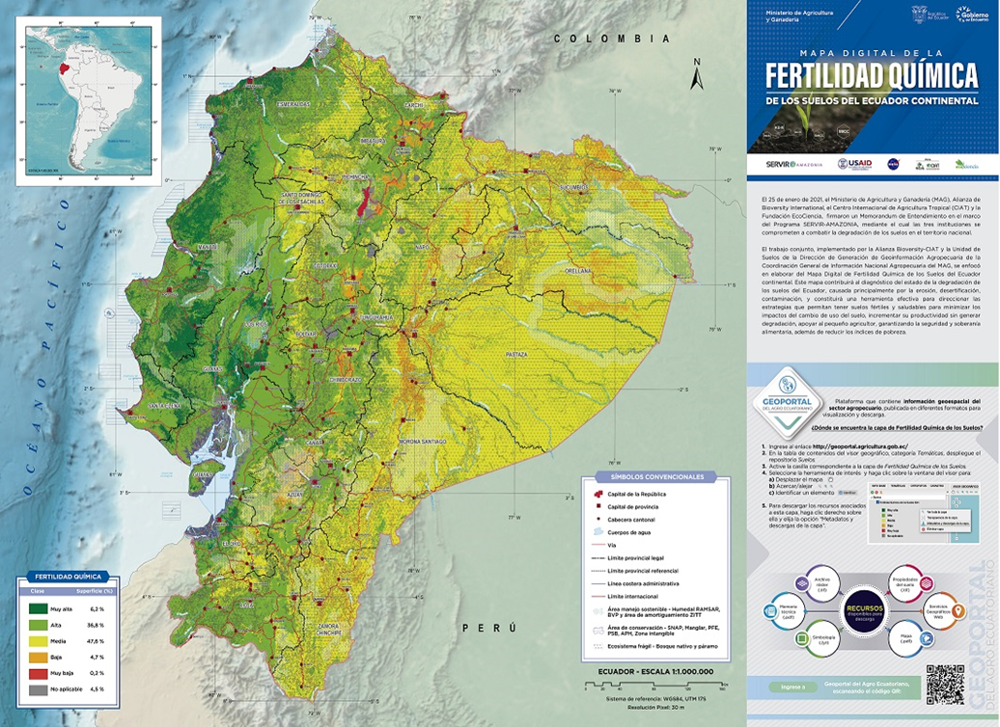
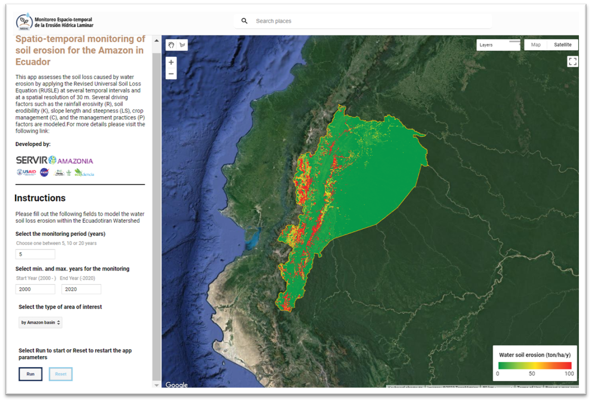

# Toma de decisiones a partir del DSM {style="color: #122562"}

Los mapas obtenidos permiten demostrar que el Mapeo Digital de Suelos es una herramienta muy acertada para la predicción de diferentes variables. Que tiene en cuenta muchos factores para tener una alta precisión en las predicciones. Con base en los resultados del DSM, se pueden tomar decisiones en diferentes áreas cómo:

## **Agricultura de precisión** {style="color: #122562"}

Se puede tener información detallada sobre las propiedades del suelo, como textura, contenido de materia orgánica, pH, capacidad de retención de agua, entre otros.La cuál es fundamental para la agricultura de precisión, permitiendo la optimización de los recursos al momento de realizar la fertilización, el riego y otras prácticas agrícolas. Que resultan en la maximización de los rendimientos, minimización de costos y del impacto ambiental.

{fig-align="center" width="579"}

## **Gestión de recursos naturales** {style="color: #122562"}

La gestión sostenible de los recursos naturales se puede realizar de una forma más eficiente al proporcionar datos sobre la distribución espacial de los suelos y de recursos como el agua. Esto es útil para la planificación del uso del suelo, la conservación de la biodiversidad, la gestión de cuencas hidrográficas y la prevención de la erosión del suelo.

{fig-align="center" width="698"}

## **Modelado de riesgos naturales** {style="color: #122562"}

El información detallada de los suelos que proporciona el DSM es fundamental para el modelado y la evaluación de riesgos naturales como inundaciones, deslizamientos de tierra, desertificación y degradación del suelo. Esto permite la implementación de medidas de mitigación y adaptación para reducir la vulnerabilidad de los riesgos.

{fig-align="center" width="611"}
