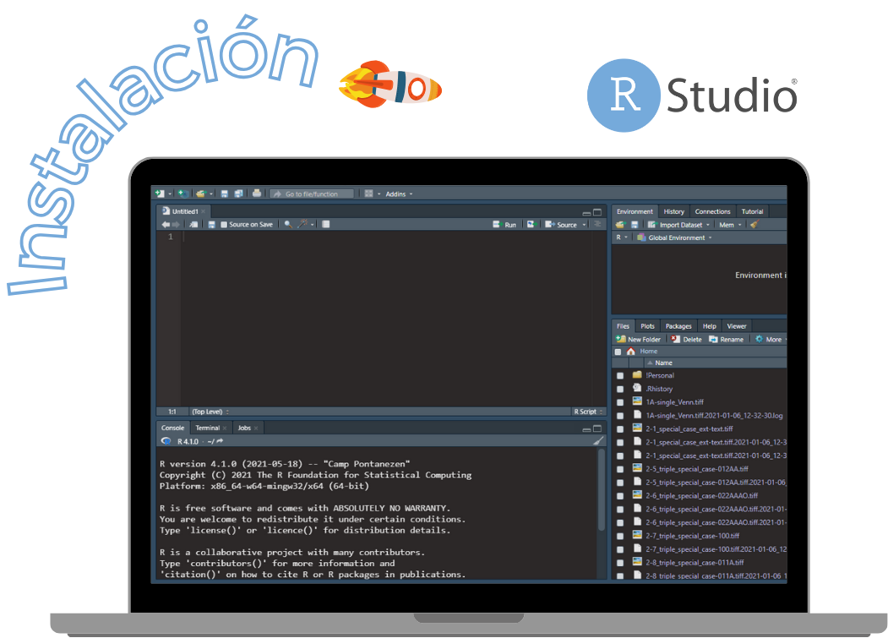
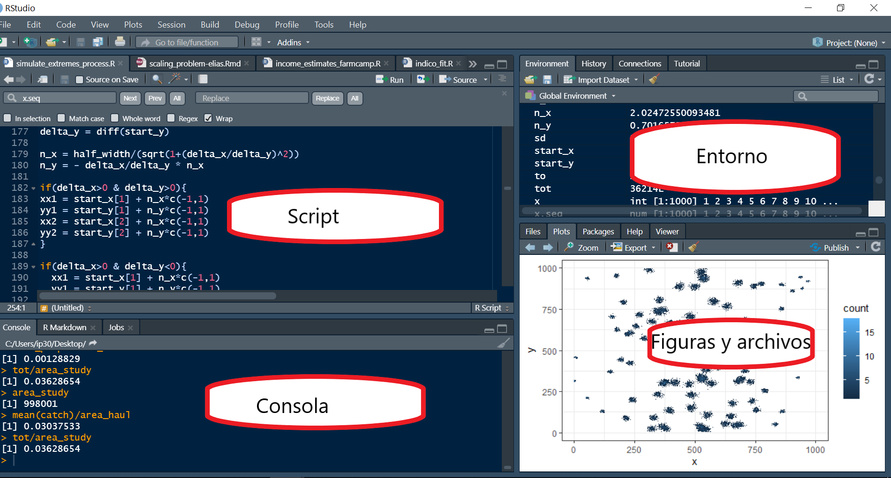
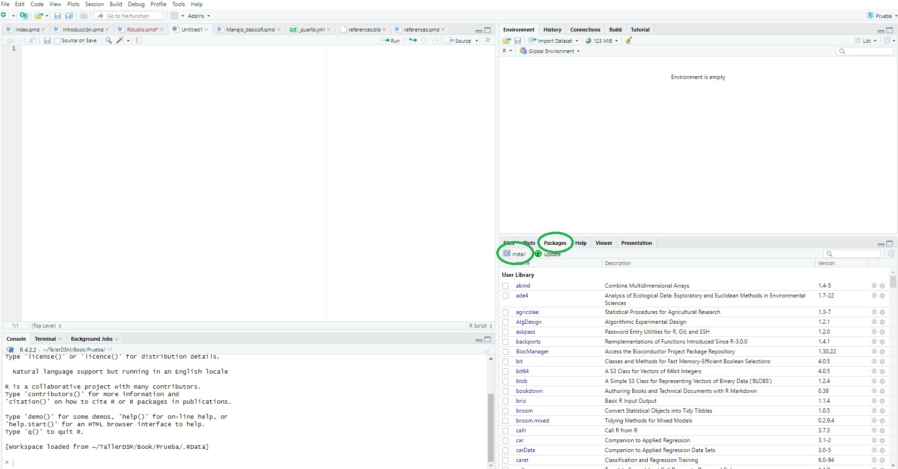
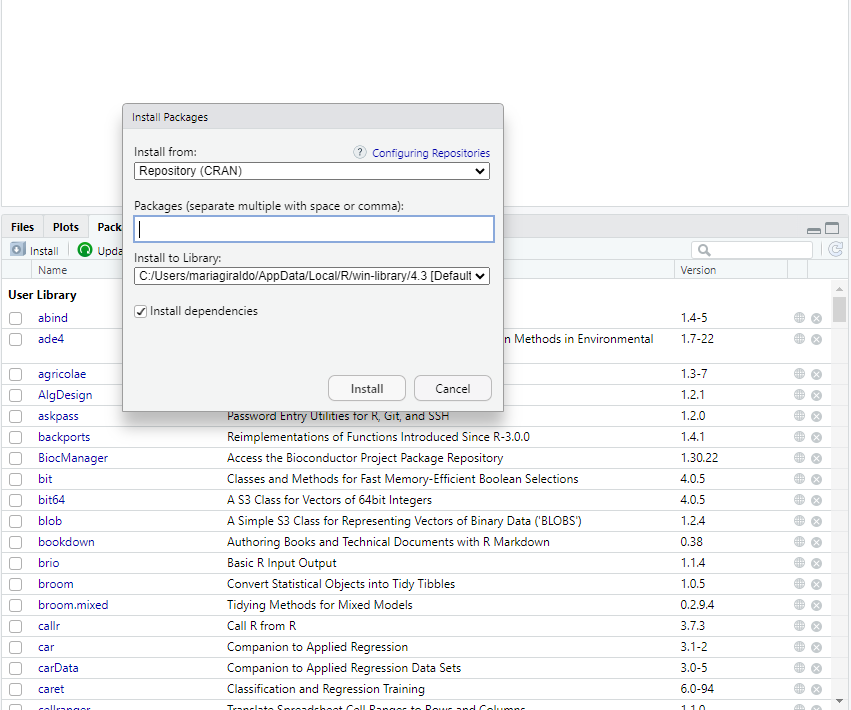
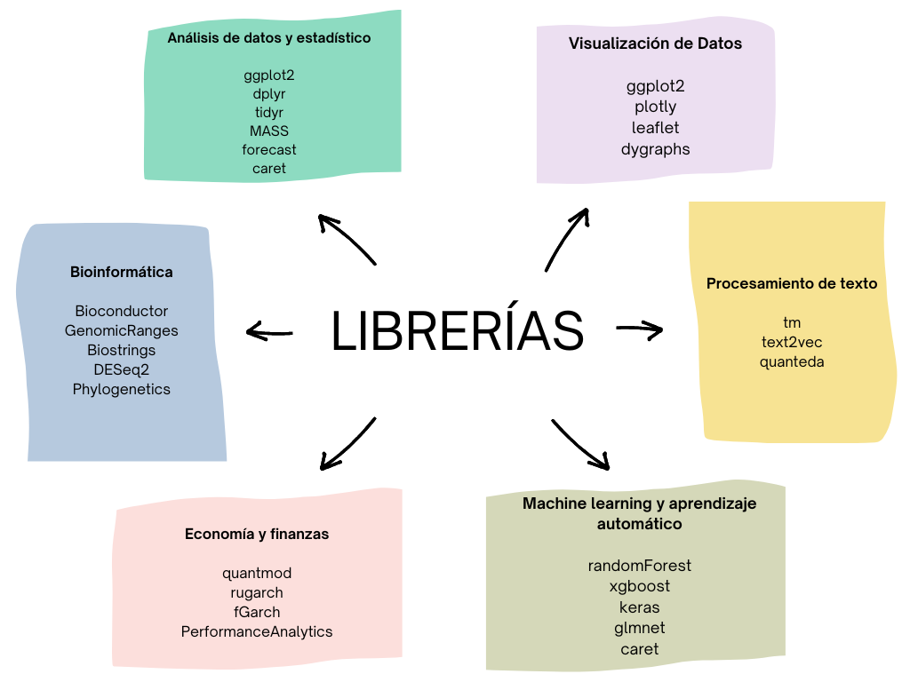
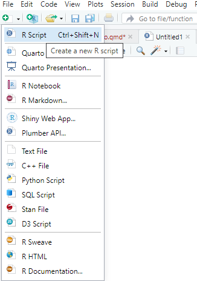
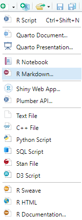
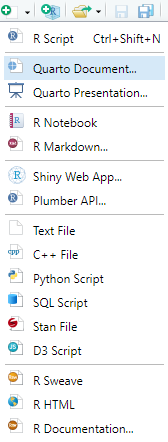
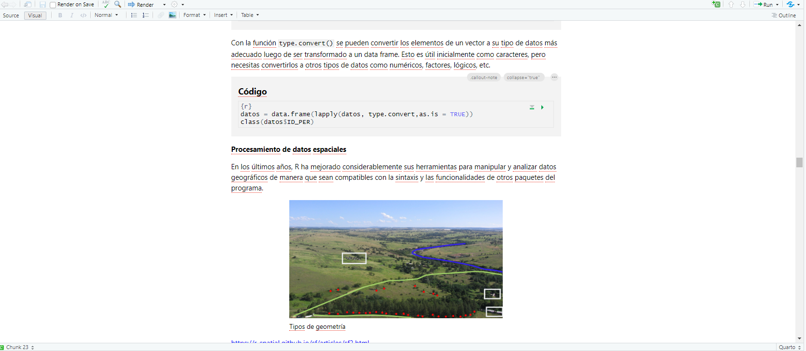

# R y un poco de su historia {style="color: #122562"}

R está basado en gran medida en el lenguaje S (un lenguaje de programación estadística), el cuál fue desarrollado en los años 70's por investigadores de Bell Laboratories en Nueva Jersey. A principios de los 90's fue publicado R por los desarrolladores Ross Ihaka y Robert Gentleman, de la Universidad de Auckland en Nueva Zelanda **(Jayo, 2020).**

Desde entonces, la popularidad de R ha crecido a pasos agigantados gracias a su inigualable flexibilidad para el análisis de datos y a sus potentes herramientas gráficas. Algo que caracteriza a R es que cualquier investigador puede contribuir con código en forma de paquetes (o bibliotecas), de modo que el resto del mundo tiene acceso rápido a los avances en estadística y ciencia de datos **(James et. al, 2021).**

## Generalidades de R {style="color: #122562"}

R es un entorno totalmente planificado y coherente con un lenguaje de programación interpretado, es decir, ejecuta instrucciones directamente sin tener que compilar previamente el programa en instrucciones en lenguaje de máquina. Este entorno se utiliza comúnmente para computación estadística y gráfica, ya que presenta una variedad de técnicas estadísticas (modelos lineales y no lineales, pruebas estadísticas clásicas, análisis de series temporales, clasificación, agrupamiento, etc.) y gráficos. **(James et. al, 2021).**

Su desarrollo actual está a cargo del equipo central de desarrollo de R. Es parte de un proyecto colaborativo y abierto donde los usuarios pueden publicar paquetes que amplían su configuración base (repositorio oficial de paquetes).

El lenguaje de programación de R puede realizar distintas tareas de análisis de datos que requieran una capacidad de computo intensiva (alto consumo de recursos como CPU y RAM). Además, puede integrarse con diferentes bases de datos y bibliotecas que facilitan su utilización. Dentro de las características más relevantas se encuentra:

-   Manejo y almacenamiento de datos.

-   Utilidades gráficas para la visualización de datos.

-   Un lenguaje de programación que incluye condicionales, bucles, funciones, utilidades para la entrada y salida de datos, etc.

-   Conjunto completo de funciones y paquetes estadísticos que satisfacen una amplia gama de necesidades estadísticas.

-   R se extienden más allá de las estadísticas tradicionales para abarcar el aprendizaje automático y el modelado predictivo.

-   Está en constante evolución, con nuevas características, paquetes, y capacidades que se agregan periódicamente.

-   Es muy versátil y se puede aplicar a un amplio espectro de dominios, incluyendo finanzas, cuidado de la salud, biología, ingeniería, ciencias sociales, y muchos más.

## Instalación {style="color: #122562"}

La manera de instalar R cambia dependiendo del sistema operativo que se utilice, pero todas tienen en común el uso de CRAN. CRAN es el *The Comprehensive R Archive Network*, una red en la que se archivan todas las versiones de R *base*, así como todos los paquetes para R que han pasado por un proceso de revisión riguroso, realizado por el *CRAN Team*, que se encarga de asegurar su correcto funcionamiento.

Para realizar la instalación de R y RStudio, entra [aquí.](https://www.icesi.edu.co/CRAN/)

{fig-alt="Instalación de R y Rstudio" fig-align="center" width="482"}

## Interfaz de RStudio {style="color: #122562"}

La interfaz de usuario de R no es muy amigable por lo que lo más común es usar R a través de RStudio. Rstudio es un entorno de desarrollo integrado (IDE) para R que facilita la escritura, ejecución y análisis de código en R. Ofrece una variedad de características y herramientas que mejoran la experiencia.

Esta interfaz proporciona una serie de herramientas que hacen que el trabajo con R sea más eficiente y productivo. Algunos de los elementos claves se pueden ver en la siguiente imagen:

[{fig-align="center" width="684"}](https://bookdown.org/paradinas_iosu/Prueba/rstudio.html)

**Editor de Script**: Es el área principal donde se puede escribir y editar el código. Ofrece características como resaltado de sintaxis, autocompletado y ayuda contextual.

**Consola de R**: En la consola se pueden escribir comandos directamente en R y ver los resultados de su ejecución. Es útil para probar rápidamente pequeños fragmentos de código.

**Paneles de Entorno**: Estos paneles muestran información sobre las variables, paquetes cargados, archivos y gráficos generados. Permite tener una visión general de los objetos creados.

**Plots y Visor de Paneles**: Estos paneles muestran gráficos generados por los scripts y documentos R Markdown. También se pueden ver los archivos HTML y PDF generados a partir de los documentos R Markdown en el visor de paneles.

En resumen, la interfaz de RStudio está diseñada para proporcionar un entorno de desarrollo completo y fácil de usar para trabajar con R, tanto para análisis de datos como para desarrollo de software estadístico.

## Diferencias de R con otros leguajes de programación {style="color: #122562"}

R se distingue de otros lenguajes de programación por varias características únicas que lo convierten en una herramienta particularmente poderosa para el análisis estadístico, la visualización de datos y el aprendizaje automático. (Wickham H, 2016) Entre las principales diferencias se encuentran:

-   **Enfoque en el análisis estadístico:** R fue diseñado específicamente para el análisis estadístico y la manipulación de datos. Su sintaxis y entorno están optimizados para estas tareas, lo que lo hace intuitivo para estadísticos, investigadores y analistas de datos. En contraste, lenguajes de programación de propósito general como Python o Java, aunque son capaces de análisis estadístico, requieren bibliotecas y paquetes adicionales para proporcionar un conjunto completo de herramientas estadísticas.

-   **Comunidad activa y colaborativa:** R cuenta con una comunidad global de usuarios y desarrolladores altamente activa y comprometida. Esta comunidad contribuye al desarrollo de nuevos paquetes, proporciona soporte a usuarios y comparte conocimientos a través de foros en línea, listas de correo y eventos. La comunidad de otros lenguajes de programación también puede ser activa, pero la comunidad de R se destaca por su enfoque específico en el análisis estadístico y la ciencia de datos.

-   **Amplia gama de paquetes estadísticos:** R cuenta con un ecosistema extenso de paquetes estadísticos desarrollados por la comunidad, que abarcan una amplia gama de métodos estadísticos, desde pruebas de hipótesis básicas hasta modelos estadísticos complejos. Estos paquetes proporcionan funciones especializadas para análisis de regresión, series temporales, minería de datos, modelado lineal y no lineal, entre muchos otros. Otros lenguajes de programación pueden tener bibliotecas estadísticas, pero la selección y profundidad de estas herramientas no suelen igualar la de R.

-   **Entorno de desarrollo interactivo:** R proporciona un entorno de desarrollo interactivo, conocido como RStudio, que facilita la exploración de datos, el desarrollo de código y la visualización de resultados. Este entorno permite escribir y ejecutar código R línea por línea, observar resultados inmediatamente y modificar el código de forma iterativa. Otros lenguajes de programación pueden tener entornos de desarrollo interactivos, pero la integración y las capacidades específicas de RStudio son únicas.

## Librerías {style="color: #122562"}

En R, las librerías (también conocidas como paquetes o bibliotecas) son conjuntos de funciones y datos que amplían las capacidades del lenguaje base. Estas bibliotecas se pueden instalar y cargar en una sesión de R para utilizar sus funciones y conjuntos de datos específicos. Para realizar la instalación de las diferentes librerías, se debe acceder a la casilla de "Install" que se ubica dentro del cuadrante de visualización como "Packages", allí se busca la librería y se procede a instalar.

{fig-align="center"}

{fig-align="center"}

Algunas de las librerías más usadas dentro de las diversas disciplinas que utilizan datos, se pueden ver en el siguiente gráfico:

{fig-align="center"}

**Análisis estadístico y gráfico:**

1.  **dplyr**: Es útil para realizar manipulaciones de datos de forma rápida y eficiente.
2.  **tidyr**: Para reorganizar y limpiar datos en formatos ordenados.
3.  **MASS**: Contiene una gran cantidad de funciones estadísticas y conjuntos de datos.
4.  **forecast**: Contiene herramientas para análisis y predicción de series temporales.
5.  **agricolae:** Esta librería presenta herramientas de análisis estadístico para la investigación agrícola.
6.  **stats:** Este paquete contiene funciones para cálculos estadísticos y generación de números aleatorios.

**Visualización de Datos:**

1.  **ggplot2**: Mencionado anteriormente, es una opción potente y flexible para crear gráficos estadísticos.
2.  **plotly**: Permite crear gráficos interactivos y dinámicos.
3.  **leaflet**: Especializado en la creación de mapas interactivos.
4.  **dygraphs**: Se usa para visualizar series temporales interactivas.

**Procesamiento de texto:**

1.  **tm**: Proporciona herramientas para trabajar con texto, incluyendo preprocesamiento, análisis y visualización.
2.  **text2vec**: Ofrece métodos eficientes para el análisis de texto a gran escala.
3.  **quanteda**: Especializada en análisis de texto cuantitativo.

**Machine learning y aprendizaje automático:**

1.  **randomForest**: Implementa el algoritmo de bosques aleatorios para la clasificación y regresión.
2.  **xgboost**: Implementa el algoritmo de refuerzo de gradiente extremo, que es popular en competiciones de ciencia de datos.
3.  **keras**: Interfaz para el paquete de aprendizaje profundo TensorFlow, para construir y entrenar redes neuronales.
4.  **glmnet**: Para ajustar modelos de regresión lineal y logística regularizados.
5.  **caret**: Proporciona una interfaz unificada para el entrenamiento y evaluación de modelos de aprendizaje automático.

**Economía y finanzas:**

1.  **quantmod**: Para descargar datos financieros de diversas fuentes y realizar análisis técnico.
2.  **rugarch**: Para modelar y pronosticar la volatilidad financiera utilizando modelos ARCH/GARCH.
3.  **fGarch**: Otro paquete para ajustar modelos ARCH/GARCH.
4.  **PerformanceAnalytics**: Para evaluar el rendimiento de carteras y estrategias de inversión.

**Bioinformática:**

1.  **Bioconductor**: Esencialmente una colección de paquetes de R diseñados para análisis y visualización de datos biológicos.
2.  **GenomicRanges**: Ayuda a trabajar con rangos genómicos y anotaciones.
3.  **Biostrings**: Ofrece herramientas para el manejo eficiente de secuencias biológicas.
4.  **DESeq2**: Para el análisis diferencial de expresión génica de datos de secuenciación de ARN.
5.  **Phylogenetics**: Una serie de paquetes para el análisis de filogenias y evolución.

## Como crear un archivo en R {style="color: #122562"}

**R Script**

Desde RStudio se puede crear un script, desde el ícono de **nuevo archivo** o con la combinación de teclas CTRL+Shift+N. Allí se abre una nueva pestaña donde se puede introducir la secuencia de código que luego se podrá ejecutar.

{fig-align="center"}

**R Markdown**

Otro tipo de archivo que se puede crear es un [R Markdown](https://rmarkdown.rstudio.com/), donde se puede procesar texto e incluir líneas de código.

{fig-align="center"}

**Quarto document**

[Quarto](https://quarto.org/) es un sistema moderno de creación de documentos dinámicos, informes, presentaciones, libros, sitios web y más. Dentro de este documento se pueden crear R Markdown, R Notebook, R script y archivos de Word, PDF, HTML y otros. Brindando un entorno más visual y un manejo más intuitivo, facilitando la preparación de los documentos.

{fig-align="center"}

{fig-align="center"}
