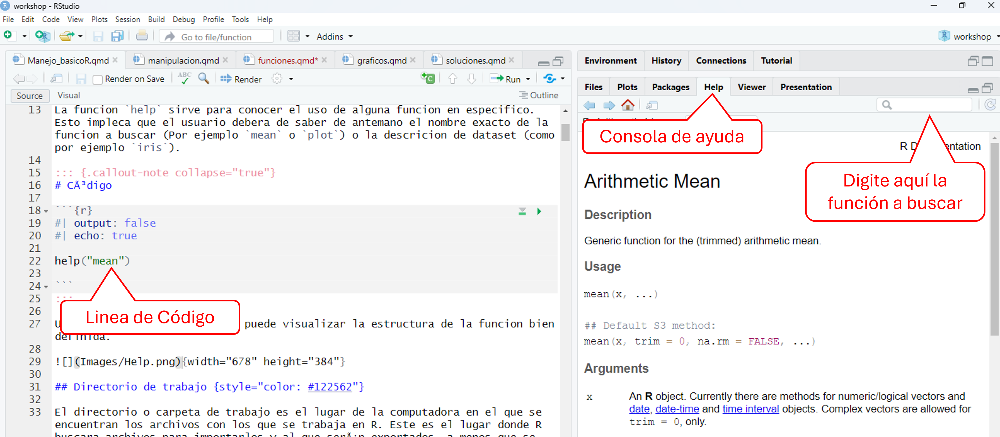

# Manejo básico de R {style="color: #122562"}

Manejo de diferentes tipos de datos, operadores aritméticos y lógicos, estructuras de control y funciones.

## Documentación {style="color: #122562"}

R cuenta con extensa documentación disponible en línea, accesible a través de la página de [posit.co](https://www.rstudio.com/resources/books/). En esta página encontrarás una variedad de libros que explorán los diferentes usos y herramientas que ofrece el programa.

## Directorio de trabajo {style="color: #122562"}

El directorio o carpeta de trabajo es el lugar de la computadora en el que se encuentran los archivos con los que se trabaja en R. Este es el lugar donde R buscará archivos para importarlos y al que serán exportados, a menos que se indique otra cosa.

Para saber cuál es el directorio de trabajo que está en uso se utiliza la función `getwd()`.

`"/<Directorio_de_trabajo>/"`

Se mostrará en la consola la ruta del directorio que está usando R.

Note que para la selección del directorio de trabajo se usa la barra `"/"` y no la contrabarra `"\"` (Caracter normalmente utilizado en Windows), para la selección de la ruta de trabajo.

Se puede cambiar el directorio de trabajo usando la función `setwd("/<Directorio_de_trabajo_nuevo>/")`, dando como argumento la ruta del directorio que se quiere usar.

*Nota: Preferiblemente se recomienda usar una dirección de trabajo donde esten almacenados los **Datasets** a ser implementados en el presente proyecto.*

Si el directorio de trabajo asignado contiene todos los conjuntos de datos con los que vas a trabajar, cada vez que desees cargar alguno de estos, aparecerán listados según la funcin que se esté implementando.

## Comandos especiales en R {style="color: #122562"}

**En un `code chunk` o script de R, se trabajan los scripts y los `code chunk` de R y los Quarto documents. En esta sección en lugar de guardar y ejecutar los códigos, es posible usar alguna de las siguientes combinaciones de teclas:**

*Tabla 1. Atajos de R mediante el teclado.*

| Combinacion              | Accion                                                                                |
|--------------------------|---------------------------------------------------------------------------------------|
| `Ctrl + Z`               | Deshacer el último movimiento que se hizo                                             |
| `Ctrl + Shift + Z`       | Rehacer el último movimiento que se deshizo                                           |
| `Ctrl + Enter`           | Ejecuta la línea de código sobre la que se encuentra el cursor                        |
| `Ctrl + Shift + Enter`   | Ejecuta la siguiente línea de código (Solo para Quarto documents)                     |
| `Ctrl + Shift + Alt + P` | Ejecuta todo el código (Solo para Quarto documents)                                   |
| `Ctrl + Alt + I`         | Agregar una línea de código (Solo para Quarto documents)                              |
| `Ctrl + Alt + R`         | Ejecuta todo el script (Solo para R script)                                           |
| `Ctrl + Alt + B`         | Ejecuta el script desde el inicio hasta la línea donde se encuentra ubicado el cursor |
| `Ctrl + Alt + E`         | Ejecuta el script desde la línea donde se encuentra ubicado el cursor hasta el final  |
| `Ctrl + Shift + C`       | Para comentar (`#`) o descomentar una linea                                           |

::: {.callout-note appareance="simple"}
# Crea un comentario

Cuando se genera un comentario en Rstudio aparecerá `#` delante de la línea de código seleccionada (`#Esto es un comentario`) y esta no será ejecutada. Para poder ejecutarla se debe de descomentar la línea y la ejecución de esta podrá observarse en la ventana de la consola.
:::

Mediante la implementación de estos comandos se hace más rápido observar los resultados del Script o Quarto document y por lo tanto, el ciclo de trabajo se vuelve más eficiente.

## Uso de la ayuda con las funciones `help` y `help.search` {style="color: #122562"}

La función `help()` sirve para conocer el uso de alguna función en específico. Esto implica que el usuario deberá saber de antemano el nombre exacto de la función a buscar (Por ejemplo `mean` o `plot`) o la descripción de dataset (como por ejemplo `iris`).

`help(mean)`

Una vez se usa este código se puede visualizar la estructura de la función bien definida como se observa en la siguiente figura.

{#fig-help fig-align="center"}

En la imagen se puede observar que la función help puede ser usada directamente desde la consola de comandos del documento quarto, o desde la opción help ubicada al lado derecho del editor. En este el usuario deberá digitar el nombre de la función y así mismo la descripción de esta aparecerá.

La funcion `help.search` es usada cuando no se conoce si existe alguna función o dataset en particular según sea el objetivo de nuestra investigación. Por ejemplo si el tema de interés es series de tiempo, entonces se podrá usar la palabra clave "Time series".

`help.search("Time series")`

El resultado de esto aparecerá automáticamente en la pestaña de `help` de la consola de RStudio. En esta se observará todos los paquetes y funciones que poseen información relacionada al tema de busqueda, junto con algunos ejemplos hacerca de su aplicabilidad.

## Tipos de datos {style="color: #122562"}

En R se manejan varios tipos de datos básicos, incluyendo:

*Tabla 2. Descripción de los tipos de datos manejados en R.*

| Tipo            | Ejemplo              | Nombre en ingles | Descripcion                                                                                                                                                |
|-----------------|----------------------|------------------|------------------------------------------------------------------------------------------------------------------------------------------------------------|
| Entero          | 1, 2, 3, ...         | integer          | Numero enteros sin una parte decimal o fraccionaria                                                                                                        |
| Numérico        | 1.3, 1.35, 1.36, ... | Numeric          | Datos numéricos que poseen parte decimal o fraccionaria                                                                                                    |
| Cadena de texto | "uno"                | character        | El tipo **character** representa texto y es fácil reconocerlo por que el dato esta siempre rodeado de comillas, simples (`' '`) o dobles (`" "`)           |
| Factor          | uno                  | factor           | Un factor es un tipo de dato específico en R. Puede ser descrito como un dato numérico representado por una etiqueta                                       |
| Lógico          | TRUE                 | logical          | Los datos de tipo lógico solo poseen dos valores disponibles: verdadero (`TRUE`) y falso (`FALSE`). Estos representan si una condicion o estado se cumple. |
| Perdido         | `NA`                 | NA               | En R se usa `NA` para representar datos perdidos                                                                                                           |
| Vacío           | `NULL`               | null             | `NULL` respresenta la ausencia de datos                                                                                                                    |

## Operadores lógicos {style="color: #122562"}

Los operadores son los símbolos que le indican a R que debe realizar una tarea. Combinando datos y operadores es que se logra que R haga su trabajo. Existen operadores específicos para cada tipo de tarea. Los tipos de operadores principales son los siguientes:

### Aritméticos

*Tabla 3. Tipos de operadores aritméticos utilizados en R.*

| Operador | Operacion       | Ejemplo | Resultado |
|----------|-----------------|---------|-----------|
| `+`      | Suma            | `5 + 3` | 8         |
| `-`      | Resta           | `5 - 3` | 2         |
| `*`      | Multiplicación  | `5 * 3` | 18        |
| `/`      | División        | `5 / 3` | 1.666667  |
| `^`      | Potencia        | `5 ^ 3` | 125       |
| `%%`     | División entera | `5%%3`  | 2         |

### Relacionales

Los operadores relacionales en R se utilizan para comparar dos valores y evaluar si una relación entre ellos es verdadera o falsa.

*Tabla 4. Operadores relacionales utilizados en R.*

| Operador | Comparación           | Ejemplo  | Resultado |
|----------|-----------------------|----------|-----------|
| `<`      | Menor que             | `5 < 3`  | `FALSE`   |
| `<=`     | Menor o igual que     | `5 <= 3` | `FALSE`   |
| `>`      | Mayor que             | `5 > 3`  | `TRUE`    |
| `>=`     | Mayor o igual que     | `5 >= 3` | `TRUE`    |
| `==`     | Exactamente igual que | `5 == 3` | `FALSE`   |
| `!=`     | No es igual que       | `5 != 3` | `TRUE`    |

## Asignación e impresión de variables {style="color: #122562"}

En R, se utiliza una sintaxis similar a la de otros lenguajes de programación. La asignación de variables se puede realizar con `<-` o con `=`. A pesar de que ambos métodos son válidos, es más común utilizar `<-` para la asignación de variables, ya que de esta manera se evitan confusiones con la implementación de los operadores matemáticos.

::: {.callout-note collapse="true"}
## Asignación

En R puedes asignar una variables de tipo entero, numerico y de texto usando la notación de flecha `<-` o el simbolo de `=`.

```{r}
#| output: false
#| echo: true

a = 5

b <- 7
```
:::

Para visualizar los valores guardados, puedes colocar el nombre de la variable o hacer uso de la función `print()`.

::: {.callout-note collapse="true"}
## Imprimir el dato

```{r}
#| output: true
#| echo: true

print(a)

b
```
:::

*Nota: Otro atajo que va a facilitar este proceso es utilizar* `Alt + -`*, con este comando se inserta la notación de flecha (*`<-`*) de asignacion de variables rápidamente.*

## Estructura de datos {style="color: #122562"}

### Vectores {#sec-Vectores}

Un vector es una colección de uno o más objetos al mismo tipo.

Existen varias formas de crear un vector en R y esto dependera del operador implementado. Un ejemplo de estos es mediante la implementacion del operador `:` el cual permite la creación de secuencias de numeros enteros fácil y rápida.

::: {.callout-note collapse="true"}
## Vectores

```{r}
#| output: true

0:10 # Secuencia de numeros del 0 al 10

10:-5 # Secuencia del 10 al -5

```
:::

A menudo se desea realizar operaciones o comparaciones entre múltiples datos del mismo tipo. Para ello, se utilizan los vectores, que son conjuntos ordenados de elementos del mismo tipo.

::: {.callout-note collapse="true"}
## Operaciones con vectores

```{r}
#| output: true
#| echo: true

x1 <- 1:10
x2 <- 11:20

x3 <- x1 + x2
x3
```
:::

Hay que tener cuidado en como se escribe el codigo al momento de crear un vector, sobre todo cuando estamos realizando operaciones entre los mismos.

`0:10 -1`

no es lo mimo que

`0:(10 - 1)`

**Escribe este código y comenta ¿cuál es la diferencia entre ambas operaciones?**

Varios vectores o elementos individuales se pueden concatenar "`c()`" para crear un nuevo vector y asignarlos dentro de una variable. Estructuras de datos más complicados consisten en la unión de múltiples vectores.

::: {.callout-note collapse="true"}
## Vector con función concatenar

```{r}
#| output: false
#| echo: true

numeros <-  c(1, 2, 3, 4, 5)
letras <- c("a", "b", "c", "d", "e")

```
:::

::: {.callout-note collapse="true"}
## Concatenación de vectores

```{r}
#| output: false
#| echo: true

numeros_letras <- c(numeros, letras)
```
:::

Al concatenar vectores de diferente tipo, R reasigna los elementos a la clase apropiada. Por ejemplo al concatenar elementos numéricos con caracteres, R convierte a todos en character y no a la inversa, ya que es la opción que no se presta para ambigüedades.

La clase de cada uno de los elementos se puede verificar usando la funcion `class()`

::: {.callout-note collapse="true"}
## Clase

```{r}
#| output: true
#| echo: true  

class(numeros)
class(letras)
class(numeros_letras)
```
:::

Las clases posibles de los vectores son 5: `integer`, `numeric`, `character`, `logical` y `complex`.

::: {.callout-note collapse="true"}
## Clases de vectores

```{r}
#| output: true
#| echo: true

x <- 1:5
class(x)
```

```{r}
#| output: true
#| echo: true

x <- seq(11, 15, by = 0.1)
class(x)
```

```{r}
#| output: true
#| echo: true

x <- c("Javier", "Camila", "Andres")
class(x)
```

```{r}
#| output: true
#| echo: true

x <- 1:3 > 1.34
class(x)
```

```{r}
#| output: true
#| echo: true

x <- 1:4 + 1i
class(x)
```
:::

Los corchetes o paréntesis rectos se utilizan para especificar elementos de los vectores. Si se quiere acceder a uno o más valores de un vector, se utilizan los índices entre paréntesis rectos `[]`. El valor que se ponga dentro indica la posición del valor requerido en el vector. Es decir `x[i]` indica en iesimo valor de x.

::: {.callout-note collapse="true"}
# Posición

```{r}
#| echo: true

numeros[3] #Muestra el tercer elemento del vector "numeros"

letras[2:4] #Muestra los elementos en las posiciones del 2 a 4 del vector "letras"

```
:::

Una función práctica es `rep`, la cuál sirve para repetir n veces un valor o un vector.

::: {.callout-note collapse="true"}
# Repetir

```{r}
#| echo: true

rep(c("Javier", "Camila", "Andres"), 3)
```

```{r}
#| echo: true

rep(c("Javier", "Camila", "Andres"), each = 3)
```
:::

La funcion `seq`, sirve para generar secuencias de valores con mayor flexibilidad que el operador `:`. Por ejemplo, para generar secuencias de valores entre 0 y 1, cuyos valores consecutivos tengan una diferencia de 0.05.

::: {.callout-note collapse="true"}
# Secuencia

```{r}

#| echo: true

seq(0, 1, by = 0.05)
```

```{r}

#| echo: true

seq(0, 1, len = 21)
```
:::

### Matrices

Las matrices pueden ser descritas como vectores multidimensionales. Al igual que un vector, pueden contener datos de un solo tipo, pero además de largo tienen dimensiones.

Típicamente se describe una **matriz A** como una matriz $m$ X $n$; en la cual **A** va a tener exactamente $m$ filas y $n$ columnas.

Una manera simple de crear una matriz, es utilizando la función `matrix()`. Esta función acepta dos argumentos principales para su funcionamiento, `nrow` y `ncol`. Con ellos se especifica el número de renglones y columnas que tendrá la matríz.

::: {.callout-note collapse="true"}
# Matriz

```{r}
#| output: false
#| echo: true

#Matrix de 4 filas y 4 columnas, siendo todos los espacios de la matriz 0
a <-  matrix(0, nrow=4, ncol=4)

```
:::

Nota que, si se crea un vector numérico dentro de una matríz sin especificar las columnas y las filas, este organizará todos los datos en una única columna.

::: {.callout-note collapse="true"}
# Matriz

```{r}

# Matriz sin especificar columnas ni renglones
matrix(1:6)

```
:::

::: {.callout-note collapse="true"}
# Matriz

```{r}

# Matriz tres renglones dos columnas

matrix(1:6, nrow = 3, ncol = 2)
```
:::

Otra forma de crear matrices es mediante el uso de las funciones `rbind` y `cbind`. Estas se usan principalmente cuando se poseen multiples vectores y se desea crear una matíz rápidamente mediante la unión de estos.

::: {.callout-note collapse="true"}
# cbind

```{r}

#| echo: true

cbind(1:5, 6:10)

```
:::

::: {.callout-note collapse="true"}
# rbind

```{r}

#| echo: true

rbind(1:5, 6:10)
```
:::

Al realizar la creación de matrices se debe de tener en cuenta el tamaño de las mismas. Es decir, si se usa `cbind` o `rbind` para crear una matriz, estas deben de poseer el mismo número de filas o columnas.

**Indices de las matrices**

Al poseer dos dimensiones, se deben dar 2 indices para la consulta de los objetos dentro de esta, primero filas, luego columnas. Las reglas son las mismas que para los vectores, en los cuales usamos los corchetes para especificar el elemento que se desea buscar (`x['filas', 'columnas']`).

::: {.callout-note collapse="true"}
## Indices

```{r}

#| echo: true

# Creacion de la matriz y asignacion dentro del elemento m1
m1 <- matrix(1:12, nrow = 4, ncol = 3)
```

```{r}
# Visualizacion de la segunda fila

m1[2,]
```

```{r}
# Visualizacion de la segunda fila

m1[, 3]
```

```{r}
# Visualizacion de dato en la segunda fila
# tercera columna
m1[2, 3]
```
:::

Para sobreescribir elementos particulares, o columnas o filas completas, se necesita identificar el elemento a ser remplazado y luego de esto asignarle nuevos valores. Estos nuevos elementos pueden ser un único valor o un vector con la misma longitud de los elementos a ser remplazados.

```{r}
#| output: false
#| echo: true

# Creacion de la matriz nueva
m2 <- matrix(1:12, 4, 3) 
```

```{r}
#| output: true
#| echo: true

# Remplazo con un unico valor

m2[2,3] <- 999

```

::: {.callout-note collapse="true"}
## Solución

```{r}
#| output: true
#| echo: true

m2
```
:::

```{r}
#| output: true
#| echo: true

# Remplazo con mas de un valor
m2[c(1,3), c(1,3)] <- c(-7, 7)

```

::: {.callout-note collapse="true"}
## Solución

```{r}
#| output: true
#| echo: true

m2
```
:::

```{r}
#| output: false
#| echo: false

m2 <- m1

```

### Operaciones con matrices

Las operaciones más simples (suma, resta, multiplicación) se realizan con los mismos criterios que con vectores.

::: {.callout-note collapse="true"}
## Operaciones

```{r}
#| output: false

m1 * 2
m1 + 1
m1 + m1
m1 - m1
exp(m1)
```
:::

Para realizar multiplicación entre matrices en R se usa el operador `*`, hay que usar un operador especial (`%*%`). De otra manera, en vez de hacer esta operación, R simplemente realiza una multiplicacion "**elemento por elemento**"

::: {.callout-note collapse="true"}
## Multiplicación

```{r}
#| output: true
#| echo: true

m3 <- matrix(1:9, 3, 3)

m1 %*% m3
```
:::

### Data frames y listas

Hasta ahora se han presentado los vectores y matrices como las estructuras más sencillas para organizar la información dentro de R. Una restricción importante es que dichos objetos requieren que todos los elementos que los componen deben ser de la misma clase/tipo.

En R la funcion `list` tiene una estructura que supera esta limitación. Por otro lado, la funcion `data.frame` es un tipo particular de lista, pensada para trabajar con tablas de datos, de forma que son muy similares a las matrices.

#### Data frame

Los data frames son la forma más natural de presentar un set de datos con una colección de observaciones de una o más variables. como las listas, los data frames no presentan restricciones en el tipo de datos de cada una de las variables; Este puede almacenar datos numéricos, factores etc. Los data frames pueden considerarse un tipo particular de lista en la que todos los objetos poseen la misma cantidad de elementos, pero cada uno puede ser de una clase distinta. Esto los hace muy útiles para almacenar datos heterogéneos de forma estructurada.

Para la creación de un data frame desde cero, la función `data.frame` es una de las opciones de uso más frecuentes. Esta funciona de manera muy similar a la funcion `list`.

```{r}

d <- data.frame(nombres = c("Carlos", "Juan", "Jose", "Pedro"),
                edades = seq(20,35,by = 5))

```

::: {.callout-note collapse="true"}
# Output Data frame

```{r}
d
```
:::

De la misma manera que la lista se pueden usar las funciones `str()` para conocer la estructura del data frame y el operador`$` para llamar una columna en especifico del data frame.

::: {.callout-note collapse="true"}
# Summary

La funcion `summary()` es muy util para ver los data frames de manera resumida

```{r}
summary(d)
```
:::

Adicionalmente, es bastante común transformar matrices en data frames, utiilizando la funcion `as.data.frame`.

::: {.callout-note collapse="true"}
## Coversión matrix a data frame

```{r}
#| output: true
#| echo: true

as.data.frame(m1)
```
:::

También se pueden realizar consultas dentro del dataset haciendo uso de los operadores logicos

::: {.callout-note collapse="true"}
## Consultando el data frame

```{r}
d == "Carlos"
```
:::

Así mismo realizar consultas simples para mostrar la información que solamente contenga los datos requeridos.

::: {.callout-note collapse="true"}
## Consulta de información

```{r}
#| output: true
#| echo: true

d[d=="Carlos",]

d[d$edades > 30, ]
```
:::

#### Listas

Una lista puede pensarse como un vector que contiene varios objetos, donde cada objeto puede ser de un tipo/clase diferente. Además los componentes de la lista no tienen por que tener la misma cantidad de elementos.

```{r}
#| output: false
#| echo: true

# En este caso lista posee un vector tipo caracter y otro numerico
# el primero posee tres elementos y el segundo tiene 20
lista <- list(rep("Casa", 3), matrix(1:4,2,2), c(TRUE,FALSE,FALSE, TRUE)) 

```

::: {.callout-note collapse="true"}
# Output listas

```{r}
lista
```
:::

Para acceder al contenido de cada elemento dentro de una lista se utilizan los corchetes dobles (`[[i]]`). De esta manera se exploran los elementos de la lista de una manera más específica.

::: {.callout-note collapse="true"}
# Inspeccion

```{r}
lista[[1]]

lista[[2]]

lista[[3]]
```
:::

Para llamar varios elementos dentro de una lista se deben de usar los corchetes simples

::: {.callout-note collapse="true"}
# Inspeccion

```{r}
lista[1:2]
```
:::

Igualmente se puede conocer la información disponible y la clase de cada elemento mediante el uso de la función `str()`.

Usando los `[[]]` tambien podemos realizar modificaciones dentro de la lista.

::: {.callout-note collapse="true"}
# Modificar lista

```{r}
#| output: false
#| echo: true

lista[[2]] <- 1:20 

lista
```
:::

Se puede realizar la asignación de nombres de los objetos dentro de una lista en el momento en el que esta es creada.

```{r}
#| output: true
#| echo: true

lista2 <- list(nombre = rep("carlos",3), numeros = 1:20, logico = c(TRUE,FALSE,FALSE, TRUE))
```

::: {.callout-note collapse="true"}
## Listas con combres asignados

```{r}
lista2
```
:::

Tambien se pueden crear listas y asignar nombres a las mismas mediante el operador `$`

::: {.callout-note collapse="true"}
Asignar nombres

```{r}
#| output: false
#| echo: false

lista2 <- NULL

lista2
```

```{r}
#| output: true
#| echo: true

lista2$nombre <- rep("carlos",3)
lista2$numeros <- 1:20
lista2$logico <- c(TRUE,FALSE,FALSE, TRUE)

lista2
```

Una vez que cada elemento dentro de la lista está nombrado, simplemente se usa el operador `$` para referirse a los mismos usando los nombres asignados.

```{r}
lista2$nombre
```
:::

Si se desea realizar la modificación de los nombres de cada una de las listas creadas, se usa la función `names()`.

::: {.callout-note collapse="true"}
## Nombres

```{r}
#| output: false
#| echo: true

names(lista2) <- c('letras', 'numeros', 'otro')

```
:::

Si solo se desea cambiar uno de los nombres de las listas se superponen corchetes despues de la funcion `names()`, indicando la lista cuyo nombre se quiere cambiar.

::: {.callout-note collapse="true"}
# Nombres

```{r}
#| output: false
#| echo: true

names(lista2)[1] <- "nombres"
```
:::

## Ejercicio de recopilación {style="color: #122562"}

Ahora integremos los conceptos vistos mediante los siguientes ejercicios:

1.  Usa R para verificar el resultado de la siguiente operacion

$$
\frac{6a + 42}{3^{4.2-3.62}} = 29.50556
$$ Cuando a = 2.3

2.  Crea y almacena una secuencia de números desde 5 hasta -11, incrementando en 0.3, hasta llegar al número deseado.

*Nota: Puedes realizar esto mediante el uso de la funcion* `seq()`. *Si tienes dudas sobre el uso de esta revisa la seccion* @sec-Vectores*.* *También puedes buscar como usar esta función mediante* `help()`

3.  Almacena los siguientes valores en un vector: 6, 9, 7, 3, 6,7, 9, 6, 3, 6, 6, 7, 1, 9, 1. Identifica entre estos los siguientes elementos

-   Aquellos valores iguales a 6
-   Valores que sean mayores a 6
-   Valores que sean menores a 6 + 2
-   valores que no sean iguales a 6

4.  Crea una lista que tenga las siguientes características:

-   20 números espaciados uniformemente entre -4 y 4
-   Una matríz con 3 filas y 3 columnas de vectores lógicos (FALSE, TRUE, TRUE, TRUE, FALSE, TRUE, TRUE, FALSE, FALSE).
-   Un vector de tipo caracter, con dos cadenas de texto "don" y "quijote"
-   Un vector de tipo factor conteniendo las observaciones ("LOW","MED","LOW","MED","MED","HIGH")

*Nota: Para la creación de un vector de factor revisa la función* `factor()` *en la pestana de* `help`

5.  Crea y almacena el siguiente data frame:

| Persona | Sexo | Carácter |
|---------|------|----------|
| Stan    | M    | High     |
| Fracine | F    | Med      |
| Steve   | M    | Low      |
| Roger   | M    | High     |
| Hayley  | F    | Med      |
| Klaus   | M    | Med      |

Para este data frame considera lo siguiente:

-   Las variables de persona debe de ser tipo caracter

-   La variable de sexo y carácter, deben de ser factores.

-   El primero con niveles F y M y el segundo con niveles Lo, Med y High.
