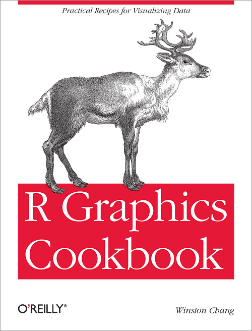

# Gráficos {style="color: #122562"}

La creación de gráficos en R es esencial para la visualización de datos, lo que permite una comprensión y un análisis más sencillos de la información. Para satisfacer estas necesidades, los gráficos exploratorios en R son particularmente útiles. Para una guía más completa sobre los tipos de gráficos que se pueden crear en R y cómo hacerlo, puede consultar el libro [R Graphic Cookbook](https://r-graphics.org/). Este recurso proporciona información detallada sobre las posibilidades en R y cómo implementarlas.

{fig-align="center" width="234"}

## Plot() {style="color: #122562"}

La función `plot()` permite observar de manera general el data frame con el cuál se está trabajando y es una de las más usadas para generar gráficos en R. Esta es una función genérica, por lo que se puede usar para representar gráficamente distinntos tipos de datos.

::: {.callout-note collapse="true"}
## Ejemplo

```{r}
#| output: true
#| echo: true

plot(iris)

```

En el gráfico anterior no se especificó que se quería graficar, por lo tanto la función retorna un gráfico donde se relacionan todas las variables del data frame entre sí.
:::

**Scatterplot**

Mediante la asignación de variables en la funcion `plot()` se pueden generar distintos tipos de gráficos, uno de estos son los diagramas de dispersión (*Scatterplot*), los cuáles se usan para examinar la relación entre dos variables continuas.

La selección o asignación de variables a graficar puede realizarse mediante el uso de los operadores `$` o doble corchetes `[[]]`.

::: {.callout-note collapse="true"}
## Ejemplo

```{r}
plot(iris[[1]], iris[[2]])
```

```{r}
plot(iris$Sepal.Length, iris$Sepal.Width)
```
:::

**Serie temporal**

Igualmente según el tipo de información con la que se este trabjando así mismo será el tipo de gráfico que será generado por esta función. Si se tienen datos con mediciones realizadas en determinados momentos, el gráfico creado con `plot()` será una serie temporal.

::: {.callout-note collapse="true"}
## Ejemplo

```{r}
plot(UKDriverDeaths)

```
:::

Se pueden realizar modificaciones al tipo de gráfico a implementar en la función `plot()` según el tipo de información con la que se está trabajando. Existen varios métodos de ajuste para adaptar los gráficos a necesidades específicas, este proceso se puede realizar mediante el uso del parametro `type` el cuál permite graficar de distintas formas.

| Tipo de plot | Descripción                             |
|--------------|-----------------------------------------|
| p            | Crea un grafico de puntos (por defecto) |
| l            | Gráfico de lineas                       |
| b            | Gráfico de lineas y puntos              |
| o            | Gráfico de lineas y putos superpuestos  |
| s            | Gráfico de escaleras                    |
| h            | Histograma como plot                    |
| n            | Ningún plot                             |

::: {.callout-note collapse="true"}
## Ejemplo

```{r}
#| output: true
#| echo: true

plot(UKDriverDeaths, type = "p")

```

```{r}
#| output: true
#| echo: true

plot(UKDriverDeaths, type = "o")

```
:::

**Diagramas de barras**

Los gráficos de barra se usan para comparar datos categóricos, o contar las ocurrencias de categorías específicas. Al usar la funcion `plot()` para graficar variables tipo factor, se obtendrá un diagrama de barras, con las frecuencias de cada una de las categorias dentro de este.

::: {.callout-note collapse="true"}
## Ejemplo

```{r}
#| output: true
#| echo: true

plot(iris$Species)

```
:::

Otra método para generar un diagrama de barras es mediante la implementación de la función `barplot()`, la cuál brinda un resultado similar que con la función anterior.

::: {.callout-note collapse="true"}
## Ejemplo

```{r}
#| output: true
#| echo: true

barplot(table(iris$Species))
```
:::

**Boxplot**

Se pueden combinar vectores numéricos con factores, usando la función `plot()` también se puede generar un diagrama de cajas.

Son útiles para mostrar la distribución de una variable y comparar la distribución entre grupos. La caja representa el rango intercuartil (IQR) de los datos, mientras que los bigotes representan los valores máximos y mínimos no atípicos.

::: {.callout-note collapse="true"}
## Ejemplo

```{r}
plot(iris$Species, iris$Sepal.Length)
```
:::

La funcion `boxplot()` es una alternativa para la visualizacion de diagramas de cajas.

::: {.callout-note collapse="true"}
## Ejemplo

```{r}
boxplot(Sepal.Length ~ Species, data = iris)
```
:::

A diferencia de la funcion `plot()` con `boxplot()` también se pueden generar diagramas de cajas de un sólo vector, siendo este netamente numérico.

::: {.callout-note collapse="true"}
## Ejemplo

```{r}
boxplot(iris$Sepal.Length)
```
:::

**Histogramas**

Los histogramas son útiles para visualizar la distribución de datos numéricos. Cada una de las barras representa el número de veces (frecuencia) que se observan datos en un rango determinado. Para obtenerlos se usa la función `hist()`:

::: {.callout-note collapse="true"}
# Histograma

```{r}
# Crear un histograma de la variable Sepal.Length del conjunto de datos iris
hist(x = iris$Sepal.Length)

```
:::

Cada una de estas funciones permite generar visualizaciones muy informativas de los datos y son parte del arsenal básico que es importante comprender siempre que se usa R.

### Modificar apariencia {style="color: #122562"}

Piensa en la funcion `plot()` como un tablero en blanco que será usado para enseñar información y antes de comenzar se deben establecer cuáles son esos elementos se quieren mostrar.

La función `plot()` incluye una serie de argumentos útiles para generar un alto impacto visual según la información que se quiera mostrar.

Algunas de estas funciones también son aplicables a otras funciones de gráficos como `plot()`, `barplot()`, `boxplot()` e `hist()`

| Funcion | Descripcion                        |
|---------|------------------------------------|
| `main`  | Agrega un titulo al gráfico creado |
| `ylab`  | Le asigna un titulo al eje y       |
| `xlab`  | Le asigna un titulo al eje x       |
| `col`   | Le asigna color al gráfico         |
| `xlim`  | Cambia los limites del eje x       |
| `ylim`  | Cambia los limites del eje y       |

Estas son las funciones básicas para realizar la personalización de los gráficos.

```{r}
#| echo: true
#| output: true

plot(x = 1,                 
     xlab = "Titulo eje x", 
     ylab = "Titulo eje y",
     xlim = c(0, 100), 
     ylim = c(0, 100),
     main = "Titulo del grafico",
     type = "n")
```

Sobre esta base se realiza la personalización de los gráficos según la información que el usuario desee mostrar.

::: {.callout-note collapse="true"}
## Ejemplo

```{r}
#| echo: true
#| output: true

plot(x = iris$Species, y = iris$Sepal.Length,                
     xlab = "Species", 
     ylab = "Sepal.Length",
     # xlim = c(0, 100), # Como x es un vector tipo factor no se usa 
     ylim = c(3, 9),
     main = "Boxplot Species",
     col = c("red", "green", "blue"))
```

```{r}
#| echo: false
#| output: true

colors <- c("#A4D3EE", "#9ACD32", "#EE5C42")
plot(iris[[3]], iris[[4]],
    ylab = "Petal.Width",
    xlab = "Petal.Length",
    xlim = c(0, 8),
    ylim = c(0, 3),
    main = "Iris Scatterplot",
    pch = 16, 
    col = colors[factor(iris$Species)],
    bty = "L" )
abline(lm(iris[[4]] ~ iris[[3]]), lty = 2) 
legend("bottomright", 
        legend = c("setosa", "versicolor", "virginica"),
        pch = c(16, 16, 16),
        col = colors)
```

```{r}
#| echo: false
#| output: true

boxplot(iris$Sepal.Length ~ iris$Species,
    main = "Iris Boxplot", 
    ylab = "Sepal Length",
    xlab = "Species",
    boxwex = 0.25,
    col = colors, 
    axes = FALSE)
axis(1)
axis(2)
stripchart(iris$Sepal.Length ~ iris$Species,
          method = "jitter", pch = 19, add = TRUE,
          vertical = TRUE, col = adjustcolor(c("#A4D3EE", "#9ACD32", "#EE5C42"),
          alpha.f = 0.5)
)

```
:::

## ggplot() {style="color: #122562"}

Ggplot2 es una de las librerias de R más usadas para la creación de gráficos. Se pueden tener resultados similares a los observados con la función `plot()` y también se pueden crear scatterplots, boxplots e histogramas como en las secciones anteriores.

::: {.callout-note collapse="true"}
## Ejemplo

## Plot

```{r}
#| output: true
#| echo: true

plot(iris$Species, iris$Sepal.Length)

```

## ggplot2

```{r}
#| output: false
#| echo: false

library(tidyverse)
```

```{r}
#| message: false
#| warning: false

ggplot() +
geom_boxplot(aes(iris$Sepal.Length, iris$Species)) +
coord_flip()
```
:::

Como se puede observar la sintáxis de escritura del código cambia, sin embargo la asignación de variables para la generación del gráfico se mantiene.

Para la creación de gráficos en `ggplot2` existen tres componentes que son clave para el uso de esta librería y esos son:

-   El uso de la función `ggplot()`, debido a que sin esta no se puede generar los gráficos. Esta antepone a todos los pasos a realizar.
-   La función complemento `aes()`, la cual va a contener cuales son las variables que deseo graficar segun el tipo de grafico a implementar.
-   Las funciones `geom_` que determina el grafico que va a mostrar la información.

| Función        | Descripción                                     |
|----------------|-------------------------------------------------|
| `geom_point`   | Genera un gráfico de puntos (scatterplot)       |
| `geom_line`    | Genera un gráfico de líneas conectadas entre sí |
| `geom_boxplot` | Genera un gráfico de cajas                      |
| `geom_bar`     | Genera un diagrama de barras                    |

La funcion `ggplot()` siempre será el primer argumento, conteniendo el dataframe con el que se está trabajando. Esta también contendrá cuáles son los ejes que se quieren mostrar.

::: {.callout-note collapse="true"}
## Blank

```{r}

ggplot(iris, aes(x = Sepal.Length, y = Sepal.Width))

```
:::

Una vez se han asignado los vectores `x` y `y`, se debe especificar qué tipo de gráficose quiere observar. Para esto, una vez se asignaron las variables al final de la función ggplot se adiciona el operador `+`, seguido de la función del grafico.

::: {.callout-note collapse="true"}
## `geom_point`

## Geom_point

```{r}

ggplot(iris, aes(x = Sepal.Length, y = Sepal.Width)) +
geom_point()

```

## Plot

```{r}
plot(iris$Sepal.Length, iris$Sepal.Width)
```
:::

La variación del tipo de gráfico funciona del mismo modo que para la funcion `plot()`. Sin embargo como se mencionó anteriormente estos deben de estar dentro del complemento `aes()` de la función.

Ahora se grafica de nuevo el gráfico de serie temporal realizado con la función plot:

::: {.callout-note collapse="true"}
## Series temporales

## ggplot

```{r}

dates <- seq(as.Date("1969-01-01"), 
             by = "month", 
            length.out = length(UKDriverDeaths))
ukdriverdeaths_df <- data.frame(
  date = dates,
  deaths = as.numeric(UKDriverDeaths)
)

ggplot(ukdriverdeaths_df, aes(x = date, y = deaths)) +
  geom_line()
```

## plot

```{r}
plot(UKDriverDeaths)
```
:::

Como se puede observar la creación en ggplot de este gráfico tuvo unos pasos extras y eso es debido a que el dataset `UKDriverDeaths` es una serie de tiempo con multiples columnas y `ggplot()` está diseñado principalmente para trabjar con data frames, aunque puede funcionar con otras estructuras.

Por otro lado los archivos que `plot()` puede graficar directamente son más amplios, pero no posee una oferta visual tan variada como ggplot.

La modificación de los gráficos en ggplot es más sencilla que con plot debido a que esta tiene una amplia oferta de temas ya creados previamente. La base para la personalización de los gráficos en ggplot es la siguiente:

::: {.callout-note collapse="true"}
## Ejemplo

```{r}
#| message: false
#| warning: false
#| echo: false


ggplot(iris, aes(x = Petal.Length, y = Petal.Width, col = Species)) + 
  geom_point() +
  geom_smooth(method = "lm", 
              se = FALSE, 
              aes(group = 1), 
              color = "black",
              linetype = "dashed") + 
  labs(title = "Iris Boxplot", x = "Species", y = "Sepal Length") +
  scale_fill_manual(values = c("setosa" = "#A4D3EE", "versicolor" = "#9ACD32", "virginica" = "#EE5C42")) +  
  scale_color_manual(values = c("setosa" = "#A4D3EE", "versicolor" = "#9ACD32", "virginica" = "#EE5C42")) +
  theme_classic() 
  
```

```{r}
#| message: false
#| warning: false
#| echo: false

ggplot(iris, aes(x = Species, y = Sepal.Length)) +
  geom_boxplot(aes(fill = Species), width = 0.25) +  
  geom_jitter(aes(color = Species), width = 0.2, alpha = 0.5) + 
  labs(title = "Iris Boxplot", x = "Species", y = "Sepal Length") + 
  scale_fill_manual(values = c("setosa" = "#A4D3EE", "versicolor" = "#9ACD32", "virginica" = "#EE5C42")) +  
  scale_color_manual(values = c("setosa" = "#A4D3EE", "versicolor" = "#9ACD32", "virginica" = "#EE5C42")) +
  theme_classic() + 
  theme(plot.title = element_text(hjust = 0.5))
```
:::

Existen más libreráas implementadas para la creación o modificación de gráficos, entre las cuales se encuentran Plotly, un paquete disenado principalmente para la visualización de datos con énfasis multivariado que permite la creación de gráficos interactivos.

Estos son solo algunos ejemplos de los paquetes existentes para la creación de gráficos, sin embargo en R la oferta es bastante amplia y cada uno de estos dependerá de los requerimientos del investigador y del uso que este le vaya a brindar.

## Ejercicios {style="color: #122562"}

**Crea el siguiente dataset y elabora los ejercicios**

| peso (kg) | Altura (cm) | Sexo   |
|-----------|-------------|--------|
| 55        | 161         | Mujer  |
| 85        | 185         | Hombre |
| 75        | 174         | Hombre |
| 42        | 154         | Mujer  |
| 93        | 188         | Hombre |
| 63        | 178         | Hombre |
| 58        | 170         | Mujer  |
| 75        | 167         | Hombre |
| 89        | 181         | Hombre |
| 67        | 178         | Mujer  |

1.  Crea un gráfico de dispersión con la información del dataset con plot y ggplot.

2.  Al gráfico creado anteriormente agrégale los nombres a los ejes.

3.  Clasifica por color los hombres y las mujeres en ambos gráficos.

4.  Crea un boxplot con la información usando plot o ggplot.

5.  Personaliza el gráfico agregando los nombres a los ejes y adiciona colores a cada uno de los factores.

6.  Crea un diagrama de barras de la columna que guste.

7.  Cambia el color de las barras.
