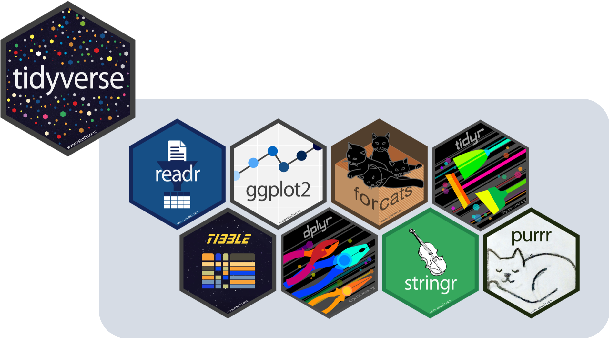
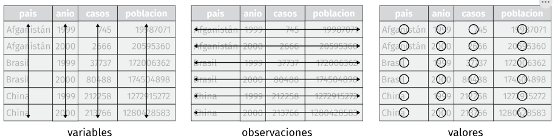
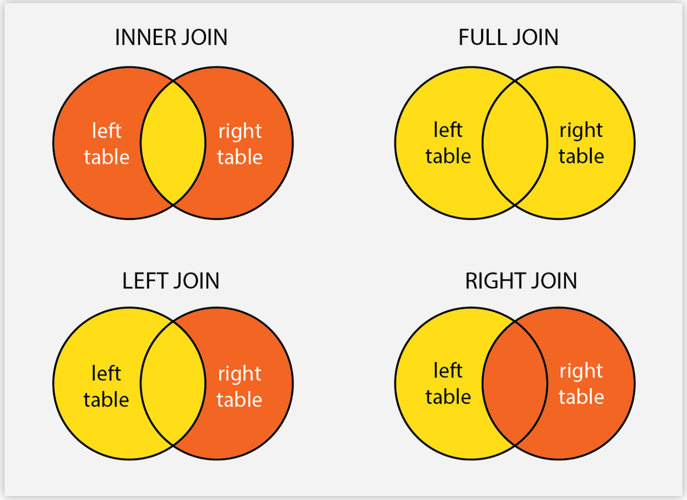

# Manipulación de datos {style="color: #122562"}

Para la presente sección se implementará la librería `Tidyverse` la cuál es una colección de paquetes designados para ciencia de datos.

[{fig-align="center" width="401"}](https://www.tidyverse.org/)

```{r}
#| output: false
#| echo: false

library(tidyverse)
library(agridat)
```

## Exploración inicial {style="color: #122562"}

En R se pueden subir archivos de diistintos tipos (xlsx, xls, csv, txt, etc...). En los datos tabulados, generalmente las columnas son variables y las filas son observaciones o individuos de esas variables.

Sin embargo, los formatos que puede leer R por defecto son `.txt` y `.csv`, para cargar archivos de otro tipo se requieren de otras librerias como `readr`.

Las columnas se separan con un carácter y las filas con un salto de línea. Este carácter puede ser un espacio, un tabulador, una coma, punto y coma etc. El formato más extendido es el CSV, donde las observaciones están separadas por comas.

Las funciones para la importar de datos se listan en la siguiente tabla:

| Funcion        | Tipo de datos de carga                                                                                                                                                                                                                                                                              | Ejemplo                                                |
|----------------|-----------------------------------------------------------------------------------------------------------------------------------------------------------------------------------------------------------------------------------------------------------------------------------------------------|--------------------------------------------------------|
| `read.table()` | Se usa para cargar archivos en formato `.txt`. Los principales argumentos de esta función son la ruta y el nombre del archivo (entre comillas), un argumento que le dice a R si los datos tiene un encabezado `header = TRUE` o no `header = FALSE` y el delimitador de los datos (argumento `sep`) | `read.table("employee.txt", header = TRUE, sep = ",")` |
| `read.csv()`   | La importación de archivos `.csv` es similar a la de los archivos `.txt`.                                                                                                                                                                                                                           | `read.csv("employee.csv", header = TRUE, sep = ";")`   |

Cuando se empieza a trabajar con un conjunto de datos, es necesario hacer un poco de exploración para entender qué información puede contener. Existen varias formas de extraer información básica de un objeto, ya sean listas, matrices, data frames o cualquier otra clase. Para observar como realizar estos procesos se usarán sets de datos que R trae por defecto.

Algunos comandos ya mencionados en secciones anteriores funcionan con todas ellas, particularmente la funcion `str()`. Otros como `colnames()` o `rownames()` solo sirven para objetos de dos dimensiones (como matrices).

### Iniciando {style="color: #122562"}

Lo primero que se debería hacer al importar o crear un set de datos, es visualizar que la información de este haya sido correctamente cargada. Para esto se puede hacer uso de la función `head()` o `tail()`, para observar las primeras o últimas 6 filas del set de datos.

::: {.callout-note collapse="true"}
## Visualizacion primeras filas

```{r}
#| output: true
#| echo: true

head(iris)

```
:::

::: {.callout-note collapse="true"}
## Visualizacion ultimas filas

```{r}
#| output: true
#| echo: true

tail(iris)

```
:::

La función `View()` también es muy útil para inspeccionar la tabla completa:

```{r}
#| output: true
#| echo: true

View(iris)

```

La función `names()` devuelve los nombres de los elementos de una lista, lo mismo funciona con los data frames. Resultado similar a la función `names()` es posible algunas veces con la función `colnames()` la cual retorna el nombre de las variables (columnas) del set de datos.

::: {.callout-note collapse="true"}
## Nombres de las variables

Como resultado obtenemos un vector de caracteres con los nombres de las variables o columnas del set de datos

```{r}
names(iris)
```

```{r}
colnames(iris)
```
:::

Los nombres de las filas se consiguen o se modifican con la función `rownames()`. Al igual que en los demás casos, se obtendrá un vector de carácteres.

A su vez, para listas y data frames existe el operador `$`, en caso de que los elementos tengan nombres asignados.

::: {.callout-note collapse="true"}
## Ejemplo

```{r}
head(iris$Species, 30)
```
:::

Como ya se ha mencionado anteriormente la función genérica `str()` es muy práctica para la obtención de información básica y resumida de cualquier objeto, incluyendo los data frames.

::: {.callout-note collapse="true"}
## Características del set de datos

```{r}

str(iris)
```
:::

Otra función importante para comprender el dataset es la función `summary()` la cuál proporciona un sumario o resumen de un objeto.

::: {.callout-note collapse="true"}
## Resumen de datos

```{r}
summary(iris)
```
:::

## Procesos básicos de dplyr {style="color: #122562"}

Tenga en cuenta que todas las funciones que se presentan a continuación requieren datos ordenados, lo que significa que:

-   Cada variable está en su propia columna
-   Cada observación, o caso, en su propia fila
-   Cada valor está en su propia celda



A continuación se pueden ver las cinco funciones básicas clave de dplyr las cuales permitirán resolver la mayor parte de los retos de manipulación de datos.

| Funcion       | Proceso                                                                     |
|---------------|-----------------------------------------------------------------------------|
| `filter()`    | Selecciona las observaciones segun una o varias caracteristicas especificas |
| `arrange()`   | Reordena las filas                                                          |
| `select()`    | Selecciona variables por sus nombres                                        |
| `mutate()`    | Crea nuevas variables con funciones o variables existentes                  |
| `summarise()` | Reducir muchos valores a un único resumen                                   |

: La función `filter()` permite subdividir las observaciones en función de sus valores.

::: {.callout-note collapse="true"}
## Filtrar informacion

```{r}
head(filter(iris, Species == "setosa"))
```

```{r}
head(filter(iris, Species == "virginica"))
```
:::

También se pueden realizar combinaciones usando el operador `&` (si las condiciones son acumulativas) o `|` (Si las condiciones son alternativas)

::: {.callout-note collapse="true"}
# Código

```{r}
filter(iris, Species == "setosa" & Sepal.Width < mean(Sepal.Width))
```

```{r}
filter(iris, Species == c("setosa", "virginica") & Sepal.Width < mean(Sepal.Width))
```
:::

Todas las funciones presentadas en esta sección deben especificar el nombre del objeto de datos como primer argumento. Sin embargo, existe una solución alternativa a la especificación del nombre del marco de datos dentro de las funciones: el pipe operator (`|>` o `%>%`).

Este permite realizar una secuencia de varias operaciones, es decir, encadenar una secuencia de cálculos. Resulta especialmente útil cuando se realizan varias operaciones sobre un objeto de datos y no se desea guardar la salida en cada paso intermedio.

::: {.callout-note collapse="true"}
## Pipe operator

```{r}

iris |>
filter(Species == "setosa" & Sepal.Width < mean(Sepal.Width)) |>
mutate(Sepal_metros_2 = Sepal.Width*Sepal.Length)
```
:::

## Extracción de observaciones {style="color: #122562"}

### Operaciones con filas

Con ayuda de la librería `dplyr` es posible extraer observaciones según su posición o sus valores. Para este proceso se puede hacer uso de la función `slice()`

::: {.callout-note collapse="true"}
## Extracción de observaciones

```{r}
# Extraccion segun su posicion
# Extraemos los datos de las filas 10, 20 y 25
iris |>
  slice(c(10, 20, 25))
```
:::

Las funciones `slice_head()` y `slice_tail()` funcionan de manera similar a las funciones `head()` y `tail()`.

Para extraer observaciones según sus valores se pueden usar las funciones `slice_min()` y `slice_max()`.

::: {.callout-note collapse="true"}
## Extraccion por valores

```{r}

# Extraer observaciones con 25% menor anchura de petalos 
iris |>
  slice_min(Petal.Width, prop = 0.25)
```
:::

Mediante el uso de esta librería también se pueden organizar las filas según el criterio. La función `arrange()` funciona de manera similar a la funcion filter. Esta toma el data frame y un conjunto de columnas y los ordena según las características de este.

::: {.callout-note collapse="true"}
## Función arrange()

```{r}

iris |>
arrange(Sepal.Width) |>
slice_head(n = 10)

iris |>
arrange(across(Sepal.Width, desc)) |>
slice_head(n = 10)
```
:::

Muchas veces sólo es necesaria la información ciertas observaciones dentro de una tabla, para esto hay que tener claros los criterios de la investigacion que se esté realizando. La función `subset()` sirve para este proceso.

::: {.callout-note collapse="true"}
## Selección de variables

```{r}
iris|>
subset(Sepal.Width >= mean(Sepal.Width)) |>
slice_head(n = 10)

```
:::

Tambien podemos obtener un resumen de la cantidad de datos segun la categoria que especifiquemos mediante el uso de la funcion `count()`

::: {.callout-note collapse="true"}
## Funcion count

```{r}
iris |>
  count(Species)
```
:::

### Operaciones con columnas {style="color: #122562"}

Otra operación constantemente implementada, es `select()`. Mediante esta se puede indicar que columnas se desean incluir en un análisis y cuales no.

::: {.callout-note collapse="true"}
## Seleccion de columnas

```{r}

iris |>
select(Species) |>
slice_head(n = 10)

```
:::

Mediante la implementación de esta se pueden realizar operaciones más precisas según los criterios que se establezcan.

::: {.callout-note collapse="true"}
## Operación con select

```{r}
iris |>
  select(where(is.numeric)) |>
  slice_head(n = 10)

```
:::

En cuanto a la modificación de datos, existen múltiples posibilidades. Algunas de ellas son:

-   `rename()` cambia el nombre de la columna
-   `mutate()` cambia los valores de las columnas y crea nueva columnas. La función `transmute()` funciona igual a `mutate()`, pero la tabla de datos resultante solo contiene las nuevas columnas.
-   `relocate()` cambia el orden de las columnas

::: {.callout-note collapse="true"}
## Funciones

```{r}
iris |>
  rename(Ancho_sepalo = Sepal.Width) |>
  slice_head(n=10)

iris |>
  relocate(Species, .before= Sepal.Length) |>
  slice_head(n=10)

iris |>
      group_by(Species) |>
      mutate(Total_na = is.na(Sepal.Length)) |>
      slice_head(n = 20)
  

```
:::

Existen diferentes funciones que pueden ser usadas de manera conjunta con la función `select()`

| Funcion        | Descripcion                                                               |
|----------------|---------------------------------------------------------------------------|
| `containis()`  | Selecciona variables cuyo nombre contiene la cadena de texto              |
| `ends_with()`  | Selecciona variables cuyo nombre termina con la cadena de caracteres      |
| `everything()` | Selecciona todas las columnas                                             |
| `matches()`    | Selecciona las variables cuyo nombre coinciden con una expresión regular  |
| `num_range()`  | Selecciona las variables por posición                                     |
| `one_of()`     | Selecciona las variables cuyos nombres están en un grupo de nombres       |
| `start_with()` | Selecciona las variables cuyos nombres empiezan con cadenas de caracteres |

### Operaciones de agrupación {style="color: #122562"}

La primera operación de resumen que puede surgir es "contar" filas. La función `tally()` devuelve el número de filas totales de un data.frame. La función `count()` proporciona también este número.

::: {.callout-note collapse="true"}
## tally function

```{r}
iris |>
  group_by(Species) |>
  tally()

```
:::

Para observar un resumen de las variables de manera detallada y según los argumentos que el usuario desea se usa principalmente la función `summarise()`

::: {.callout-note collapse="true"}
## Sumarise function

```{r}

iris |>
  group_by(Species) |>
  summarise(
    min = min(Sepal.Length),
    max = max(Sepal.Length),
    mean = mean(Sepal.Length)
  )

```
:::

## Combinación de datos {style="color: #122562"}

[{fig-align="center" width="419"}](https://www.slideshare.net/ConfluentInc/zen-and-the-art-of-streaming-joins-the-what-when-and-why-nick-dearden-confluent-kafka-summit-nyc-2019?next_slideshow=true)

La combinación de tablas en R funciona de manera muy similar a como se realiza en otros programas. En esencia para combinar tablas que contienen información relacionada, hay que saber cuáles son las columnas que refieren a lo mismo, para realizar uniones mediante `joins`. Existen cuatro tipos de uniones que se pueden realizar.

-   `inner_join()` incluye las filas de ambas tablas para las que coinciden las variables de unión.
-   `left_join()` incluye todas las filas de la primera tabla y solo las de la segunda donde existen coincidencias.
-   `right_join()` incluye las filas de la segunda tabla y solo las de la primera donde existen coincidencias.
-   `full_join()` incluye todas las filas de las dos tablas.

Las funciones requieren como argumentos dos tablas de datos y las especificaciones de columnas coincidentes.

::: {.callout-note collapse="true"}
## Funciones join()

```{r}

A <- data.frame(id=c(1,2,2,3),cod=c(23,65,60,87),name=c("Leia","Luke","Yoda","Hank"))
B <- data.frame(id=c(2,3,4),cod=c(65,87,29),age=c(23,20,25))
```

```{r}
A |> 
  inner_join(B)

A |>
  left_join(B)

A |>
  right_join(B)

A |>
  full_join(B)

```
:::

## Ejercicio de recopilación {style="color: #122562"}

En este ejercicio, se utilizará el dataset `senshu.rice` de la librería `agridat`.

Utiliza la función `help()` para obtener más información sobre el contenido de este dataset.

1.  Usa la función `summarise` para calcular los valores mínimos, máximos y los promedios.

2.  Cuenta la cantidad de datos por cada uno de los países.

3.  Realiza un filtro de la información del set de datos donde tenga información de **Colombia.**

4.  Obtén el promedio de la columna yield por cada uno de los países.

5.  Realiza un filtro y selecciona los datos cuyo **rad** sea menor a 350.

6.  Seleccione las filas 15, 18, 20 35 y 40 del set de datos.
