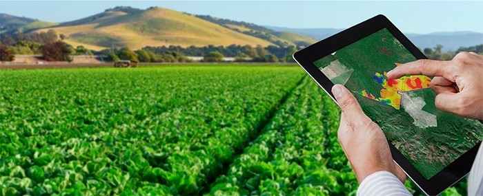
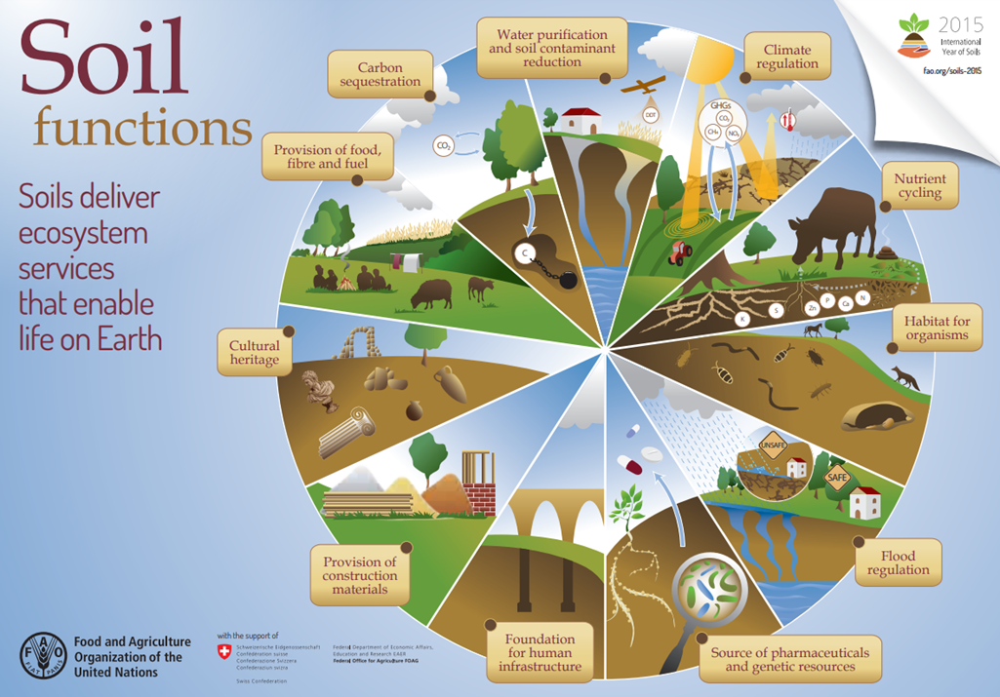

[{fig-align="center"}](https://mundogeo.com/es/2018/05/17/inteligencia-artificial-para-controlar-la-fertilidad-del-suelo/)

# Introducción al Mapeo Digital de Suelos {style="color: #122562"}

El mapeo digital de suelos es un proceso que utiliza tecnologías de teledetección, sistemas de información geográfica (SIG) y modelos predictivos para crear mapas detallados y precisos de los diferentes tipos de suelo en una región específica. Estos mapas son fundamentales para entender la distribución espacial de los suelos y sus características, lo que permite tomar decisiones informadas en áreas como la agricultura, la gestión del medio ambiente, la planificación del uso del suelo y la conservación de los recursos naturales.

## ¿Por qué mapear y monitorear suelos? {style="color: #122562"}

Conocer la variabilidad de los suelos permite entender mejor la disponibilidad de los servicios ecosistémicos de los suelos y apoyar la toma de decisiones informadas en diversos sectores:

-   Desarrollo agrícola

-   Planificación del uso del suelo

-   Gestión medioambiental

-   Gestión de los recursos naturales

-   Estudios sobre el cambio climático

-   Desarrollo de infraestructuras

[{fig-align="center"}](https://wires.onlinelibrary.wiley.com/doi/10.1002/wcc.780)

## Mapeo Digital de Suelos (DSM) {style="color: #122562"}

Es la producción **asistida por computador** de mapas digitales de clases y propiedades de suelos, que combina diferentes **variables ambientales** con datos **puntuales colectados del suelo** en un **modelo matemático/estadístico/ML**, para producir **mapas de suelos** de alta resolución (raster/píxeles) que son **continuos y variables en el espacio-tiempo**.

La metodología ha evolucionado a partir de las teorías de la génesis del suelo desarrolladas por Dokuchaev (1883) en su obra "Los Chernozems rusos", que más tarde fueron formalizadas por Jenny (1941) con la ecuación de los factores de formación del suelo. La ecuación conceptual de los factores de formación del suelo ha sido actualizada por McBratney, Santos y Minasny (2003) de la siguiente manera:

S=f(S,C,O,R,P,A,N)

Donde S son las clases o atributos del suelo a modelar, en función (f) de:

-   S: Otras propiedades del suelo

-   C: Clima

-   O: Organismos, incluyendo la cobertura/uso del suelo y actividad humana

-   R: Relieve

-   P: Material parental

-   A: Edad del suelo

-   N: Posición geográfica.

[.png){fig-alt="(Click para ir a la fuente)" fig-align="center" width="609"}](https://soilandhealth.org/wp-content/uploads/01aglibrary/010159.Jenny.pdf)

Este proceso requiere la colaboración de expertos en suelos, teledetección y análisis espacial, así como el acceso a datos adecuados y herramientas de software de SIG y modelado.

[.png){fig-align="center" width="650"}](https://alchetron.com/Digital-soil-mapping)

## Mapeo convencional vs Mapeo Digital de Suelos {style="color: #122562"}

-   **Mapeo Convencional de Suelos:**

    -   En este enfoque, los suelos se mapean utilizando técnicas tradicionales de campo, que pueden incluir la observación directa, la recopilación de muestras de suelo y su análisis en laboratorio, y la interpretación de datos topográficos y geológicos.

    -   Los expertos en suelos recorren el área a mapear, identificando y clasificando los diferentes tipos de suelo basándose en características como textura, color, estructura, contenido de materia orgánica, pH y otros parámetros físicos y químicos.

    -   Originalmente, los límites del suelo los marcaban manualmente los científicos del suelo en los que los topógrafos dibujaban los límites de forma manual o digital utilizando el papel o computadoras de campo.

    -   Este enfoque proporciona una comprensión de la distribución espacial de los diferentes tipos de suelo, así como de algunas de sus propiedades. Sin embargo, puede ser intensivo en tiempo y recursos, especialmente para áreas extensas.

    -   Las propiedades del suelo adquieren valores uniformes dentro de cada polígono, donde, la variación espacial sólo ocurre en los límites de los polígonos.

-   **Mapeo Digital de Suelos:**

    -   El mapeo digital de suelos utiliza tecnologías de teledetección, sistemas de información geográfica (SIG) y modelos computacionales para predecir la distribución de los suelos en un área determinada.

    -   Se basa en la integración de datos provenientes de diversas fuentes, como imágenes satelitales, datos topográficos, información climática y bases de datos de suelos existentes.

    -   Los algoritmos y modelos computacionales se utilizan para analizar y procesar estos datos, generando mapas predictivos de los diferentes tipos de suelo y sus propiedades en función de variables ambientales y geoespaciales.

    -   Este enfoque es más rápido y menos costoso que el mapeo convencional, y puede ser especialmente útil para áreas extensas o de difícil acceso. Sin embargo, la precisión de los resultados depende en gran medida de la calidad y la cantidad de los datos utilizados, así como de la precisión de los modelos empleados.

    -   Los modelos empleados con esta técnica permiten determinar su precisión e incertidumbre y pueden actualizarse más fácilmente cuando salga a la luz nueva información.

    -   En el mapeo digital de suelos moderno, se utilizan técnicas y tecnologías semiautomáticas para adquirir, procesar y visualizar información del suelo e información auxiliar, de modo que el resultado final pueda obtenerse a costos más económicos.

A diferencia de los métodos convencionales, las técnicas modernas de DSM hacen un uso extensivo de avances tecnológicos que incluyen receptores GPS, escáneres de campo y sensores remotos; al mismo tiempo avances computacionales y algoritmos machine learning, SIG, modelo de elevación digital y minería de datos.

El mapeo digital de suelos intenta superar algunos de los inconvenientes de los mapas de suelos tradicionales que a menudo solo se centran en definir clases de suelo, es decir, tipos de suelo. Estos mapas de suelos tradicionales: no proporcionan información para modelar la dinámica de las condiciones del suelo y son inflexibles para los estudios cuantitativos sobre la funcionalidad de los suelos.

## Metodología usada en DSM {style="color: #122562"}

1.  Colección de datos espaciales: Proceso previo que reune toda la información espacial existente de la zona de estudio.

2.  Estrategia de muestreo: Se plantea una estrategia de acuerdo a la información que se necesite y la disponibilidad de los recursos.

3.  Muestreo en campo: Se lleva a cabo la estrategia planteada y se recolecta la muestra de suelo.

4.  Análisis de laboratorio: Aplicación de análisis de acuerdo al requerimiento del estudio.

5.  Análisis de datos: Una exploración que permite conocer cómo se encuentran distribuidos los datos; se realiza un pre procesamiento de la información que reduzca el error en los datos.

6.  Predicción espacial: Se aplican modelos que permiten la construcción de los mapas y la predicción de las variables de interés.

7.  Análisis de resultados: Se evalúa la precisión y exactitud del modelo que asegure su posterior uso.

8.  Comunicación y publicación: Se dan a conocer los resultados obtenidos.

## Algunas de las aplicaciones del DSM {style="color: #122562"}

-   Disponibilidad de agua
-   Salud del suelo y prácticas de manejo
-   Caracterización de suelos
-   Uso eficiente de fertilizantes
-   Erosión y degradación de suelos
-   Riesgo de inundación
-   Secuestro de carbono
-   Contaminación del suelo
