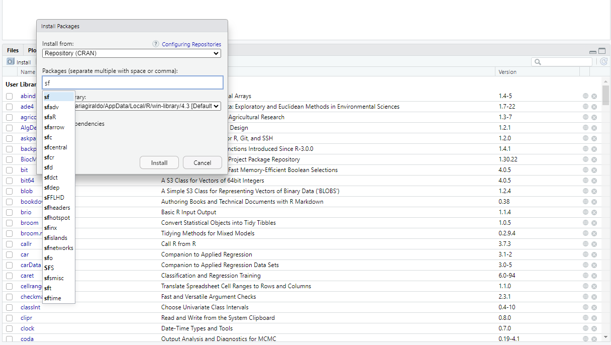
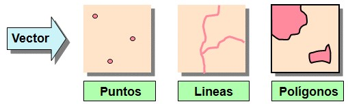
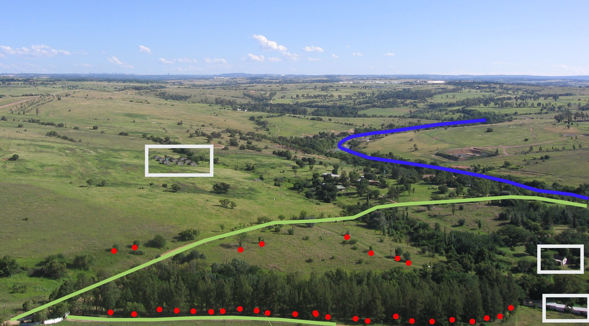

# Procesamiento de datos espaciales- Vectoriales {style="color: #122562"}

::: {.callout-tip}
## Datos de este capítulo

Los archivos que usa este capítulo están en [datos/cap07](https://github.com/ctirado-cgiar/Libro_MDS/tree/main/datos/cap07).

Para ejecutar el código, descarga el proyecto completo ([Libro_MDS.zip](https://github.com/ctirado-cgiar/Libro_MDS/archive/refs/heads/main.zip)), descomprímelo y ábrelo en RStudio con `DSM.Rproj`. Las rutas del código funcionan tal cual.
:::


## Datos geoespaciales {style="color: #122562"}

Los datos geoespaciales son información que está asociada a ubicaciones geográficas específicas en la superficie de la Tierra. Estos datos se caracterizan por tener coordenadas geográficas que permiten su localización precisa en un sistema de referencia espacial. Estos datos pueden describir una amplia gama de fenómenos físicos, químicos, ambientales, sociales o económicos.

## Librerías para el manejo de datos geoespaciales {style="color: #122562"}

Para trabajar con datos geoespaciales en R, existen varias librerías especializadas que ofrecen una amplia gama de funciones que permiten la manipulación, análisis y visualización de los datos. Para el trabajo que se realizará se instalarán las siguientes librerías:

-   **sf**

    Esta es una librería moderna que proporciona funciones para manejar datos espaciales vectoriales (puntos, líneas, polígonos) de manera eficiente. También es compatible con el formato Simple Features (sf) y permite realizar operaciones espaciales y análisis geoespacial avanzado.

-   **raster**

    Su funcionalidad se centra en el manejo y análisis de datos espaciales raster (grillas o mallas). Ofrece funciones para leer, escribir, manipular y analizar datos raster, así como para realizar operaciones algebraicas entre capas raster.

-   **leaflet**

    Leaflet es una librería para la creación de mapas interactivos basados en la web. Permite visualizar datos geoespaciales en un mapa interact ivo y agregar capas adicionales como marcadores, polígonos y líneas.

-   **tmap**

    tmap es una librería que proporciona una interfaz fácil de usar para crear mapas temáticos estáticos y dinámicos. Ofrece una amplia gama de opciones de diseño y estilo para personalizar la apariencia de los mapas.

-   **spatialEco**

    Esta librería es utilizada en el análisis de datos espaciales en ecología y biogeografía. Ofrece funciones para realizar análisis espaciales, modelado predictivo y visualización de datos relacionados con el medio ambiente.

-   **rgeos**

    rgeos es una interfaz R para la biblioteca GEOS (Geometry Engine - Open Source), que proporciona funciones para realizar operaciones geométricas y topológicas en datos espaciales.

-   **randomForest**

    Este es un algoritmo de aprendizaje automático supervisado que se utiliza tanto para tareas de clasificación como de regresión. Es una técnica de conjunto que combina múltiples árboles de decisión para mejorar la precisión y la generalización del modelo.

-   **rgdal**

    Interfaz con la `++` biblioteca de abstracción de datos geoespaciales de datos espaciales C/C.

-   **tidyverse**

    Es una colección de paquetes orientados a la manipulación, importación, exploración y visualización de datos. Dentro de este se encuentra readr, dplyr, ggplot2, tibble, tidyr, purr, stringr, forcast.

-   **ggmap**

    Es una extensión de ggplot2 que facilita el manejo de datos espaciales.

-   **plotly**

    Esta librería es utilizada para la visualización de datos espaciales o geográficos.

-   **ggtern**

    Esta librería permite crear gráficos ternarios utilizando ggplot2. Un gráfico ternario es un tipo de gráfico utilizado para representar datos tridimensionales en un sistema de coordenadas triangular.

-   **geodata**

    Proporciona conjuntos de datos geográficos que pueden ser utilizados sin necesidad de descargar y cargar conjuntos de datos externos.

-   **lattice**

    Esta biblioteca sirve para la visualización de datos estadísticos y geoespaciales.

-   **rasterVis**

    Esta librería contiene diferentes métodos para mejorar la visualización e interacción con datos ráster. Para la visualización de datos cuantitativos y datos categóricos, tanto para rásteres univariados como multivariados.

-   **lhs**

    Proporciona una serie de métodos para crear y aumentar muestras de hipercubo latino y muestras de hipercubo latino de matriz ortogonal.

-   **psych**

    Sus funciones son principalmente para análisis multivariado y estadísticas descriptivas básicas.

-   **corrplot**

    Esta librería es una herramienta de exploración visual sobre la matriz de correlación, que admite el reordenamiento automático de variables para ayudar a detectar patrones ocultos entre las variables.

-   **gclus**

    Permite ordenar paneles en matrices de diagramas de dispersión y visualizaciones de coordenadas.

-   **car**

    Este es uno de los paquetes que proporciona funciones y herramientas para el análisis de regresión.

-   **gridExtra**

    Proporciona una serie de funciones para trabajar con gráficos de "cuadrícula", en particular para organizar múltiples gráficos basados en cuadrículas en una página y dibujar tablas.

-   **terra**

    Esta librería contiene diferentes métodos de análisis de datos espaciales con datos vectoriales y rasterizados.

-   **ggplot2**

    Esta librería es de código abierto para el lenguaje de programación R, ampliamente utilizada para la creación de gráficos de alta calidad y estéticamente agradables. Tiene un enfoque flexible y modular para la construcción de visualizaciones.

-   **stats**

    Este paquete contiene funciones para cálculos estadísticos y generación de números aleatorios.

-   **skimr**

    Esta librería está diseñada para proporcionar estadísticas de resumen sobre variables en marcos de datos, tibbles, tablas de datos y vectores.

-   **aqp**

    Esta librería posee un conjunto de herramientas para visualización, agregación y clasificación del perfil del suelo. Es un ejemplo de paquetes que han sido creados para temas específicos.

-   **car**

    Este paquete contiene una colección de funciones para el diagnóstico de regresión y el ajuste de modelos lineales generalizados.

Busca el nombre de la librería dentro del repositorio CRAN y realiza la instalación de cada una.

{fig-align="center"}

## Vectores {style="color: #122562"}

Los archivos que contienen datos espaciales se conocen comúnmente como shapefiles. En R, los shapefiles se suelen representar mediante vectores, que consisten en la descripción de la geometría o forma (shape) de los objetos.

Los datos espaciales son diversos en sus características y generalmente se dividen en tipos de vectores que en cada caso consisten en un conjunto de pares de coordenadas (x,y):

-   Puntos: Una sola ubicación descrita por un punto como la dirección de una casa geocodificada.

-   Líneas: Un segmento compuesto por una serie de puntos conectados entre sí que no forman un objeto cerrado.

-   Polígonos: Una superficie plana compuesta por una serie de líneas conectadas entre sí que forman un objeto cerrado.

[{fig-align="center"}](https://ecoscript.org/vectorvsraster/#google_vignette)

***Librerías***

*Antes de iniciar con los procesos de edición de datos, se recomienda cargar todas las librerías que se usarán. Para agilizar los procesos que se llevarán a cabo y asegurar que las funciones operen de manera correcta.*

::: {.callout-note collapse="true"}
# Cargar librerías

```{r, warning=FALSE}
library(sf)
library(raster)
```
:::

### **Creación de vectores** {style="color: #122562"}

**Crear puntos espaciales**

La función `st_point()` crea una geometría de un solo punto en las coordenadas de longitud y latitud especificadas.

::: {.callout-note collapse="true"}
# Coordenada

```{r}
# Crear un punto en las coordenadas (x, y)
coordenadas =c(3.501251,-76.355102)

punto= st_point(coordenadas)
plot(punto, axes = TRUE)

```
:::

Con la función `st_multipoint()` se puede crear una colección de múltiples geometrías de puntos, donde cada fila de la matriz representa las coordenadas de un punto (longitud, latitud).

::: {.callout-note collapse="true"}
# Puntos

```{r}
# Crea un vector con coordenadas en x
Xs = c(3.501251, 3.498767, 3.505466, 3.499799, 3.504230 )
# Crea un vector con coordenadas en y
Ys = c(-76.355102,  -76.356593, -76.343899, -76.346217, -76.359751 )
# Pega Xs y Ys para crear una tabla de coordenadas
puntos = cbind(Xs,Ys)
# Crea el objeto Multipoint (MP) y visualiza
MP = st_multipoint(puntos)
plot(MP, axes = TRUE)

```
:::

**Crear un polígono**

`st_polygon()` Esta función permite crear un elemento poligonal a partir de una lista de geometrías lineales que definen sus límites.

::: {.callout-note collapse="true"}
# Polígono

```{r}
# Crea y cerrar las coordenadas en X
x = c(3.501251, 3.498767, 3.499799,3.504230,3.501251)
# Crea y cerrar las coordenadas en Y
y= c(-76.355102,  -76.356593, -76.346217,-76.359751,-76.355102)

# Crear un dataset con las coordenadas
c = cbind(x,y)
print(c)
class(c)
# IMPORTANTE: Se debe cerrar el polígono (último par de coord = primero)

# Crea el objeto Polygon. Un polygon es una forma simple cerrada
polygon <- st_polygon(list(c)) 
plot(polygon, axes= TRUE)

```
:::

**Asignar CRS**

Para que estos datos sean geoespaciales es importante asignarles un sistema de coordenadas, mediante la función `st_set_crs()`:

::: {.callout-note collapse="true"}
# CRS

```{r}

data = data.frame(Longitud= x, Latitud= y)
shapefile= st_as_sf(data, coords = c('Longitud','Latitud')) %>% st_set_crs(4326)
plot(shapefile, axes= TRUE)
```
:::

**Importar los datos**

El paquete shapefile puede manejar varios tipos de formato como shp, GeoJSON, GPKG, etc. Para importarlo se utiliza la función `st_read` con la ruta del archivo y el formato a cargar (.shp, .geojson, .gdb, .dbf, etc.)

::: {.callout-important collapse="true"}
## Base de datos

Nota: Los datos utilizados en este estudio fueron obtenidos de la *Base de Datos Armonizada de Suelos del Ecuador 2021* (Armas, D. I. et al, 2022) que contiene análisis de suelos realizados en Ecuador con información de datos del perfil del suelo y datos de horizontes.
:::

::: {.callout-note collapse="true"}
# Datos

```{r}
datos= st_read("datos/cap07/horizontes.gpkg", quiet = TRUE)

vectorial= st_read("datos/cap07/Watersheds.gpkg", quiet = TRUE)
vectorial

```
:::

**Guardar los datos editados**

Cuando se hayan realizado las modificaciones necesarias, se pueden guardar los datos con `st_write()` :

::: {.callout-note collapse="true"}
# Guardar

```{r}
#ejemplo= st_write(datos, "ruta/para/guardar/archivo.shp")
```
:::

**Transformación de datos**

Los archivos vectoriales permiten la conversión de los tipos de datos o la creación de nuevas características derivadas de las existentes.

Para estas modificaciones es importante tener en cuenta que se pueden usar las siguientes funciones:

`as.integer()` para convertir a tipo entero.

`as.character()` para convertir a tipo caracter.

`as.logical()` para convertir a tipo lógico (booleano).

`as.factor()` para convertir a tipo factor, etc.

::: {.callout-note collapse="true"}
# Ejemplo

```{r}
class(datos$ID_PER)

dato_integer= as.character(datos$ID_PER)
class(dato_integer)

```
:::

Con la función `type.convert()` se pueden convertir los elementos de un vector a su tipo de datos más adecuado luego de ser transformado a un data frame. Esto es útil inicialmente como caracteres, pero necesitas convertirlos a otros tipos de datos como numéricos, factores, lógicos, etc.

::: {.callout-note collapse="true"}
# type.convert

```{r}
convert= data.frame(lapply(datos, type.convert,as.is = TRUE))
class(convert$ID_PER)
```
:::

**Procesamiento de datos espaciales**

En los últimos años, R ha mejorado considerablemente sus herramientas para manipular y analizar datos geográficos de manera que sean compatibles con la sintaxis y las funcionalidades de otros paquetes del programa.

[{fig-align="center"}](https://docs.qgis.org/3.34/es/docs/gentle_gis_introduction/vector_data.html)

**Reproyectar datos**

Cuando se van a utilizar los archivos, proyectar las capas vectoriales a un sistema de coordenadas de referencia (SRC) específico en R, permite homogenizar la información y minimizar los errores en el procesamiento. La librería `sf` es útil dentro de este procedimiento.

`st_crs()` recupera la proyección asociada con un objeto de datos espaciales, proporcionando información sobre las unidades y el dato utilizado para representar las coordenadas.

::: {.callout-note collapse="true"}
# Reproyectar

```{r}
crs_vectorial=st_crs(datos)
crs_vectorial
```

Luego se le puede asignar nuevo sistema de coordenadas a los datos:

```{r}
crs_vectorial=st_crs(vectorial)
crs_vectorial
```
:::

`st_transform()` esta función también reproyecta datos espaciales de un CRS a otro, lo que permite el análisis de conjuntos de datos con diferentes sistemas de coordenadas.

::: {.callout-note collapse="true"}
# Reproyectar

```{r}
crs_polygon=st_transform(vectorial, crs = st_crs(4326))
st_crs(crs_polygon)
```
:::

**Geometría**

Usando la función `st_geometry()` se puede ver la geometría incluida en el shapefile y seleccionarla.

::: {.callout-note collapse="true"}
# Geometría

```{r}
#| output: true
#| echo: true
st_geometry(vectorial)
```
:::

**Intersección y diferencia de geometrías**

`st_intersect()` Calcula la intersección de dos geometrías, devolviendo el área o geometría compartida por ambas.

::: {.callout-note collapse="true"}
# Intersección

```{r, warning= FALSE}


# Calcular la intersección entre los dos polígonos
interseccion = st_intersection(vectorial, datos)

# Visualizar los resultados
plot(st_geometry(vectorial), col = "gray")
plot(st_geometry(datos),add= TRUE, col = "red", pch= 20)
plot(st_geometry(interseccion), add= TRUE, col = "green", pch= 20) 
```
:::

`st_difference(geom1, geom2)` Calcula la diferencia entre dos geometrías, lo que da como resultado la parte de una geometría que no está incluida en el otro polígono.

::: {.callout-note collapse="true"}
# Diferencia

```{r, warning= FALSE}
  
  
# Calcular la diferencia entre los polígonos
diferencia = st_difference(vectorial, datos)

# Visualizar los resultados
plot(st_geometry(diferencia), col = "red", main = "Diferencia entre polígonos")
plot(st_geometry(datos), add = TRUE, col = "blue")
plot(st_geometry(vectorial), add = TRUE, col = "green")
```
:::

**Unión de geometrías**

La función `st_union()` combina dos geometrías en una sola geometría, creando potencialmente un multipolígono si se superponen significativamente. Los argumentos permiten controlar cómo manejar las superposiciones (por ejemplo, disolución, unión, intersección).

::: {.callout-note collapse="true"}
# Unión

```{r}
# Fusionar las geometrías
poligono_fusionado = st_union(vectorial)

# Visualizar los resultados
plot(poligono_fusionado, col = "lightblue", main = "Fusión de polígonos")

vectorial= poligono_fusionado
```
:::

`st_centroid()` determina el centro geométrico (centroide) de un punto, cadena de líneas o polígono.

::: {.callout-note collapse="true"}
# Centro

```{r}
# Calcular el centroide del polígono
centroide = st_centroid(vectorial)

# Visualizar los resultados
plot(st_geometry(vectorial), col = "lightblue", main = "Centroide del polígono")
plot(centroide, pch = 16, col = "red", add = TRUE)
```
:::

**Buffer o zona de amortiguamiento**

`st_buffer()` con esta función se crea una zona de amortiguamiento alrededor de una geometría, extendiendo sus límites una distancia especificada en las unidades CRS especificadas.

::: {.callout-note collapse="true"}
# Buffer

```{r}

# Crear un buffer alrededor del punto
buffer = st_buffer(vectorial, dist = 1000)
vectorial = buffer
plot(vectorial)
```
:::

`st_area()` Calcula el área de una geometría de polígono, devolviendo el valor en las unidades del CRS.

::: {.callout-note collapse="true"}
# Área

```{r}
# Calcular el área del polígono
area_poligono = st_area(vectorial)
area_ha= (area_poligono/10000)

# Mostrar el área del polígono
print(area_poligono)
print(paste(area_ha , "hectáreas"))
```
:::

## Conversión de formatos

La conversión de archivos entre formatos de vector y ráster es importante para el análisis espacial. Cada formato tiene sus propias características y ventajas, por lo que la elección del formato adecuado depende de la tarea que se vaya a realizar.

**Vector a ráster**

Luego de definir los valores de extensión y resolución del ráster de salida, la función `rasterize()` permite realizar el cambio del formato.

::: {.callout-note collapse="true"}
**Vector a ráster**

```{r}
# Especifica la ruta al archivo Shapefile
datos_shape = as(st_read("datos/cap07/Watersheds.gpkg", quiet = TRUE), "Spatial")

# Crear un raster vacío
raster_resultante = raster()

# Definir la extensión del raster resultante basada en los límites del Shapefile
extent_raster = extent(datos_shape)

# Definir la resolución del raster resultante
resolucion = 30  # ajusta la resolución según sea necesario

# Establecer la extensión y la resolución del raster resultante
extent(raster_resultante) = extent_raster
res(raster_resultante) = resolucion

# Rasterizar el Shapefile
rasterizado = rasterize(datos_shape, raster_resultante)

plot(rasterizado)
```
:::
