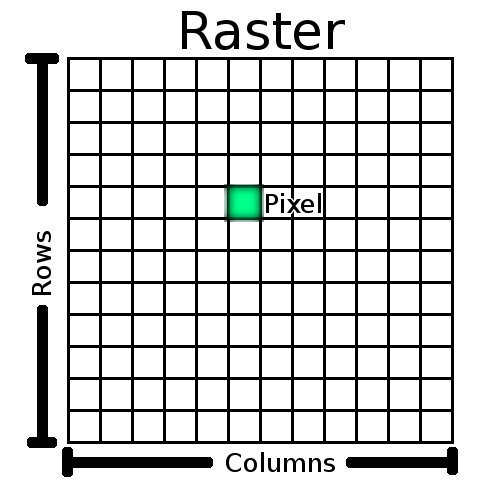
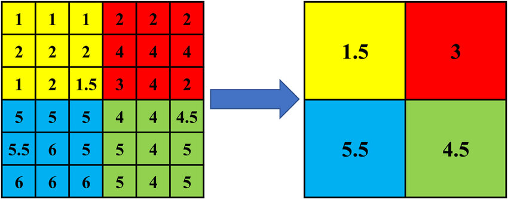
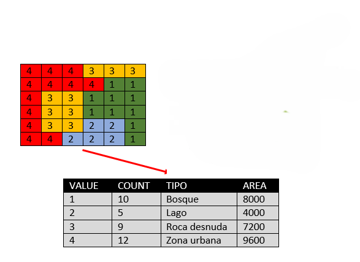

# Procesamiento de datos espaciales- Ráster

::: {.callout-tip}
## Datos de este capítulo

Los archivos que usa este capítulo están en [datos/cap08](https://github.com/ctirado-cgiar/Libro_MDS/tree/main/datos/cap08).

Para ejecutar el código, descarga el proyecto completo ([Libro_MDS.zip](https://github.com/ctirado-cgiar/Libro_MDS/archive/refs/heads/main.zip)), descomprímelo y ábrelo en RStudio con `DSM.Rproj`. Las rutas del código funcionan tal cual.
:::


## Ráster {style="color: #122562"}

Un archivo ráster es un tipo de archivo que almacena datos de imagen en forma de una cuadrícula de píxeles o puntos de datos, en contraposición a los archivos vectoriales que almacenan datos de imagen en forma de líneas, formas y curvas.

Cada píxel en un archivo ráster contiene información sobre el color y la intensidad de la luz en una posición específica de la imagen.

Las imágenes de satélite, radar, LiDAR, fotografía aérea digital, mapas escaneados entre otros son ejemplos de fuentes de datos raster.

Los usos de estas fuentes son variados, por ejemplo, las imágenes de satélite frecuentemente son utilizadas para inventario y monitoreo de recursos naturales, para trabajos de ubicación, efectos y control de desastres como inundaciones, impactos de tsunamis, o terremotos.

El formato de archivo ráster más común dentro del análisis espacial es el TIFF.

Trabajar con datos ráster en R se puede hacer principalmente con el paquete `raster`. Este paquete proporciona herramientas para importar, manipular y analizar datos ráster, que son representaciones matriciales de datos geoespaciales, como imágenes satelitales, mapas de elevación, entre otros.

[{fig-align="center" width="298"}](https://docs.qgis.org/3.34/es/docs/gentle_gis_introduction/raster_data.html)

**Creación y manipulación de datos ráster:**

`raster()` Crea un objeto ráster a partir de una matriz de datos, especificando la extensión (coordenadas mínimas y máximas), las dimensiones (número de filas y columnas) y el sistema de referencia de coordenadas (CRS).

```{r}
#| output: false
#| echo: false

library(raster)
library(sf)
# Especifica la ruta al archivo Shapefile
datos_shape = as(st_read("datos/cap08/Watersheds.gpkg", quiet = TRUE), "Spatial")

# Crear un raster vacío
raster_resultante = raster()

# Definir la extensión del raster resultante basada en los límites del Shapefile
extent_raster = extent(datos_shape)

# Definir la resolución del raster resultante
resolucion = 30  # ajusta la resolución según sea necesario

# Establecer la extensión y la resolución del raster resultante
extent(raster_resultante) = extent_raster
res(raster_resultante) = resolucion

# Rasterizar el Shapefile
rasterizado = rasterize(datos_shape, raster_resultante)

```

*Nota: Recuerda cargar antes las librerías*

::: {.callout-note collapse="true"}
# Librería

```{r}
library(raster)
```
:::

::: {.callout-note collapse="true"}
# Crear matrix

```{r}
# Crear la matriz
m = matrix(c(3,4,55,7,34,5,5,73,24,3,6,2,5,7,3,2,35,5,43,5 ),ncol=4,nrow=5,byrow=TRUE)
plot(m)
```

```{r}
r <- raster(m)
extent(r) <- extent(c(0,6,0,4))
class(r)
print(r)
```

```{r}
plot(r)
```
:::

**Guardar archivo**

`writeRaster(raster, filename, format, ...)` escribe un objeto ráster en un archivo en varios formatos de datos ráster, como GeoTIFF ( `".tif"`), Esri Grid ( `".grd"`) o ASCII Grid ( `".asc"`). Los argumentos permiten la personalización del tipo de datos que se quiere guardar.

::: {.callout-note collapse="true"}
# Guardar

```{r}
# Guardar el raster reclasificado
#writeRaster(raster_reclasificado, "ruta/donde/guardar/raster_reclasificado.tif", format = "GTiff")
```
:::

**Importar datos ráster**

Para importar un archivo ráster, como un GeoTIFF:

::: {.callout-note collapse="true"}
# Importar datos

```{r}
#| output: false
#| echo: true
raster = raster("datos/cap08/Coverage.tif")
```
:::

**Verificación de los datos**

Para verificar los detalles del ráster:

::: {.callout-note collapse="true"}
# Ver datos

```{r}
#| output: true
#| echo: true
plot(raster)
```
:::

**Reproyectar**

Cuando se realiza una reproyección, se busca modificar la proyección de un dataset ráster, dataset de mosaico o elemento ráster. También se pueden remuestrear los datos para obtener un nuevo tamaño de celda y definir un origen.

Para definir el CRS destino se debe utilizar el código del EPSG, por lo que el texto se escribe con el formato: `+init=epsg:EPSG`

::: {.callout-note collapse="true"}
# Reproyectar

Se obtiene el crs del archivo

```{r}
#| output: true
#| echo: true

raster_zona= raster("datos/cap08/coverage_zone.tif")
crs (raster_zona)

```

Se utiliza la función `projectRaster` y se indica que el nuevo crs es el que le corresponde al ráster:

```{r}
#| output: true
#| echo: true
raster_proj = projectRaster(raster_zona, crs = "+proj=utm +zone=17 +south +datum=WGS84 +units=m +no_defs ")
raster_zona = raster_proj
crs(raster_zona)
```
:::

**Cambio de resolución o extensión**

El cambio de la resolución y extensión del ráster (realizar un remuestreo), sirve para trabajar con capas de diferentes resoluciones. Y en la práctica es útil cuando se realizan operaciones con variables como pendiente, precipitación, indices de vegetación, elevación, entre otras.

[{fig-align="center" width="370"}](https://acolita.com/cambiar-la-resolucion-de-un-raster-en-qgis-3/)

::: {.callout-note collapse="true"}
# Cambiar resolución

```{r}


#| output: true
#| echo: true
res(raster_zona)

# Cambiar la resolución del raster
raster_nueva_resolucion = aggregate(raster_zona, fact = 10)
res(raster_nueva_resolucion)

# Cambiar la resolución del raster
raster_nuevo = disaggregate(raster_zona, fact = 10)
res(raster_nuevo)
```
:::

**Combinar ráster**

La función `merge()` combina dos objetos ráster según una función especificada, normalmente combinando sus valores de celda según una operación lógica o matemática.

Los archivos deben tener la misma extensión para que se puedan combinar.

::: {.callout-note collapse="true"}
# Combinar

```{r}

DEM= raster("datos/cap08/DEM_Cont.tif")
# Fusionar los raster
raster_fusionado = merge(rasterizado, DEM) #Recuerda que rasterizado es el shape que se convirtió en ráster

# Mostrar el resultado
plot(raster_fusionado)

```
:::

**Reclassificar**

Reclasificar un raster es un proceso en el que se cambian los valores de las celdas (píxeles) en un raster original a nuevos valores, según ciertos criterios predefinidos. Este proceso es comúnmente utilizado en análisis espacial para simplificar o redefinir los datos raster, por ejemplo, para categorizar los valores en rangos específicos, convertir valores continuos en clases discretas o cambiar la resolución del raster.

[{fig-align="center" width="437"}](https://desktop.arcgis.com/es/arcmap/latest/tools/3d-analyst-toolbox/reclass-by-ranges-of-values.htm)

En el ejemplo se reasignarán los valores así:

-   Valores de 0 a 12 metros: reclasificar como grupo 1.

-   Valores de 16 a 30 metros: reclasificar como grupo 2.

-   Valores superiores a 30 metros: reclasificar como grupo 3.

::: {.callout-note collapse="true"}
# Reclasificar

```{r}
#| output: true
#| echo: true

# Definir las reglas de reclasificación
reglas = c(-Inf, 15, 1,
            15, 30, 2,
            30, Inf, 3)

# Reclasificar el raster
raster_reclasificado = reclassify(rasterizado, reglas)
plot(raster_reclasificado)
                               

```
:::

**Procesamiento de datos ráster**

**Cortar capa ráster**

Cortar a partir de un contorno

Cuando se tiene un ráster de gran extensión, se puede utilizar otra capa, que sirva como el polígono que recorte el ráster. Con la función `crop(raster, extent)`

::: {.callout-note collapse="true"}
# Cortar

```{r}
#| output: true
#| echo: true

cropped_raster = crop(raster_zona,rasterizado)
plot(cropped_raster)
```
:::

`mask(raster, mask)` esta función aplica una máscara a un objeto ráster, estableciendo los valores de las celdas fuera de la máscara en un valor específico (normalmente NA). La máscara puede ser otro ráster o una matriz lógica.

::: {.callout-note collapse="true"}
# Cortar

```{r}
# Cargar el raster de elevación (puedes usar cualquier raster)
poligono_interes = read_sf("datos/cap08/Watersheds.gpkg")


# Aplicar la función mask para extraer los valores de elevación dentro del polígono de interés
raster_recortado = mask(raster_zona, poligono_interes)

# Verificar el raster resultante
plot(raster_recortado)

# Guardar el raster recortado en un archivo
writeRaster(raster_recortado, filename = "salidas/recorte.tif", format = "GTiff", overwrite = TRUE)

```
:::

**Propiedades de datos ráster**

Se tienen diferentes tipos de funciones que proporcionan la información que contiene el ráster, lo que permite un mejor manejo, análisis y síntesis de los datos.

`ncell(raster)`:Recupera el número total de celdas de un objeto ráster.

::: {.callout-note collapse="true"}
# Celdas

```{r}
# Calcular el número de celdas en el raster
numero_de_celdas = ncell(raster_zona)

# Imprimir el número de celdas
print(numero_de_celdas)
```
:::

`extent(raster)`: Extrae la extensión (coordenadas mínima y máxima) de un objeto ráster.

::: {.callout-note collapse="true"}
# Extensión

```{r}
# Obtener la extensión del raster
extension = extent(raster_zona)

# Mostrar la extensión
print(extension)
```
:::

`values(raster)`: Accede a los valores de píxeles de un objeto ráster como una matriz numérica.

::: {.callout-note collapse="true"}
# Valores

```{r}
valores = values(raster_zona)

# Mostrar los valores
head(valores)
```
:::

## Ejercicios de recopilación {style="color: #122562"}

En la siguiente carpeta podrás descargar el archivo que se utilizarán para el ejercicio:

```{r}
copia_este_link_en_el_navegador= "https://drive.google.com/drive/folders/1l7sgm2b0D9Hp8trHZvmVBs3eEYx1AjJl?usp=sharing"
```

En el archivo "horizontes" se encuentran los puntos de muestreo tomados en campo y en "Watersheds" se encuentran las 3 cuencas visualizadas en el ejercicio.

1.  Reproyecta los archivos al CRS en que trabajaremos: wgs 84 - 4326

2.  De los 3 poligonos seleccione uno para realizar el mapeo.

3.  Seleccione unicamente los puntos que pertenecen a su zona de estudio y guardelos.

4.  Al área de mapeo seleccionada, realicele un buffer y guarde este ultimo poligono como: "Area_final.shp"
