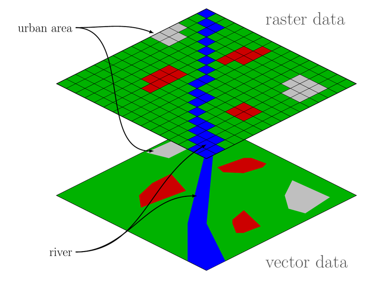

# Visualización de datos espaciales {style="color: #122562"}

::: {.callout-tip}
## Datos de este capítulo

Los archivos que usa este capítulo están en [datos/cap09](https://github.com/ctirado-cgiar/Libro_MDS/tree/main/datos/cap09).

Para ejecutar el código, descarga el proyecto completo ([Libro_MDS.zip](https://github.com/ctirado-cgiar/Libro_MDS/archive/refs/heads/main.zip)), descomprímelo y ábrelo en RStudio con `DSM.Rproj`. Las rutas del código funcionan tal cual.
:::


Las diferentes estructuras de datos son formatos que organizan y almacenan información. Para visualizarlos, existe un gran conjunto de paquetes en R disponibles que permiten trabajar con datos espaciales y espacio-temporales.

Estos paquetes se describen en la [Vista de tareas de Cran: Análisis de datos espaciales](https://cran.r-project.org/view=Spatial) . La vista de tareas de CRAN organiza los distintos paquetes en categorías, donde se pueden identificar las opciones de paquetes según las necesidades del proyecto.

[{fig-align="center" width="464"}](https://www.jeffdoser.com/files/for875/_book/sp)

***Librerías***

*Antes de iniciar con los procesos de visualización, se recomienda cargar todas las librerías que se usarán. Para agilizar los procesos que se llevarán a cabo y asegurar que las funciones operen de manera correcta.*

::: {.callout-note collapse="true"}
# Cargar librerías

```{r, warning=FALSE}
library(sf)
library(ggplot2)
library(raster)
library(readxl)
library(tmap)
library(plotly)
```
:::

```{r, warning=FALSE}

#| output: false
#| echo: false
raster = raster("datos/cap09/coverage_zone.tif")
cuencas= st_read("datos/cap09/Watersheds.gpkg", quiet = TRUE)
puntos= st_read("datos/cap09/spline.gpkg", quiet = TRUE)

```

## **Plot** {style="color: #122562"}

La función `plot()` es una función genérica de R que está disponible en el paquete base del programa. Su objetivo principal es crear gráficos y permite una visualización de forma sencilla.

De acuerdo al tipo de dato que se proporcione como argumento, generará diferentes tipos de gráfica. Además, para cada tipo de gráfico, se pueden ajustar diferentes parámetros que controlan su aspecto. Todas las modificiaciones se realizan dentro de la misma función.

::: {.callout-note collapse="true"}
# Plot en dataframe

```{r}
#| output: true
#| echo: true
plot(cuencas)
```
:::

### St_geometry {style="color: #122562"}

Para visualizar un atributo en específico dentro del shape, se puede utilizar la función st_geometry(), la cuál pertenece a la librería sf. Dentro de la función se nombra el elemento que se desea traer del shapefile y devuelve la geometría del mismo.

::: {.callout-note collapse="true"}
# Código

```{r}
#| output: true
#| echo: true
plot(st_geometry(cuencas, SHAPE_Area))
```
:::

::: {.callout-note collapse="true"}
# Plot en ráster

```{r}
#| output: true
#| echo: true
plot(raster)
```
:::

**Ventajas:**

-   Facilidad de uso y entendimiento

-   Es eficiente en conjuntos de datos pequeños

**Desventajas:**

-   La personalización y el diseño es limitado

-   Los recursos son limitados para generar los gráficos avanzados

## **Ggplot2** {style="color: #122562"}

Esta librería permite elaborar gráficos a partir de un proceso de acumulación de capas. Tiene cierto grado de complejidad, pero permite obtener resultados muy profesionales. Esta librería en particular solo acepta un tipo de datos: dataframes.

::: {.callout-note collapse="true"}
# Mapa sencillo

```{r}
#| output: false
#| echo: true
# Mapa base sencillo vector

ggplot(data = cuencas) +
  geom_sf()
```
:::

::: {.callout-note collapse="true"}
# Edición de las capas

```{r}
#| output: false
#| echo: true
ggplot() +
  geom_sf(data = cuencas, fill = "lightblue", color = "black") +
  labs(title = "Visualización del Shapefile con ggplot2") +
  theme_minimal()

```
:::

**Ventajas**:

-   Tiene una estructura de fácil entendimiento
-   Alta capacidad para crear gráficos complejos al adicionar capas
-   Se puede integrar con `dplyr` y `tidyr`

**Desventajas:**

-   Descripción detallada de cada objeto que se quiere agregar
-   Sólo permite graficar los datos espaciales tipo shape

## **Plotly** {style="color: #122562"}

Plotly es una librería Open Source que sirve para generar visualizaciones de datos en forma de gráficos y mapas interactivos.

Dentro de sus ventajas se encuentra que es integrada en múltiples lenguajes y plataformas, así como la facilidad que ofrece para compartir los gráficos, mapas y visualizaciones de datos creados con esta librería. Por otra parte, al ser mapas interactivos permite mover el cursor dentro del mismo, hacer zoom, seleccionar elementos, entre otros.

::: {.callout-note collapse="true"}
# Código

```{r, warning=FALSE}
#| output: false
#| echo: true


plot_ly(data = cuencas, 
        type = "scatter",
        colors = "Set1") %>%
  layout(title = "Visualización del Shapefile")


```
:::

**Ventajas**

-   Los gráficos que se construyen son interactivos
-   Se puede personalizar el diseño
-   Tiene facilidad para ser exportados y compartidos: HTML, PNG y SVG

**Desventajas**

-   El rendimiento en grandes conjuntos de datos es limitado
-   No se integra a los datos ráster

## Graficar a partir de datos en tablas o matrices {style="color: #122562"}

Cuando se tienen datos espaciales en fromatos de tablas o matrices, se pueden volver mapas al relacionarlos con las funciones adecuadas de cada librería.

::: {.callout-note collapse="true"}
# Mapear a partir de datos

Se carga el arcivo .csv o .xlsx con los datos

::: {.callout-note collapse="true"}
# Cargar archivo

```{r, warning=FALSE}
#| output: true
#| echo: true
df = read_excel("datos/cap09/datos_suelo_EC.xlsx") #También puedes cargar el shape de horizontes y volverlo un dataframe
df= data.frame(lapply(df, type.convert,as.is = TRUE))
```
:::

Una de las librerías más útiles para este proceso es ggplot: se agregan los datos, se definen los ejes y demás atributos del mapa para finalmente obtener un mapa con los datos proporcionados:

::: {.callout-note collapse="true"}
# Visualización

```{r}
ggplot(df, aes(x = CORX, y = CORY)) +
  geom_point() +
  ggtitle("Muestreos de suelos - Ecuador")+
  xlab("Longitud") +
  ylab("Latitud")
```
:::
:::

## **Tmap** {style="color: #122562"}

Esta librería está diseñada para la visualización de datos geoespaciales. Proporciona una interfaz fácil de usar para crear mapas temáticos (thematic maps) y mapas interactivos, lo que permite una visualización con un fácil entendimiento de los datos espaciales.

::: {.callout-note collapse="true"}
# T map en ráster

```{r}
#| output: true
#| echo: true

tmap_data = raster
tm_shape(tmap_data) +
  tm_raster() +
  tm_layout(title = "Coberturas")

```
:::

library(tmap)

::: {.callout-note collapse="true"}
# T map en shapefile

```{r}
#| output: true
#| echo: true

data("cuencas")  
tm_shape(cuencas) + tm_polygons()
```
:::

::: {.callout-note collapse="true"}
# Tmap para varias capas al tiempo

```{r}
#| output: true
#| echo: true

tm_view("view")

tm_shape(raster) +
  tm_raster( palette = "Blues", title="Coverage") +
  tm_shape(puntos) + 
  tm_dots("X0_30_cm", palette = "Greens") + 
tm_shape(cuencas) + 
  tm_borders(col = "red")
```
:::

**Ventajas:**

-   Sintaxis simple e intuitiva
-   Su funcionalidad es específicamente para datos geoespaciales
-   Permite crear gráficos interactivos

**Desventajas:**

-   Depende del paquete *sf*
